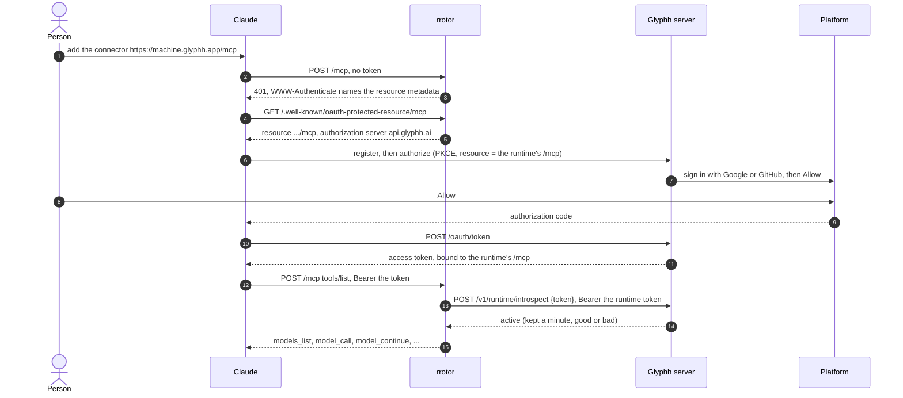
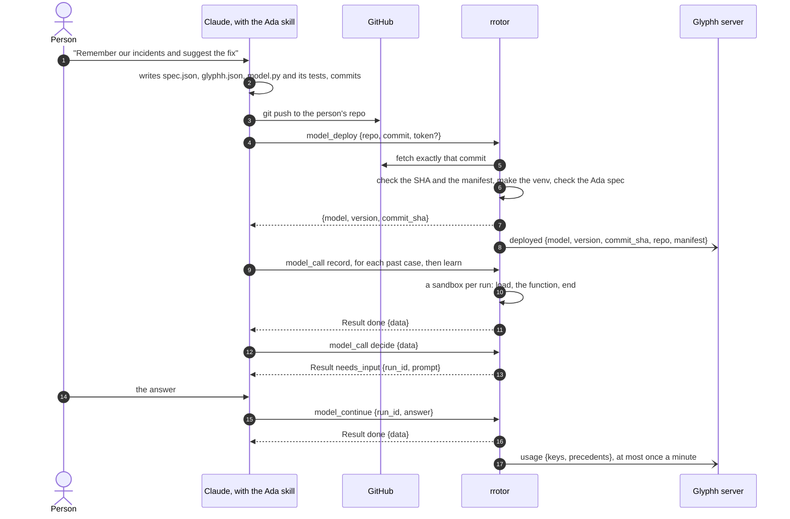
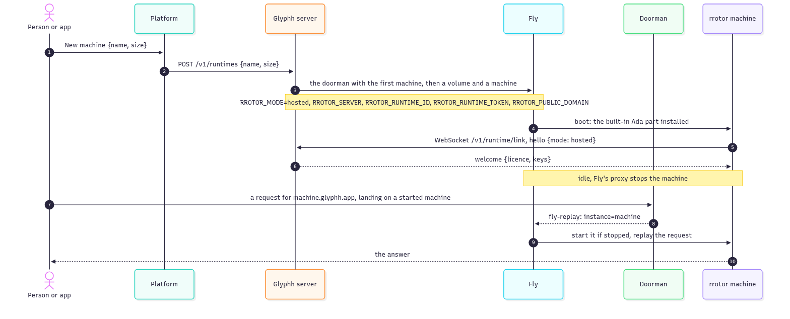
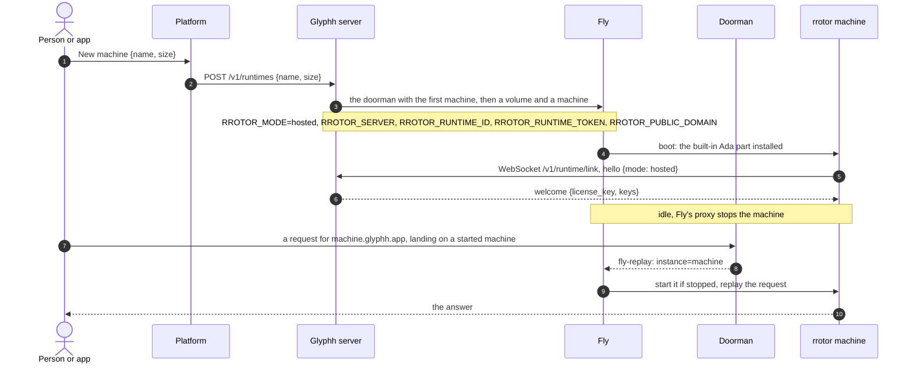
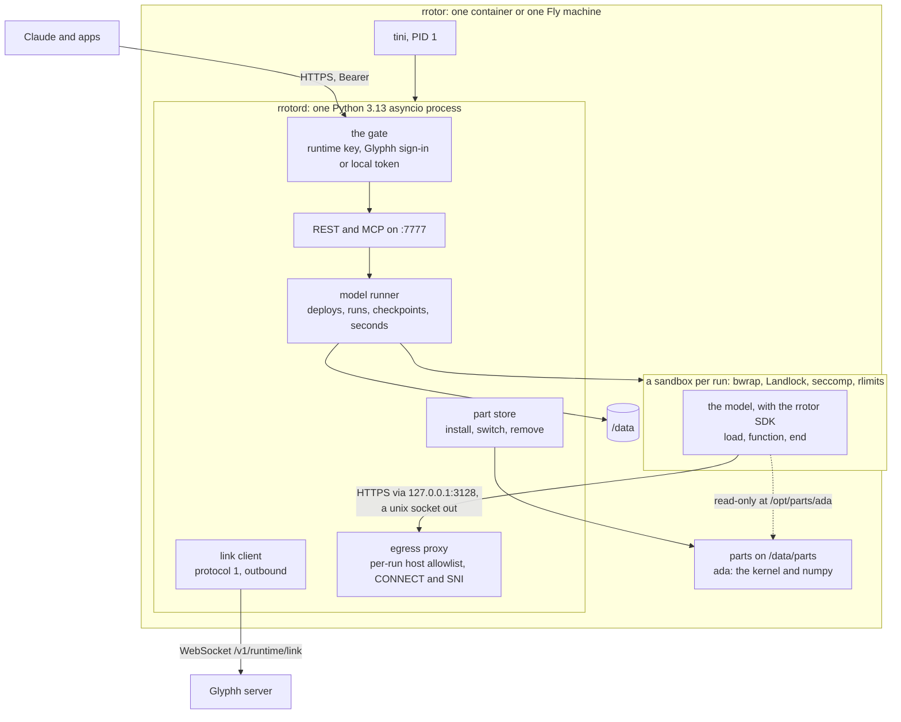
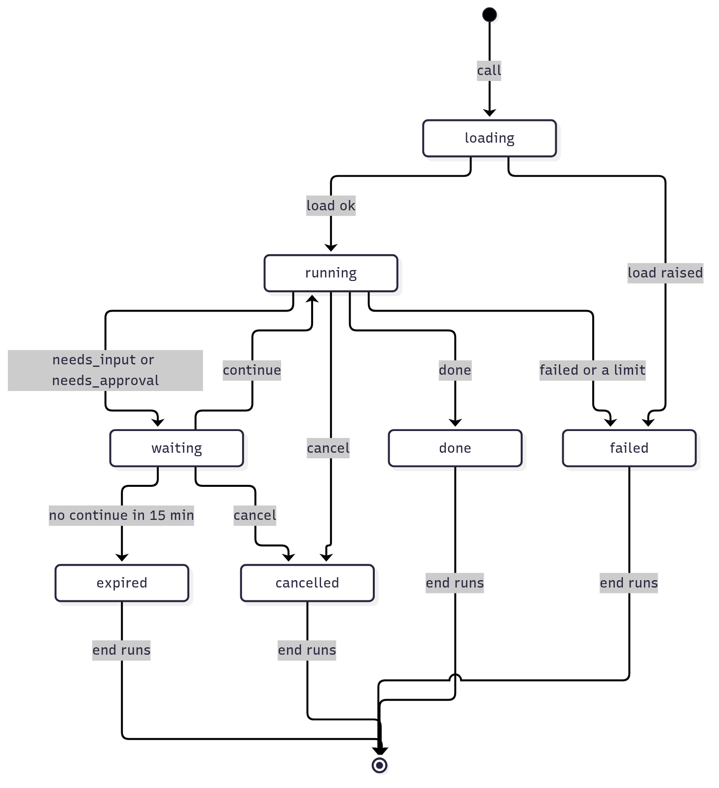
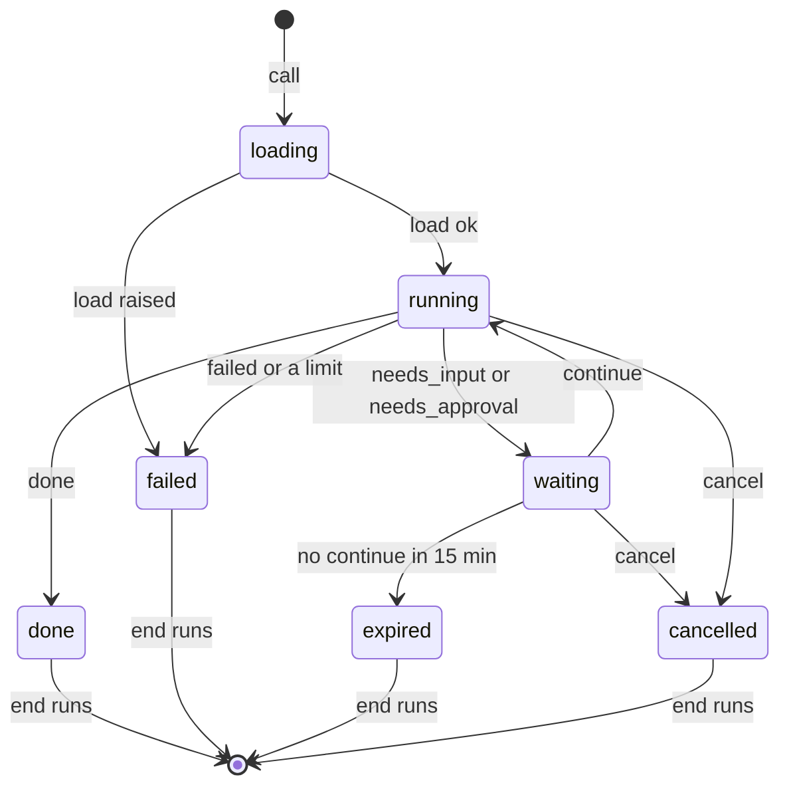

# rrotor architecture

rrotor is the runtime a person's Ada models run in: one headless Linux image that deploys a model by commit, runs
each call in a sandbox with no network but the hosts it declares, and answers over REST and MCP at its own address.
This document is how its parts work and call each other. The system around it (accounts, plans, the data model,
provisioning) is in `glyphh-ai/server`, `docs/architecture.md`; running your own is in
[`self-hosting/`](self-hosting/README.md). What is decided but not built is in [Not built yet](#not-built-yet), with its build specs in
[`specs/`](specs/), and nowhere else.

## 1. The parts

| Part | What it is |
|---|---|
| **Claude** | Claude Code, the Claude apps or any MCP client. It has the runtime as a connector and, with the `glyphh` plugin (`glyphh-ai/glyphh`), the Ada skill: how to write, deploy and call an Ada model with the runtime's own tools |
| **Apps** | Anyone's software, calling the runtime's REST API with a runtime key, directly or through the SDKs (`glyphh` on PyPI, `@glyphh-ai/glyphh` on npm, both in `glyphh-ai/glyphh`) |
| **rrotor** | This repo: the daemon `rrotord` and the model SDK `rrotor`, in the image `ghcr.io/glyphh-ai/rrotor`. One per volume |
| **The Glyphh server** | `https://api.glyphh.ai`: provisions hosted machines, makes runtime keys and runtime tokens, signs the licence key, vouches for a Glyphh sign-in, and holds the runtime's link. Never on the data path |
| **The platform** | `https://platform.glyphh.ai`: where a person makes and starts machines, makes runtime keys, registers a self-hosted runtime and shows its licence key |
| **Fly** | Hosts the hosted machines: one app, `*.glyphh.app`, a machine and a volume per runtime, and the doorman |

One image, four modes, set by `RROTOR_MODE` at start (`rrotord/config.py`):

| Mode | Where | Reached at | Callers authenticate with |
|---|---|---|---|
| `hosted` | A Fly machine the server made | `https://<machine>.glyphh.app` | A runtime key or a Glyphh sign-in |
| `self` | The owner's own machine, cluster or cloud ([12](#12-self-hosting)) | `https://<public host>`, TLS ended in front | A runtime key or a Glyphh sign-in (a key alone with the link off) |
| `doorman` | One always-on Fly machine per app | Every `*.glyphh.app` request's first hop | Nobody: it only replays ([3](#3-hosted-machines)) |
| `local` (the default) | Any container host | `127.0.0.1:<port>` only | A local token, held as its SHA-256 (`RROTOR_LOCAL_TOKEN_SHA256`); the runtime token is handed in with `PUT /v1/runtime/token` |

rrotor has no sign-in of its own and nothing to log into. It connects out to the server (the link, [6](#6-the-link-protocol-1));
the server never connects in. A call goes from the caller to the runtime and back: nothing of Glyphh's sees its
inputs or its answer.

**Glyphh-run hosting is off.** The server's `GLYPHH_HOSTING` flag (default off) decides whether it makes hosted
machines; `hosted` and `doorman` stay in the code, used only if Glyphh turns it on ([3](#3-hosted-machines)).
Customers run rrotor themselves, in `self` mode at their own address ([12](#12-self-hosting),
[`self-hosting/`](self-hosting/README.md)).

## 2. A model, end to end

### 2.1 Adding the runtime to Claude

The person adds the runtime's address as a custom connector (Settings, Connectors), once. The runtime is an OAuth
protected resource (RFC 9728) whose authorization server is the Glyphh server, so Claude signs the person in to
Glyphh with one Allow click and no key.




An app sends a runtime key instead (`Authorization: Bearer <key>`), made on the platform's Keys page; rrotor holds
only the keys' SHA-256s ([7](#7-the-api)).

### 2.2 Build, deploy and call

A model is a GitHub repo; a version is a commit. Claude, following the Ada skill, writes the model with the person,
pushes it, and deploys the commit through the runtime's own MCP.




- **Deploy by commit:** `model_deploy` (and `POST /v1/models/deploy`) takes `{repo, commit, token?}`: `repo` is
  `owner/name` on GitHub, `commit` the full 40-character SHA, `token` for a private repo. rrotor fetches that one
  commit (depth 1), checks its SHA, reads `glyphh.json` ([5.2](#52-the-manifest-glyphhjson)), makes a venv from
  `requirements.lock` (binary wheels only, with hashes: no model code runs outside the sandbox, not even a package's
  setup) and makes the version active. The REST route also takes `{bundle, commit}`, a git bundle of the commit in
  base64, up to 64 MB. The server can deploy too, down the link, with a short-lived token from the Glyphh GitHub
  App.
- **Every deploy is reported** up the link as `deployed`, however it was asked for, so the server records every
  model and version on the runtime.
- **The samples:** `examples/ada_incidents/` and `examples/ada_tickets/` are Ada models ([8](#8-ada));
  `examples/daily_sales/` is a model that needs no part, used to test the base end to end: it reads a sales export
  from its folder, converts the total with one declared host, asks approval for its `write` step and writes a
  ledger.

## 3. Hosted machines

Built, and off while the server's `GLYPHH_HOSTING` is off ([1](#1-the-parts)).

A person's hosted runtimes are machines on Fly, made and run from the platform (or the Glyphh connector's
`create_runtime` and `start_runtime`), each named and of a size (small, medium, large). The server makes them; the
sizes, the billing and the machine routes are in the server's `docs/architecture.md`.





- **The address is the machine:** `https://<machine>.<RROTOR_PUBLIC_DOMAIN>` (`glyphh.app`), the machine id from
  Fly's `FLY_MACHINE_ID`. A request for another machine's address is answered `fly-replay: instance=<machine>`;
  Fly's proxy replays it there, starting that machine if it is stopped. The **doorman** (`RROTOR_MODE=doorman`,
  `rrotord/doorman.py`) answers every request that way and `/healthz` itself, so nobody's machine is woken to
  bounce someone else's request. Any other `Host` is 421 `E_HOST`. `fly-replay` carries bodies up to 1 MB.
- **The token and the keys:** the runtime token is in the machine's environment, so nobody hands anything in. The
  runtime keys' SHA-256s arrive in `welcome` and as `keys` whenever they change; the licence key arrives in `welcome`.
- **In development**, `RROTOR_PUBLIC_HOST` (an ngrok name, say) is the one exact host instead, and nothing is
  replayed.

## 4. rrotor, inside




| Piece | Job |
|---|---|
| **gate** | Who may call, by mode ([7](#7-the-api)); counts each request a runtime key let in |
| **REST and MCP** | One set of operations (`api/ops.py`) behind both ([7](#7-the-api)) |
| **link client** | Connects out, reconnects with backoff (1 s to 30 s, with jitter), replays what is not acknowledged ([6](#6-the-link-protocol-1)) |
| **model runner** | Launches each run in its sandbox, keeps a waiting run's worker up to 15 minutes, runs `end` always, counts each run's seconds |
| **egress proxy** | A run's only network: an HTTP `CONNECT` proxy on a unix socket per run; lets through port 443 of the hosts the manifest declares when the TLS SNI matches, refuses addresses that resolve to loopback, private or link-local ranges, and records what it refuses |
| **part store** | Checks a part's hash and signature, unpacks it, switches it in one rename ([10](#10-parts)) |
| **logs, audit, drain** | JSON log lines naming the node and the run; audit events, kept on Enterprise; OTLP to the customer's collector and, opt-in, to Glyphh ([13](#13-logs-audit-and-drains)) |

There is no s6 and no other process: everything is `rrotord` under `tini`.

**The sandbox.** Each run is one worker process started with `bwrap`:

| Layer | What it holds |
|---|---|
| **bubblewrap** | New user, mount, PID, IPC, UTS, cgroup and network namespaces; `--die-with-parent`, `--new-session`, `--clearenv`. Read-only `/usr` (and its `/lib`, `/bin` links), the version's code at `/model`, its venv at `/venv`, the SDK at `/opt/rrotor`, each part it needs at `/opt/parts/<name>`; writable `/files` (the model's folder), `/data` (its data folder, when the manifest asks) and a private `/tmp`. The network namespace has only loopback |
| **Landlock** | Applied by the worker before it imports the model: read only the read-only mounts, write only the writable ones; on ABI 4 and later, TCP only to `127.0.0.1:3128`; on ABI 6, no abstract unix sockets or signals outside the sandbox. A kernel without Landlock refuses runs |
| **seccomp** | A filter built with libseccomp and handed to `bwrap --seccomp`: `ptrace`, `mount`, `unshare`, `setns`, `bpf`, `perf_event_open`, `userfaultfd`, `keyctl`, `io_uring_*`, kernel modules, `kexec`, clocks, `reboot` and others refused; new user namespaces refused; sockets only `AF_UNIX`, `AF_INET`, `AF_INET6`. `no_new_privs` is set |
| **egress** | Inside the namespace the worker forwards `127.0.0.1:3128` to the run's proxy socket, so `HTTPS_PROXY` works for any library |
| **limits** | `prlimit`: data size (the manifest's `memory_mb`), CPU seconds, open files, file size, no core files; the runner's wall clock (`limits.seconds`) kills the run |

- **Every layer is checked at start** and shown in `GET /v1/health`; a layer that cannot work makes rrotor refuse
  runs (`E_SANDBOX_UNAVAILABLE`, naming the layer and why). Nothing is skipped silently. A self-hosted rrotor also
  says what its container lacks ([12](#12-self-hosting)).
- **In a container**, bwrap needs seccomp, AppArmor and `/proc` unconfined (`--security-opt seccomp=unconfined
  --security-opt apparmor=unconfined --security-opt systempaths=unconfined`), and on Ubuntu 23.10 and later the
  host's `kernel.apparmor_restrict_unprivileged_userns=0`. rrotor's own seccomp filter then holds each run. Why,
  exactly: [self-hosting](self-hosting/README.md#the-containers-privileges-and-why). A Fly machine is a Firecracker
  VM, so none of this applies there.
- **No cgroups per run:** memory and CPU are held by `prlimit` and the wall clock.

**`/data`**, the one volume:

| Path | What |
|---|---|
| `runtime.json` | The runtime's id and token (0600) |
| `access.json` | The runtime keys' SHA-256s |
| `licence.json`, `licence.token` | The licence key held, `{key, source}`; a key dropped in as a file (as `/etc/rrotor/license.key`) |
| `machine-id` | A self-hosted rrotor's machine id, where the host gives none |
| `link/outbox.json` | The sequence counter and what is not yet acknowledged |
| `models/<name>/versions/<commit>/` | A deployed version: `src/` (the checkout), `venv/`, `version.json`; immutable |
| `models/<name>/active.json` | Which version is active |
| `models/<name>/files/` | The model's own folder, seeded from the commit's `files/` on its first deploy |
| `models/<name>/data/` | Its persistent data, outside git (an Ada model's `precedents.sqlite`) |
| `runs/<run_id>/` | Each run's `run.json` (with its checkpoints) and `log.jsonl` |
| `parts/<name>/<version>/`, `parts/<name>/current` | An installed part, and the version in use |
| `audit/<YYYY-MM-DD>.jsonl`, `audit/.cursor`, `audit/.cursor-glyphh` | Enterprise: the audit log, a file a day; how far the customer's drain and server-side logging have read it ([13](#13-logs-audit-and-drains)) |
| `logging.json` | Whether server-side logging was on at the last start (turning it on or off is an audit event) |

**The image** (`image/Dockerfile`): Debian 13 (trixie) slim, amd64 and arm64; `tini`, Python 3.13 (Debian's),
Node 22, git, bubblewrap, libseccomp, util-linux (`prlimit`), CA certificates; in rrotord's venv, the OpenTelemetry
SDK and its OTLP/HTTP exporter (pinned, about 8 MB with protobuf and requests). No browser, no database. It runs as
`rrotor` (uid 10001) on a read-only root with a tmpfs `/tmp`; everything kept is on `/data`. The published image
is the `hosted` target: the base with the Ada part in `/opt/parts-builtin`, installed at boot ([11](#11-the-image-and-ci)).

## 5. A model

### 5.1 What a model is

A git repo; a version is a commit.

| File | What |
|---|---|
| `glyphh.json` | The manifest |
| `model.py` | `load`, the functions, `end` |
| `requirements.lock` | Optional: its Python dependencies, pinned with hashes, installed at deploy, never at run |
| `files/` | Optional: seed files, copied into its folder on the first deploy |
| `spec.json` | An Ada model's spec ([8](#8-ada)) |

### 5.2 The manifest: `glyphh.json`

```json
{
  "name": "incidents",
  "description": "An app's incidents, remembered: the fix for a new error",
  "python": "3.13",
  "functions": {
    "record": { "writes": true, "inputs": { "type": "object", "required": ["data"] } },
    "query": { "writes": false, "inputs": { "type": "object", "required": ["data"] } },
    "decide": { "writes": true, "inputs": { "type": "object", "required": ["data"] } },
    "start": {}
  },
  "needs": ["ada"],
  "data": true,
  "limits": { "seconds": 300, "memory_mb": 512 }
}
```

| Key | What |
|---|---|
| `name` | `^[a-z][a-z0-9_]{0,62}$`; a deploy names the model by it |
| `version` | Optional, 1 or more |
| `description`, `python` | Free text; `python` must be `3.13` |
| `functions` | Each callable function: `description`, `inputs` (a JSON Schema the call's inputs are checked against, `E_INPUTS`), `approvals` (the steps that may ask), `writes` (whether it changes what a cluster syncs: `true` runs it on the cluster's head, `false` on whichever node the call reaches, read-only there; default the model's `data`) ([14](#14-the-cluster)). At least one; `load` and `end` are not functions |
| `hosts` | The hosts a run may reach on 443 (`*.example.com` allowed) |
| `needs` | The parts it imports from, by name (`["ada"]`) ([10](#10-parts)) |
| `data` | `true` mounts its persistent data folder at `/data` |
| `limits` | `seconds` (1 to 3600, default 300) and `memory_mb` (64 to 8192, default 512) per run |
| `secrets`, `databases`, `connectors` | Accepted and kept; nothing uses them yet ([Not built yet](#not-built-yet)) |

A deploy refuses (`E_MANIFEST`) a manifest with an unknown key, a bad value, or a function `model.py` does not
define (read from its syntax tree: no model code runs outside the sandbox).

### 5.3 The SDK: `rrotor`

The `rrotor` package, standard library only, ships in the image and is mounted read-only into every sandbox at
`/opt/rrotor`: models import it and never install it.

```python
from rrotor import Ctx, Result, ada

Result.done(data)                                     # finished, with data (JSON)
Result.needs_input(prompt, schema=None, options=None) # a value or a choice
Result.needs_approval(step, prompt)                   # about to act; a continue answers it
Result.failed(step, reason)                           # stopped, with why

ctx.inputs                    # the call's inputs, checked against the function's schema
ctx.answer                    # what the last continue brought (None on the first call)
ctx.ask_approval(step, prompt) -> bool   # True once approved, False if declined; until then the run waits
ctx.needs_input(prompt, schema=None, options=None, key=None)   # the answer once given; until then the run waits
ctx.checkpoint(key, fn)       # fn runs once per run; a resumed run reads the stored value
ctx.http                      # HTTPS to the declared hosts (any library works too: HTTPS_PROXY is set)
ctx.files                     # its folder, a pathlib.Path
ctx.data                      # its persistent data folder ("data": true), else None
ctx.home                      # its code (spec.json beside model.py)
ctx.clearance                 # who asks, 0 to 1; 1 unless the call says
ctx.caller                    # who called
ctx.limits                    # an Ada model's precedent cap, from the licence key (8)
ctx.log(message, **detail)
ctx.today(), ctx.yesterday()  # UTC dates, YYYY-MM-DD
ada.open(ctx)                 # an Ada model: the spec and the store, on ctx.ada (8)
```

- **Approvals and inputs are re-entrant.** A `continue` calls the same function again with the same inputs: steps
  done are skipped by `ctx.checkpoint`, and `ctx.ask_approval(step, …)` then answers the decision for that step
  (`{"approved": true}`). A step not named in the function's `approvals` fails the run (`E_STEP_UNDECLARED`).
- **`rrotor.testing`** gives a model's own tests a `Ctx` with no sandbox (`Harness`): inputs, answers, a folder, and
  an `http` that answers what the test says.

### 5.4 A run





- **One run, many calls:** a call opens a run (`run_id`); each `continue` resumes it in the same worker while it
  waits (up to 15 minutes). If the worker is gone (rrotor restarted), a `continue` starts a new one: `load`, then
  the function, its checkpoints read back.
- **`end` always runs**, on `done`, `failed`, a limit, a cancel or an expiry.
- **Every call answers a `Result`**, never an exception: a crash is `failed` with the error and the step.
- **Seconds** are the time a run spent running, not waiting.

## 6. The link: protocol 1

JSON messages over the WebSocket `{RROTOR_SERVER}/v1/runtime/link` (`Authorization: Bearer <runtime token>`, never
in a URL), one per frame, each with `type` and `id`. rrotor connects out; the server never connects in.

| Direction | `type` | Carries |
|---|---|---|
| up | `hello` | protocol 1, rrotor's version, mode, runtime id, the versions deployed |
| down | `welcome` | accepted; for a hosted or self-hosted runtime, the licence key (`license_key`, [9](#9-the-licence)), in release N also the legacy licence (`licence: {payload, signature}`; the key is preferred), and the runtime keys' SHA-256s (`keys`, the whole list) |
| down | `keys` | `hashes`: the whole list again, whenever a key is made, revoked or expires |
| down | `deploy`, `activate`, `remove` | model, version, commit SHA, `repo` and a short-lived `token` (null for a commit the runtime already holds) |
| down | `continue` | `run_id`, `answer` |
| down | `call`, `cancel` | `run_id`, model, version, function, inputs, caller, clearance; `cancel` the `run_id`. Handled; the server sends neither |
| down | `pause`, `resume` | Handled (a paused hosted runtime answers 402 `E_LIMIT` to all but `/healthz`); the server sends neither |
| up | `result` | `seq`, `run_id`, the `Result`, seconds: only for a run a `call` opened |
| up | `deployed` | model, version, commit SHA, `repo` (null unless from a repo), `manifest`; after **every** deploy, by any route; not numbered, kept until acknowledged |
| up | `event` | `seq`, model, kind, data: `deploy_failed` `{version, commit_sha, code, message}` when a `deploy` or `activate` cannot be done |
| up | `usage` | `seq`, `keys` (each runtime key that let a request in: `{key_sha256, calls, last_used_at}`), `precedents` (the runtime's total across its Ada models) |
| both | `ping`, `pong` | every 20 s |
| both | `ack` | `of`: the `id` acknowledged (the server acks every `result`, `event`, `usage` and `deployed`) |

- **Order and replay:** `result`, `event` and `usage` share one rising sequence number per runtime; rrotor keeps
  the unacknowledged ones on `/data` and replays them after a reconnect, and the server applies each number once.
  A new runtime token starts the counter again.
- **Closes:** 4401 the token is not good (rrotor stops: `refused`); 4409 a newer link of the same runtime took over
  (`replaced`); 4426 another protocol (`upgrade_needed`); 4400 the first message was not a good `hello`
  (`bad_hello`); 4408 nothing heard for three pings, 1011 the server could not record a message, 1012 the server is
  restarting, and any other close or a dropped connection: reconnect with backoff. A `welcome` not heard within
  10 s of `hello` closes and reconnects.
- **`usage`, and never more:** the gate counts, in memory, one call per request a runtime key let in (a 401 or 402
  is not a call; a Glyphh sign-in or the local token is no key). Every 60 s, when there were calls or the
  precedents are due, one numbered `usage` goes up; the daemon flushes once more when it stops. Calls in the minute
  before a crash are lost. Never a call's inputs, outputs or the key itself:

  ```json
  {"type": "usage", "id": "<hex>", "seq": 7, "keys": [{"key_sha256": "<hex>", "calls": 2, "last_used_at": "2026-10-18T09:00:00+00:00"}], "precedents": 1200}
  ```

- **`precedents`:** every model with a version that needs `ada` has its store counted without the kernel and
  without writing (`rrotor.ada.count`, `rrotord/precedents.py`), every nine minutes on the minute's tick. The total
  is due once after each start and then whenever it differs from the one last reported (with `keys: []` if there
  were no calls). A store that does not read is logged and the reading before stands; until one has read, `usage`
  carries no `precedents`.
- **`secret_set`** is parsed and logged `E_NOT_BUILT`; the link stays.
- **Runs called at the runtime's address** stay on it: their results never go up the link.
- **The link off** (`RROTOR_LINK=off`, self-hosted only) means no link, no heartbeat and no introspection.

## 7. The API

One API, REST and MCP, behind one gate (`api/gate.py`). Refusals are `{"error": {"code", "message"}}` with a
stable code. What changes the runtime itself (`PUT /v1/runtime/token`, `POST /v1/parts`, `DELETE /v1/parts/{name}`,
`PUT /v1/licence`) answers only on a local rrotor; hosted and self-hosted it is 403 `E_LOCAL_ONLY`, whoever calls:
those take their token, parts and licence from their environment, their image and Glyphh. Whoever the gate lets in
is who the audit log names for what the request does, and every 401 and 403 is an audit event
([13](#13-logs-audit-and-drains)).

**The gate, by mode:**

- **Hosted and self-hosted:** `Authorization: Bearer` with a **runtime key** (its SHA-256 among those in
  `/data/access.json`: from `RROTOR_KEYS_SHA256` at first, then the whole list from the link; every hash compared
  in constant time) **or a Glyphh sign-in** (the server's token for this runtime's `/mcp`; rrotor asks
  `POST /v1/runtime/introspect` with its runtime token, `rrotord/introspect.py`, and keeps the answer a minute,
  good or bad). With the link off, only a runtime key. A hosted rrotor answers only its own address
  ([3](#3-hosted-machines)); a self-hosted one only `RROTOR_PUBLIC_HOST`; any other `Host` is 421 `E_HOST`.
- **Open:** `GET /healthz`, `GET /readyz`, and `GET /.well-known/oauth-protected-resource` (and `…/mcp`): `{resource:
  https://<address>/mcp, authorization_servers: [RROTOR_SERVER], scopes_supported: [account]}`. A refusal is 401
  with `WWW-Authenticate: Bearer resource_metadata="https://<address>/.well-known/oauth-protected-resource/mcp",
  scope="account"` (and `error="invalid_token"` when a token was sent), which is how Claude finds where to sign in.
- **Local:** `Host` must be `127.0.0.1:<port>` or `localhost:<port>`, an `Origin` other than those is refused (no
  web page may call it), and the bearer is the local token, compared by its SHA-256 in constant time.

**REST:**

| Call | Does |
|---|---|
| `GET /healthz` | `{ok: true}` while the process is up |
| `GET /readyz` | `200 {ready: true}` while this node may take traffic: standalone and up, or a cluster's member in step with its head; else `503 {ready: false, reason, code}`, the reason `joining`, `catching_up`, `refused` or `no_cluster` ([14](#14-the-cluster)) |
| `GET /v1/cluster` | This node's cluster: `{cluster_id, node_id, role, status, head, term, commit_seq, applied_seq, tier, max_nodes, ha, members: [{node_id, address, role, voter, applied_seq, lag, last_seen, connected, version, instance, joined_at}], refused: [{node_id, at, code}], refusal}`; `{role: standalone}` with the cluster off, and the reason when the key does not allow it ([14](#14-the-cluster)) |
| `GET /v1/health` | Version, mode, runtime id, the link's state (`no_token`, `connecting`, `online`, `backoff`, `refused`, `replaced`, `upgrade_needed`, `bad_hello`, `off`), each sandbox layer (self-hosted: `container_needs`), the parts, the licence key's view (as `GET /v1/licence`), the last heartbeat (self-hosted), how many keys it holds, runs waiting for approval, the number of models, `cluster` (`{role: standalone}`, or the cluster's id, this node's role and status, whether it is ready, the head, the term and the members' count), `drains` (per signal: `state` (`off`, `waiting`, `ok`, `failing`), `buffered`, `dropped`, `last_export_at`) and `server_logs` (`on`, and the warning while it is) |
| `GET /v1/models` | Each model, its versions (number, commit, when), the active one, its functions |
| `POST /v1/models/deploy` | `{repo, commit, token?}` or `{bundle, commit}` ([2.2](#22-build-deploy-and-call)): `201 {model, version, commit_sha, deployed_at}` |
| `POST /v1/runs` | `{model, function?, inputs?, version?, clearance?}` (`function` defaults to `start`, `clearance` to 1): opens a run and answers its first `Result`: `{run_id, model, version, function, status, data, step, prompt, seconds}` |
| `POST /v1/runs/{id}/continue` | `{answer}`: the next `Result` |
| `POST /v1/runs/{id}/cancel` | Stops it; `end` runs; `cancelled` |
| `GET /v1/runs/{id}` | Status, function, times, seconds, the last `Result` |
| `GET /v1/runs/{id}/log` | The run's log lines |
| `GET /v1/approvals` | Runs waiting for approval: run, model, step, prompt, when |
| `GET /v1/parts`, `POST /v1/parts`, `DELETE /v1/parts/{name}` | The parts installed; install one (`{name, version, sha256, signature, archive \| url}`); remove one ([10](#10-parts)); installing and removing are local only |
| `GET /v1/licence`, `PUT /v1/licence` | `{licence}`: the key held, its state and the limits that apply ([9](#9-the-licence)); hand one in as the body (release N: or a legacy `{payload, signature}`, `{token}` or offline token), `{licence, kept}`, `kept: false` when another is held; a bad one is 400 `E_LICENCE`; handing one in is local only |
| `GET /v1/audit` | `?since&until&kind&actor&model&run_id&limit&cursor`: the audit log, newest first, `{events, cursor}` (`limit` 100, at most 1000; `cursor` null at the end); Enterprise only, 403 `E_NOT_IN_PLAN` otherwise ([13](#13-logs-audit-and-drains)) |
| `PUT /v1/runtime/token` | `{runtime_id, token}`: a runtime token handed in (a local runtime's way to get one); kept in `/data/runtime.json`, and the link reconnects with it; local only |

**MCP:** `POST /mcp`, Streamable HTTP, stateless, one JSON-RPC message per POST; MCP 2026-07-28 (`server/discover`,
each request's `_meta` naming the version) and the `initialize` revisions 2025-11-25, 2025-06-18 and 2025-03-26
(`api/mcp.py`). Its tools are the same operations as the routes:

| Tool | Does |
|---|---|
| `models_list` | The models, their versions, the active one, its functions |
| `model_deploy` `{repo, commit, token?}` | A commit of a GitHub repo as the model's next version |
| `model_call` `{model, function?, inputs?, version?, clearance?}` | Opens a run: the first `Result`, with its data |
| `model_continue` `{run_id, answer}` | The next `Result` |
| `model_cancel` `{run_id}` | Stops a run |
| `run_status`, `run_log` `{run_id}` | A run's status and last `Result`; its log lines |
| `approvals` | The runs waiting for the person's approval |
| `audit_query` `{since?, until?, kind?, model?, run_id?, limit?}` | `GET /v1/audit` |
| `cluster_status` | `GET /v1/cluster` |

A refusal is a tool error carrying the API's `{error}`.

A node a cluster refused (past `max_nodes`, removed, or its key no longer allowing sync) answers 503 with the
refusal's code to everything but `/healthz` and `/readyz` ([14](#14-the-cluster)).

**In a cluster** ([14](#14-the-cluster)) every route and tool answers the same on every node: a follower sends a
writing call (`"writes": true`, or any call of a model with data but no Ada), a deploy, and anything about a run
another node holds (run ids are `<node id>~<uuid>`) to its head, which does it as the same caller; `GET
/v1/approvals` gathers every node's. A member's answers carry `Rrotor-Cluster-Seq` (the head's last seq, a
follower's applied one); a follower that forwarded a write answers once it has applied it (up to 2 s), and a request
with `Rrotor-Min-Seq: <seq>` is answered from a node at least that far, or by the head. No head (or a head that
was deposed): 503 `E_NO_HEAD` with `Retry-After: 2` for writes, reads go on; with HA, a write the head cannot get
onto a majority of voters within 5 s: 503 `E_NOT_COMMITTED` (it is kept, and committed when they return); a run on a
node no longer in the cluster: 410 `E_RUN_LOST`.

## 8. Ada

An Ada model is a typed spec and a precedent store, run as a model: a repo with `glyphh.json` (`"needs": ["ada"]`,
`"data": true`), `spec.json` (what a case looks like, its `seed` and `dimension`) and `model.py`, whose functions
call the kernel through `rrotor.ada`. How to write one is the Ada skill (`glyphh-ai/glyphh`,
`plugins/glyphh/skills/ada/SKILL.md`); the kernel is `glyphh-ai/ada-private`.

```python
from rrotor import Result, ada

def load(ctx):
    ada.open(ctx)          # the spec read, the store opened: the kernel's Model on ctx.ada

def record(ctx, inputs):
    return Result.done({"id": ctx.ada.record(inputs["data"], inputs.get("outcome"))})

def query(ctx, inputs):
    return Result.done(ctx.ada.query(inputs["data"], clearance=ctx.clearance).to_json())
```

- **The part:** the kernel and numpy, built into the published image and installed at boot ([10](#10-parts)); a
  model imports them because its manifest needs `ada`.
- **The store** is `precedents.sqlite` in the model's data folder (`/data/models/<name>/data`, mounted at `/data`),
  so it outlives every version.
- **Checked at deploy:** an Ada model without `"data": true` or without a readable `spec.json` is refused
  (`E_MANIFEST`). A changed encoding (the spec's `seed` or `dimension`) between the active version and the new one
  makes rrotor run `rrotor.ada.reencode` in the new version's sandbox before it goes active: every precedent's glyph
  rebuilt from its recorded situation. If that fails, the deploy is refused (`E_ADA_ENCODING`), the version before
  stays active and the new one is not kept.
- **`clearance`** (0 to 1) comes with the call (`clearance` on `POST /v1/runs` and `model_call`), never from the
  inputs; the model passes `ctx.clearance` to the kernel, which cuts what a reader below a layer's
  `security_weight` may see.
- **The precedent cap:** the licence key's `max_precedents` ([9](#9-the-licence)): Community's 5,000 with no key,
  null (unlimited) on Enterprise, per node across all its Ada models. When an Ada run starts, the runner counts the
  other Ada models' stores and hands the run `limits.precedents_elsewhere` beside `limits.precedents` and `plan`;
  `rrotor.ada` wraps the kernel's two paths that grow a store: `record` with a new id is refused once the model's
  own count plus that has reached the cap (one whose id the store holds replaces its row and goes), and
  `space.merge(path)` is refused, whole, when the rows it would add pass it. `learn`, `calibrate`, `refresh`,
  `configure`, a re-encode and a deploy are never checked. Refused, it raises `rrotor.ada.LimitExceeded`, which a
  model may catch; uncaught, the run ends **`done`**, never `failed`, with `{"status": "limit_exceeded", "indexed":
  false, "message": "Precedent store capacity limit reached (50,000 max for the Pro plan). Upgrade the key to index
  further precedents.", "precedents": 50000, "cap": 50000}` as its data (REST 200, MCP's `model_call` result, not a
  tool error); the precedents recorded earlier in the run stay. Nothing is counted on the hot path, so runs of
  different models at the same time can overshoot by what they record meanwhile; the next run of each is refused.
  A store over the cap (after a downgrade) keeps every row and answers queries, `learn` and settings; only growth is
  refused, `GET /v1/licence` shows `precedents.over: true` and the nine-minute count logs a warning once per change.
  A store that does not read counts none (logged).
- **Size:** about 16 KB of RAM per precedent.
- **The examples,** each with its tests on `rrotor.testing.Harness` and the kernel in `tests/kernel/`:
  `examples/ada_incidents/` (an app's incidents: the fix for a new error, and the nearest precedent's cause, owner
  and runbook for a cleared caller) and `examples/ada_tickets/` (support-ticket triage). Both have `record`,
  `query`, `facts`, `probabilities`, `learn` (weights and calibration from the store's own precedents),
  `settings` (the model's levers, read or changed live), `decide` (asks for the outcome when no answer is good
  enough) and `start`.

## 9. The licence

rrotor runs with no key at all, as **Community** (one node, 5,000 precedents, no sync); a signed **licence key**,
checked on the node with no network request, lifts those limits to its own (`rrotord/licence_key.py`,
`rrotord/licence.py`). Built as [`specs/licensing.md`](specs/licensing.md) sections 1 to 4 decide: the node cap is
enforced at join, sync is gated by the key, and in a cluster the precedent cap is held by the head, the only
writer, on the synced store every node holds ([14](#14-the-cluster)); HA (a cluster electing its own head) is
`tier: enterprise` with sync, shown as `ha`.

- **The plans** (the server's policy for what it signs; rrotor acts on the key's own numbers): Free $0 (1 node,
  5,000 precedents), Pro $99/month (3, 50,000), Team $299/month (10, 500,000), Enterprise by contract (unlimited,
  HA, the audit log). Keys expire at the end of the paid month and the next arrives at the heartbeat.

- **The key:** `<base64url payload>.<base64url signature>`, base64url without padding; Ed25519 over the payload's
  exact bytes. The payload is UTF-8 JSON: `license_id` (UUID), `tier` (`free`, `pro`, `team`, `enterprise`),
  `max_nodes` (≥ 1, or null), `max_precedents` (≥ 0, or null: unlimited), `cluster_sync_enabled`, `issued_at`,
  `expires_at` (RFC 3339 UTC) and `customer_id`. Unknown fields are ignored; one missing or mistyped makes it bad.
- **The public key is in the code** (`licence_key.PUBLIC_KEYS`: Glyphh's, and the next during a rotation); a key is
  good if any of them verifies it. `RROTOR_LICENCE_PUBLIC_KEY` is no longer read: whoever sets the environment could
  then sign their own.
- **Where it is read:** `GLYPHH_LICENSE_KEY` (alias `RROTOR_LICENCE`), at start; `/etc/rrotor/license.key` (alias
  `/data/licence.token`), at start, every hour and on `SIGHUP`; the heartbeat's answer and `welcome`
  (`license_key`); `PUT /v1/licence`, local only. The key held is kept in `/data/licence.json` as `{key, source}`.
- **Which is held:** of the good keys found, the newest `issued_at` not past grace (ties: the later `expires_at`);
  with none within grace, the newest, so the health says what expired.
- **Outcomes:** none: Community, logged once (`community: no licence key`). Bad: logged at error with its source at
  every start and re-read (`licence key refused: <why>`), state `bad`, Community; never a failed start. Good: the
  key's limits, `live`; past `expires_at` 14 days' grace (`GRACE_DAYS`, rrotor's constant) with the key's limits,
  `grace` and `days_left`, a warning daily; past that, `expired`, Community, a warning daily.
- **Nothing a licence does refuses a run:** an Ada model runs with no key; the worst case is Community's cap.
- **The legacy licence** (release N only): the server's `{payload, signature}` over canonical JSON, wherever one
  arrives, mapped: `plan` as the tier (unknown: `free`), `max_nodes` and `max_precedents` from the plan table (Pro 3
  and 50,000, Team 10 and 500,000, Enterprise unlimited), `features.sync` as `cluster_sync_enabled`, `expires_at`
  plus `grace_days` as `expires_at`; refused if it names another runtime. A key is preferred to it.
- **`GET /v1/licence` and the health:** `{tier, community, license_id, customer_id, source, issued_at, expires_at,
  state (live, grace, expired, bad, none), days_left, max_nodes, max_precedents, cluster_sync_enabled, ha,
  precedents: {held, cap, over}}`, the limits those that apply now, `held` the node's count ([8](#8-ada)).

## 10. Parts

A **part** is what a model needs beside the base. One is built: **ada**, the Ada kernel (`glyphh_kernel.py`,
`glyphh_spec.py`, `glyphh_nsm.py`, `glyphh_lexicon.py` and its lexicon) and numpy (`parts/ada/`).

- **What a part is:** a gzipped tarball with `part.json` at its top, `{name, version, mod, arch (amd64 | arm64 |
  any), rrotor (the lowest base version it needs), env: {PYTHONPATH: [folders]}, services}`, and its tree
  (`lib/`). `scripts/part.py build <folder>` makes one, deterministically, with its SHA-256 and its Ed25519
  signature by Glyphh's release key (`RROTOR_RELEASE_KEY`); `scripts/part.py keygen` makes a pair.
- **Where it comes from:** CI builds the Ada part for both architectures and publishes it as the release
  `part-ada-<kernel version>` (`<name>-<version>-<arch>.tar.gz`, `.sha256`, `.sig`); the published image carries it
  in `/opt/parts-builtin` and installs it at boot, this architecture's only.
- **Install, upgrade, remove** (a local rrotor; hosted and self-hosted take the image's): `POST /v1/parts` (the archive in base64, or a URL fetched up to 256 MB), `GET
  /v1/parts`, `DELETE /v1/parts/{name}`. rrotor checks the hash and the
  signature with `RROTOR_RELEASE_PUBLIC_KEY` before it unpacks anything, then `part.json` (the part asked for, this
  architecture, this rrotor); it unpacks to `/data/parts/<name>/<version>/` and switches `current` in one rename, and the older
  version goes. A failed install leaves the one before.
- **A model's parts** (`needs`) are each mounted read-only at `/opt/parts/<name>`, their `env.PYTHONPATH` folders
  after the SDK's. A run whose part is not installed fails `E_PART_MISSING`, naming the part; no licence refuses one.

## 11. The image and CI

`.github/workflows/ci.yml`, on every push and pull request:

| Job | What |
|---|---|
| `checks` | ruff (lint and format), mypy strict, pytest with 100% line and branch coverage of `rrotor` and `rrotord`, the examples' tests |
| `deploy` | Compose (and the air-gapped overlay) from `.env.example`, the Caddyfiles, `helm lint --strict` and `helm template` with each `ci/` values file, `terraform fmt -check` and `validate` for both modules and their examples. Nothing is started |
| `image` | Builds the base and runs the sandbox tests inside it; starts the daemon in `local` mode and checks every sandbox layer is ready; starts it self-hosted and air-gapped and checks it answers at its public host only (421 elsewhere), its link `off` |
| `part-ada` (main) | Clones `glyphh-ai/ada-private` at `main` (`ADA_KERNEL_TOKEN`), builds and signs the Ada part for amd64 and arm64 (`RROTOR_RELEASE_KEY`), publishes the release `part-ada-<version>` |
| `image-hosted` (main, `PUBLISH_IMAGES=true`) | The `hosted` target with the release public key baked in: to `registry.fly.io/<FLY_RUNTIME_APP>` (amd64, which the server's machines run) and to `ghcr.io/glyphh-ai/rrotor:<version>` and `:latest` (amd64 and arm64, public) |

The version is `pyproject.toml`'s; a new version is a new image tag.

## 12. Self-hosting

A self-hosted rrotor is the published image in `self` mode on its owner's machine, cluster or cloud, one rrotor per
volume, on HTTP `:7777` behind whatever ends TLS. It is registered on the platform (`POST /v1/runtimes/self`), which
shows its id and token once; it links out as `hello {mode: self}` unless its link is off, and is gated as
[7](#7-the-api) says. The packages (Docker Compose, the Helm chart, the Terraform modules), the environment, the
container's privileges, the outbound connections, backups and upgrades are in
[`self-hosting/`](self-hosting/README.md); where the licence key is read and the heartbeat's exact body in
[`self-hosting/licensing.md`](self-hosting/licensing.md). A setting missing or malformed stops it at start with
`E_CONFIG`, naming the variable.

- **The heartbeat** (`rrotord/heartbeat.py`): at boot and every 24 hours, `POST {RROTOR_SERVER}/v1/license/verify`
  with the runtime token and exactly `{machine, licence_id, version, active_runs, node_id, cluster_id, role,
  precedents}` (`node_id` is `RROTOR_NODE_ID`, else the hostname; `cluster_id` and `role` the cluster's and
  this node's, `head` or `follower`, else null and `standalone` ([14](#14-the-cluster)); `precedents` the node's
  count); the answer's `license_key` is offered as a key. A failure is
  logged and shown in the health, and tried again after a minute, doubling to an hour; it never stops rrotor.
- **What the container lacks:** when bwrap cannot start, a self-hosted rrotor reads from `/proc` what is in its way
  (its seccomp mode, its AppArmor profile, mounts over `/proc`, the user-namespace sysctl) and puts it in the
  health as `sandbox.container_needs`, one sentence each with the fix. Runs are refused until it is fixed; the API
  is served.
- **Never paused:** a `pause` is ignored in `self` mode.
- **Several nodes as one runtime:** the cluster's membership, replication, manual failover and elected heads are
  built ([14](#14-the-cluster)).

## 13. Logs, audit and drains

Built as [`specs/cluster.md`](specs/cluster.md#7-logging-audit-and-drains) section 7 decides, for one node (build
order steps 3 and 4); the head gathering a cluster's follows with the cluster ([Not built yet](#not-built-yet)).
**Everything stays on the rrotor by default:** nothing leaves it unless the customer sets a drain or turns on
server-side logging. The heartbeat and the link's `usage` are licensing, not telemetry, and keep their fixed fields.

- **Log lines** (`rrotord/log.py`): JSON on stdout, `RROTOR_LOG_LEVEL`, tokens masked; every line has `at`, `level`,
  `logger`, `message` and its fields, `node_id` (and `cluster_id` and `role` in a cluster), the run's `run_id`, `model`, `version` and `function` while one is
  handled, and `trace_id` and `span_id` while a span is recorded. The packages rotate them (Docker's `json-file`,
  10 MB, five files; the kubelet). A run's `ctx.log` lines stay in `runs/<id>/log.jsonl`.
- **Audit events** (`rrotord/audit.py`): `{id, at, node_id, cluster_id, kind, actor, client, via, …, outcome,
  seconds}`, one per `run.call`, `run.continue`, `run.cancel` (refused ones too, `outcome.status: refused` with the
  code) and `run.end`, by any route (REST, MCP, the link); `model.deploy`, `model.activate`, `model.remove`,
  `model.deploy_failed`; `keys.changed` (counts, hashes added and removed); `licence.changed`, `licence.expired`,
  `licence.bad`; `access.denied` (a 401 or 403, with the code); `config.server_logs`; `cluster.head`,
  `cluster.join`, `cluster.refused` and `cluster.leave` (the node, the code or the reason, the term; on the head;
  `cluster.head` with its reason: `bootstrap`, `elected`, `promoted` by an operator, `deposed`, `no_majority`). `actor.type` is `key` (its
  SHA-256), `sign-in` (`sub` from the introspection's answer), `local`, `server` (the link), `rrotor` (its own work)
  or `anonymous` (a 401: the SHA-256 of the bearer sent, if any). `client` is the last `X-Forwarded-For` hop, else
  the connection's address; `via` is `rest`, `mcp` or `link`.
- **Kept on Enterprise only** (the key's tier while it counts): `/data/audit/<YYYY-MM-DD>.jsonl`, each event appended
  and fsynced; days past `RROTOR_AUDIT_RETENTION_DAYS` (90) deleted, then, past `RROTOR_AUDIT_MAX_MB` (1024), the
  oldest day first, never today's, each deletion logged. `GET /v1/audit` and `audit_query` read it backwards,
  filtered and paged. Below Enterprise each event is a log line (`logger: rrotor.audit`) and nothing is kept.
- **The drain** (`rrotord/drain.py`, `rrotord/otel.py`): with `OTEL_EXPORTER_OTLP_ENDPOINT` (or a per-signal
  endpoint) set, logs, metrics, traces and audit events go by OTLP over HTTP with protobuf to the customer's
  collector, through OpenTelemetry's own exporters, so `OTEL_EXPORTER_OTLP_*` mean what OpenTelemetry says;
  `OTEL_EXPORTER_OTLP_PROTOCOL=grpc` is `E_CONFIG` at start. `RROTOR_DRAIN_SIGNALS` picks what goes. The resource:
  `service.name` (`OTEL_SERVICE_NAME`, default `rrotor`), `service.version`, `service.instance.id` (the node id),
  `rrotor.runtime.id`, `rrotor.node.role` (`standalone`), `rrotor.mode`, and `OTEL_RESOURCE_ATTRIBUTES`. Log lines
  are log records (the line's fields as attributes); audit events are log records named
  `rrotor.audit.<kind>`. Metrics: `rrotor.runs` (model, function, status), `rrotor.run.seconds`,
  `rrotor.precedents` (per model) and `rrotor.precedents.cap`, `rrotor.link.state`, `rrotor.drain.dropped`. Traces
  (`OTEL_TRACES_SAMPLER`, default `parentbased_always_on`): a span per API request, a child of the caller's
  `traceparent`, with `rrotor.sandbox.start` and `rrotor.function` under it. Each node exports itself
  (`RROTOR_DRAIN_AT` is read; with no cluster a node is its own head).
- **Buffer and drop:** logs, metrics and traces wait in memory, `RROTOR_DRAIN_BUFFER` (10,000) per signal per
  destination, sent every 5 s in batches of 512, a failure tried again after 10 s doubling to a minute; past the
  buffer the oldest go, counted (`rrotor.drain.dropped`, the health) and logged at most once a minute. Audit events
  are never dropped: each destination reads `/data/audit` from its own cursor and moves it only when a batch is
  taken. Below Enterprise they are log records and follow the log rule.
- **Server-side logging** (`RROTOR_SERVER_LOGS=on`, `E_CONFIG` with the link off): the same four signals also go to
  `{RROTOR_SERVER}/v1/otlp/v1/{logs,metrics,traces}`, OTLP protobuf, gzipped, with the runtime token, and never the
  customer's OTLP headers or certificates. rrotor logs at every start, and the health shows: "Server-side logging is
  on: this rrotor's logs, metrics, traces and audit events are sent to Glyphh (api.glyphh.ai) and leave your
  infrastructure. Set RROTOR_SERVER_LOGS=off to keep them here." Turning it on or off is an audit event.
- **Redaction:** never in a log line, audit event, span or metric: a model's inputs or outputs, `ctx.log`'s fields,
  secrets, tokens or keys (keys as SHA-256 only), request bodies; a drain sends each line exactly as stdout masks it.
  `RROTOR_LOG_PAYLOADS=on` adds inputs and `Result.data` (4 KB each) to the `rrotor.function` span and the kept
  `run.end` event, for the customer's drain only: before anything goes to Glyphh, `client`, `inputs`, `data`,
  `rrotor.inputs` and `rrotor.data` are stripped.

## 14. The cluster

Built as [`specs/cluster.md`](specs/cluster.md) build order steps 5 to 8 decide: membership, replication, manual
failover, and elected heads (`rrotord/cluster/`). Several self-hosted rrotors of one runtime find and authenticate each other, one
makes the cluster and is its **head**, the rest join it as **followers** up to the key's `max_nodes`. The head is the
single writer of what syncs (each Ada model's precedent store, the deployed versions, the runtime keys, the licence
key) and ships it to every follower as one ordered log; followers serve every read from their replica and forward
every write to the head.

- **On, and gated by the key:** `RROTOR_CLUSTER=on` (a self-hosted rrotor only) starts the cluster's transport only
  while the licence key held has `cluster_sync_enabled`. Under Community, or a key without it, the listener never
  starts: rrotor logs `cluster synchronisation disabled under the Community licence` (or `under this licence`) at
  warning and runs standalone. The gate is looked at every 10 seconds and on every licence change: when a key stops
  allowing it (past grace, a downgrade to Free), the head runs on standalone and tells its followers, which become
  refused (`E_LICENCE_CLUSTER`, `/data` kept); a key that allows it again resumes the cluster.
- **The transport** (`cluster/transport.py`): a WebSocket on aiohttp on its own listener, `RROTOR_CLUSTER_PORT`
  (7778), never the API's port and never behind the public load balancer. JSON frames with `type` and `id`; a
  request (`hello`, `join`, `ping`, `command`) is answered by an `answer` with its id, `ok` or an `error {code,
  message, status, detail}`; the head pushes `removed` unasked, and asks a follower `append`, `snapshot` and
  `forward` over the follower's own connection. `GET /cluster/v1/versions/<model>/<commit>.tar` and `GET
  /cluster/v1/snapshot` are plain requests on the same listener, for members only. Any other type is
  `E_CLUSTER_MESSAGE` (`vote` and `telemetry` come with elections and the aggregate drain).
- **Mutual TLS from one secret** (`cluster/tls.py`): from `RROTOR_CLUSTER_SECRET` (32 bytes or more, base64) every
  node derives, with HKDF-SHA256, the same Ed25519 cluster CA key and the same CA certificate; at start it makes its
  own key and a leaf from that CA naming its node id. TLS 1.3, a certificate from the cluster CA required on both
  sides, and the node id in the peer's certificate must be the one its `hello` names (`E_CLUSTER_PEER`). A node
  with another secret fails the handshake and logs `cluster: peer certificate not from this cluster`. While a new
  secret rolls out, `RROTOR_CLUSTER_SECRET_PREVIOUS` is trusted too: a node holds a leaf from each CA, dials with the
  current one then the previous, and its listener presents the leaf the dialer's TLS server name asks for
  (`<CA tag>.rrotor-cluster`). No runtime key is ever used between nodes.
- **Finding each other** (`cluster/discovery.py`): `RROTOR_CLUSTER_PEERS` (a static `host:port` list, the same on
  every node) or `RROTOR_CLUSTER_DNS` (a headless Service's name, resolved at most every 10 seconds and dialled on
  the cluster port). A node says hello to every address, itself among them; each answers its id, role, cluster and
  head.
- **Bootstrap:** with no cluster anywhere, the node named by `RROTOR_CLUSTER_HEAD`, else the lowest node id once
  every address has answered, makes it: a new `cluster_id`, term 1, itself head (`cluster.head`). The others wait
  (`no_cluster`); a node that has heard of a cluster never makes one. With a peer down at the very first start and
  no head named, nobody makes it until that peer answers.
- **Joining, and `max_nodes`:** a node that hears of a head asks it to join. The head admits it unless the cluster
  already has the key's `max_nodes` members (`E_CLUSTER_FULL`), a connected member has its id
  (`E_CLUSTER_NODE_ID`; a member that is not connected and comes back with a new disk takes its place), it belongs
  to another cluster (`E_CLUSTER_ID`), or it left and was not asked back (`E_CLUSTER_LEFT`). A refusal is logged and
  audited (`cluster.refused`) on the head and logged at error on the node, which keeps its `/data`, answers 503
  with the code to everything but `/healthz` and `/readyz`, and asks again every minute. A member that reconnects
  (a restart, a lost connection) is let back in without counting again. A follower pings its head every 5
  seconds and is told how far each member is; while the head is away it keeps serving and asks again.
- **Leaving:** `rrotord cluster leave <node>` and `rrotord cluster join` (`cluster/command.py`), run on a node
  (`docker compose exec`, `kubectl exec`), authenticated by the cluster secret: the command makes its own leaf from
  the cluster CA and asks the node's listener on loopback; a follower passes a leave to its head. The node removed is
  told (`removed`, `E_CLUSTER_LEFT`) and does not ask again until `rrotord cluster join` is run on it. The head
  cannot leave (`E_CLUSTER_HEAD`: promote another node first). Not on the API, so no runtime key can change the
  cluster. A member unseen for `RROTOR_CLUSTER_EVICT_AFTER` (24 hours) is removed by the head, and may join again
  when it is back. A key with a smaller `max_nodes` makes the head remove the members joined last (never itself),
  one at a time, until the cluster fits; they become refused (`E_CLUSTER_FULL`). Each removal is `cluster.leave`
  with its reason.
- **Membership is in the log** (`cluster/raft.py`): the head commits a `member` entry for each node it admits,
  removes or evicts, and for a member whose address, version or instance changed, each carrying the members after
  it in order of joining, each a **voter** (the first five) or a **learner**; a node takes the members as soon as it
  holds the entry, and goes back to the ones before if that entry is dropped. Changes go one at a time: the next
  waits until the last, and an entry of the head's own term, are held by a majority (a join meanwhile is
  `E_CLUSTER_BUSY` and asked again; `rrotord cluster leave` waits up to 5 s). A voter removed is replaced by the
  first learner in a change of its own, so no change moves more than one vote. With two members a change needs
  both: a node lost from a two-node cluster stays a member until it returns.
- **State:** `/data/cluster/state.json`: this node's random instance id, the cluster id, the term and the vote
  given in it, the head and its address, the members (id, address, version, instance, joined at, voter), the
  configuration's (seq, term) and the one before it, the nodes that left, the seq applied, and `stale` (a deposed
  head's stores may hold writes no log has). A restarted node finds its head again from it.
- **Terms and fencing** (Raft's rules, `cluster/raft.py`, on our own log and transport): every `append`,
  `snapshot`, `vote`, `join` and `forward` carries the sender's term. A node refuses anything of a lower term,
  answering its own, and takes a higher one at once. A head that sees a higher term (in an answer, a vote, a forward
  or a join, or in a member's hello when it has lost its followers and looks every 5 s) steps down there and then
  (`cluster.head`, `deposed`): its shippers stop, its followers' connections close and they find the new head, its
  writing runs in flight fail `E_NO_HEAD`, and it marks itself `stale`, so it takes the new head's snapshot before it
  follows: what it wrote that nobody else holds, logged or not, is discarded. A head takes over with a `head` entry
  in its term, and applies all its log holds before it writes.
- **Elected heads, Enterprise (HA)** (`ha` in the licence: Enterprise with sync; `GET /v1/cluster` shows it): the
  first five members by join are **voters**, the rest **learners** that follow and never count or stand. A voter
  that hears nothing from a head for its election timeout (1.5 to 3 s, randomised; the head's appends are heartbeats
  every 250 ms, and a follower taking a snapshot or entries is hearing from it) stands: the next term, its own vote,
  and every other voter asked; a majority of voters elects it (`cluster.head`, `elected`), it applies all its log
  holds and leads, and the others find it. A node that heard from its head within 1.5 s ignores a candidate, so a
  node cut off and back cannot depose a working head. An entry is committed once a majority of voters hold it and
  one of the head's own term is among them, and a write is answered then (`E_NOT_COMMITTED` after 5 s; the entry is
  kept). A head that has not heard from a majority of voters for 1.5 s steps down (`cluster.head`, `no_majority`)
  before anyone else can be elected, so a partition's minority serves reads and refuses writes. While there is no
  head, writes are 503 `E_NO_HEAD` with `Retry-After: 2`. An elected head restarted does not lead again: it follows
  whoever is elected, taking its snapshot first. Followers apply only what is committed. `promote` still moves the
  head, to a voter whose log is as up to date as a majority's; `--force` is refused (`E_CLUSTER_HA`). An Enterprise
  cluster of two nodes behaves like Pro (no majority survives a loss): three or more voters, an odd number.
- **Manual failover, Pro and Team** (`rrotord cluster promote <node> [--force] [--yes]`, `cluster/command.py`): on
  any node, passed to the node named. It asks every member who it is (term, last seq, last term) and shows each one's
  lag behind the longest log; it refuses with fewer than a majority of members reachable (`E_CLUSTER_QUORUM`), a node
  behind another reachable one (`E_CLUSTER_LAG`, unless `--force`: the writes it lacks are lost), and a head that
  does not answer (`E_CLUSTER_CONFIRM`: at a terminal the operator is asked whether it is down; else `--yes`). Then it
  asks each member for its vote at the next term: a vote is given once a term, to a log at least as up to date as the
  voter's own, or, forced, by a member with the same members as the candidate (so two heads never share a term
  whatever is forced); a majority of members makes it head (`cluster.head`, `promoted`, the operator as actor), and
  `E_CLUSTER_VOTES` otherwise (the term has moved, and a head that answered may have stepped down: run it again). A
  head that answers steps down when asked for its vote, so a promotion is also how the head is moved. A head
  restarted leads again in its term unless a member it reaches knows a higher one.
- **What the rest of rrotor sees:** `GET /readyz`, `GET /v1/cluster`, MCP's `cluster_status` and the health's
  `cluster` ([7](#7-the-api)); the heartbeat's `cluster_id` and `role` ([12](#12-self-hosting)); `cluster_id` and
  `role` on every log line and `cluster_id` on every audit event ([13](#13-logs-audit-and-drains)).
- **Which calls write** (`manifest.py`): each function's `"writes"`, default the model's `data` (the examples
  and the Ada skill mark `query`, `facts` and `probabilities` false). A follower runs a `false` one itself, with
  `/files` and `/data` mounted read-only (`--ro-bind`, and Landlock read-only) and the Ada store opened with the
  kernel's read-only mode (`Model(..., readonly=True)`, kernel 3.10): a function marked `false` that writes fails
  `E_READ_ONLY`, naming it, and the store is untouched. A model with data but no Ada keeps state no replication
  carries: every call to it runs on the head. An older kernel cannot open a store read-only: `E_ADA_KERNEL`.
- **Forwarding** (`api/forward.py`, `cluster/node.py`): a writing call, a deploy, and continue, cancel, status and
  log of a run another node holds go to the head over the cluster transport (`forward {op, args, who, target,
  deadline}`), with the caller as data (its actor, address and route), and the head does them as that caller: its
  audit events name them, and a forwarded call is audited where it runs, never twice. A run held by another
  follower is passed on by the head (410 `E_RUN_LOST` when that node is not connected). A run's id names its node,
  `<node id>~<uuid>` (a plain UUID is the head's, or a run the link opened). `GET /v1/approvals` gathers every
  node's. A follower with no head answers writes 503 `E_NO_HEAD` and serves reads.
- **Change capture on the head** (`cluster/capture.py`): before every run of an Ada model, after it (and each of its
  steps), and every second while runs are in hand, the daemon installs in the store a change table
  (`_rrotor_changes`) and triggers on `precedents` and `meta` (insert, update, delete, a changed key), reads the
  keys changed and each row as it is now in one read transaction, appends one `rows` entry per model, and deletes
  what it shipped. A store captured for the first time is shipped whole (`rows` with `reset` and its schema). A
  record, `learn`'s weights and the rows it rewrites, `calibrate`'s temperature, `configure`'s settings and a
  re-encode all travel this way, so `learn` on the head changes every follower's answers.
- **The log** (`cluster/log.py`): `/data/cluster/log/` on every node, JSON-line segments named by their first seq,
  each entry `{seq, term, kind, ...}`: `rows`, `deploy {model, version, commit_sha, manifest}` (any version made
  active, by the API, MCP or the link), `remove`, `keys {hashes}`, `licence {key}`, `member {op, node, members}`,
  `head {node}`. Committed once on the head's disk (fsynced): Pro and Team. Kept until every member has applied it,
  and never past `RROTOR_CLUSTER_LOG_KEEP` (the oldest segments go; the newest stays; `base` keeps the seq and term
  of the last one gone). Each entry's term is known (runs of one term, read again at start), and a tail that
  diverged from the head's is dropped (`truncate`).
- **Applying** (`cluster/replication.py`): the head ships each follower `append {term, head, prev_seq, prev_term,
  entries, commit_seq}` past what it holds, and waits for new entries when it is in step. The follower takes them
  only if its log holds the entry before them at that term (else it answers where to begin again, its applied seq);
  an entry that conflicts is dropped with all after it, unless it was applied, when it asks for a snapshot. It
  applies what is committed in order: `rows` in one SQLite transaction on the replica (capture off), `deploy` by fetching the
  version's `src/` and `venv/` from the head as a tar (no GitHub or PyPI on a follower; a head of another
  architecture is refused, `E_CLUSTER_ARCH`), `remove`, `keys` into the access list, `licence` offered to its own
  licence, which checks the signature itself. `applied_seq` is kept in `cluster/state.json`. An entry that does not
  apply stops the applying there, logged, and the node is not ready until it does. **Replicas are kept in
  `journal_mode=DELETE`:** the kernel's read-only open reads a WAL file that has no `-wal` and `-shm` beside it as
  immutable, which a writer would make inconsistent; a rollback-journal file is opened plain `mode=ro`, SQLite's
  locks keep a read whole (the applier waits on `busy_timeout`), and a run reads the store before an entry or after,
  never half.
- **Snapshots and catch-up:** a new node, or one behind what the head's log still holds, is sent `snapshot`: it
  fetches one tar (every Ada store by SQLite's online backup after the head ships what was pending, every version,
  the keys, the licence key, the seq it stands at), installs it (each store swapped in atomically), and its log
  starts after that seq. A member that comes back within the log catches up from the log. A follower is
  `catching_up` (`/readyz` 503) until it has applied what the head had committed, and again once behind it for
  more than a second.
- **Read-your-writes:** `Rrotor-Cluster-Seq` on every member's answers, the follower's wait of up to 2 s for a write
  it forwarded, and `Rrotor-Min-Seq` ([7](#7-the-api)). `commit_seq` and `applied_seq` in `GET /v1/cluster` are
  real, and each member's `applied_seq` and `lag` are what it last acknowledged.
- **The head's other jobs:** only the head opens the runtime's link (a follower's stays `follower`, and closes if
  it was up when it became one); its `hello` names the node, its cluster and its role. Each follower's ping carries
  its runtime keys' calls since the last one, which the head adds to its own: its `usage` is the cluster's, with
  the synced store's precedents. Every node still heartbeats. The precedent cap is the head's to hold, on the
  synced store: every node holds the same precedents, so a Pro cluster holds 50,000 across its nodes, not 50,000 on
  each ([9](#9-the-licence)).
- **The seams left for what comes next:** the snapshot is a plain GET on the listener rather than binary frames on
  the WebSocket; a deposed head takes a whole snapshot rather than only the models it touched; the drain's
  `rrotor.node.role` resource attribute is `standalone`; the clients' retry of `E_NO_HEAD` is the SDKs' (in
  `glyphh-ai/ada`), not this repo's.
- **Proven by simulation** (`tests/daemon/cluster/sim.py`): the nodes' Raft over a seeded network in one thread, no
  clock but the scheduler's: messages delayed, reordered, lost and doubled, partitions, crashes and restarts (log,
  term, vote and store kept), writes, members joining and leaving, compaction, and an operator's promotions, forced
  or not (without HA), elections (with it). After every event it checks at most one head per term, that no node's
  term goes down or takes an append of a lower one, and (HA) that an entry committed anywhere is the same entry
  wherever else it is committed or applied; at the end it heals everything, lets a head emerge, writes once more and
  checks every member holds the head's store and log and (HA) every committed entry is in it. CI runs 1,500 seeds
  without HA and 3,000 with (`RROTOR_SIM_SEEDS` for more), and a test shows a broken rule caught; scripted cases in
  `test_raft.py` show the rules it reaches only by luck (Raft's figure 8).

## Not built yet

- **Secrets:** a vault for a model's `secrets` (`ctx.secrets` answers `E_NOT_BUILT`; `secret_set` on the link is
  logged and skipped).
- **Database parts:** Postgres with pgvector, MongoDB and Neo4j for a model's `databases` (`ctx.db` answers
  `E_PART_MISSING`).
- **The cluster's packages** (build order step 10): Helm's `cluster.enabled`, Compose's cluster files and Terraform's
  `node_count`, with the cluster port, the secret and `/readyz` as the readiness probe.
- **The cluster's drain and audit log** ([`specs/cluster.md`](specs/cluster.md#7-logging-audit-and-drains), build
  order step 9): followers sending their telemetry to the head, `RROTOR_DRAIN_AT=head` exporting it there, the
  cluster's audit store under `/data/audit/cluster/` and `GET /v1/audit` answered by the head; the
  `rrotor.cluster.lag` and `rrotor.cluster.term` metrics and the forward and commit-wait spans. Each node logs,
  audits and drains itself today ([13](#13-logs-audit-and-drains)). Server-side logging also needs the server's
  OTLP receiver (`glyphh-ai/server`).
- **SSO and SAML, roles (RBAC).**
- **Programs:** coding-agent CLIs run on the runtime, scheduled from the cluster's head
  ([`specs/cluster.md`](specs/cluster.md#8-programs-and-the-gateway-later)).
- **The gateway:** models behind OpenAI- and Anthropic-compatible endpoints, configured at the head
  ([`specs/cluster.md`](specs/cluster.md#8-programs-and-the-gateway-later)).
