# rrotor architecture: the flows

How the parts of Glyphh work together, step by step: signing in, the runtimes, the Glyphh connector, and one sample model built, deployed, updated, run live and run on a schedule. The system design (what each part is, the data model, the plans) is in `glyphh-ai/server`, `docs/architecture.md`; this document follows it and shows the calls between the parts.

Each step is marked by its state: **built** (in `glyphh-ai/server` on branch `relaunch`, in `glyphh-ai/mods`, or in this repo, working), **designed** (decided, not built) or **proposed** (needed to make a flow work, not yet decided: listed under [Open](#open)).

## Decisions (Chris, 2026-10-15)

These come first where anything below says otherwise.

1. **The product is mods, sold by subscription.** The server holds accounts, plans with per-mod limits, Stripe and the Glyphh connector; nothing about compute or models. The mod that uses rrotor: **Ada**. **rrotor itself is not sold:** it is the runtime Ada installs into, and an Ada model is a model it runs. See [Ada](#9-ada).
2. **Ada is a mod** that depends on rrotor. An Ada model is a model: a repo with `spec.json` and a small model file, deployed by commit, run in the model sandbox with no network, its precedent store in a persistent per-model data folder outside git. Designed, not built ([9.3](#93-ada)).
3. **A small base image, and a part per mod.** The base: Python, Node, the model sandbox (bubblewrap, Landlock, seccomp, the egress proxy), the link client, the local API and the model runner. A mod installs its own part into rrotor (Ada: numpy and the kernel). Postgres with pgvector, MongoDB and Neo4j become parts a mod or a model asks for, not the base. Parts are versioned, come from the mod's own release, are verified, and are licensed by the plan ([Parts](#10-parts)).
4. **rrotor has no sign-in of its own.** The mod is signed in (device flow, `~/.glyphh/install.json`); it asks the server for the runtime token (`POST /v1/runtime/local`) and hands it to rrotor at start; rrotor sends it on its outbound link; signing out the install cuts rrotor off (built on the server). A hosted rrotor gets its token from the server when it is provisioned (designed).
5. **How Claude reaches rrotor.** Locally, **through the mods**: a mod registers tools (`$.tool.register`) and draws panels, and calls rrotor's **local API on 127.0.0.1** with a local token only the mod holds. Remotely (routines, other AI clients, a hosted rrotor), **through the Glyphh connector**, then the server, then the runtime link. rrotor serves no MCP to Claude, and no plugin carries an MCP server.
6. **Local runtimes:** Docker, OrbStack or Apple's `container`, preferring `container` where it is present (a VM per container, the closest to the hosted Firecracker isolation). Hosted on Fly: designed only.
7. **The mod installs rrotor; no separate install.** It finds a container runtime, pulls `ghcr.io/glyphh-ai/rrotor` at the version matching the mod (pinned by digest, verified), starts it with `/data` on a named volume and hands in the runtime token; updating the mod updates rrotor, and the data stays. PyPI carries only the `rrotor` model SDK. macOS: Apple's `container`, then OrbStack, then Docker; Windows: WSL2, preferably a WSL distribution of the same image (designed); Linux: Docker or Podman (designed) ([11](#11-where-rrotor-runs-and-how-it-is-installed)).

## The parts

| Part | What it is | Where |
|---|---|---|
| **Person** | The user, in Claude | |
| **Claude** | Claude Code (desktop Code tab or CLI), and Claude's routines on Anthropic's machines | Their machine; Anthropic |
| **Mod** | The Ada mod (`glyphh-ai/mods`, `ada`), which carries the shared sign-in and licence module | Inside Claude on their machine |
| **Pane** | Claude's own browser pane | Their machine |
| **Local rrotor** | The local runtime: the base image plus the parts its mods installed | Their machine (Apple's `container`, OrbStack or Docker) |
| **Cloud** | The Glyphh server: API, device sign-in pages, Glyphh connector (`/mcp`), the runtime link | Glyphh's cloud |
| **Hosted rrotor** | The same image, hosted (designed) | Fly, provisioned by the Cloud |
| **Google / GitHub** | Sign-in providers | |
| **Stripe** | Checkout, subscriptions, portal | |

## 1. Signing in

### 1.1 The mod signs this machine in

Started by `/<mod> signin` in any Glyphh mod (`shared/licence/` in `glyphh-ai/mods`), or by asking Claude to sign in. One sign-in serves every Glyphh mod on the machine. The diagram names the mod `glyphh`, as the first build did; today every mod carries the same flow.


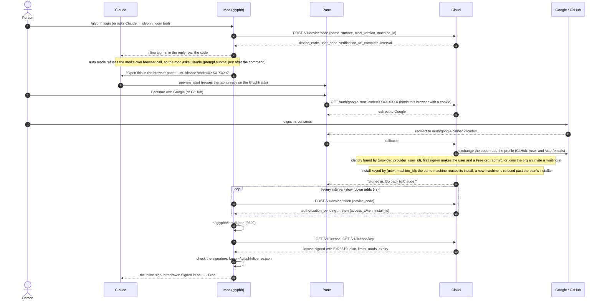

**State:** built, end to end, on 2026-10-14 (Google and GitHub, `/glyphh login`, `glyphh_login`, install reuse by machine).

- `/<mod> signout` revokes this machine's install (`POST /v1/sign-out`) and removes `install.json` and `license.json`; the local rrotor's runtime token stops working with it (4401 on its link).
- **Linking** a second provider to the same account (`POST /v1/me/identities` → the provider's page → the same callback, marked as a link): built.
- The license is refreshed at start and daily; a revoked install answers 401 and the mod signs out.

### 1.2 The local rrotor starts and links

The Ada mod starts rrotor once the machine is signed in. rrotor has no sign-in of its own: the mod's sign-in gets the runtime token and hands it in.


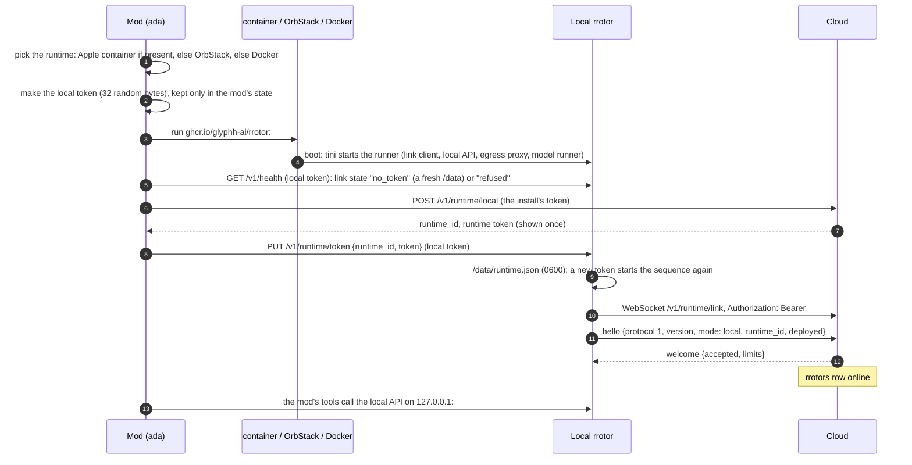

**State:** built and checked live on 2026-10-15 (Docker Desktop on macOS 14): the Cloud's side (the runtime token, `/v1/runtime/link`), the rrotor base (this repo), and the mod side (built in the Models mod before it was dropped on 2026-10-15; the Ada mod carries the same code) detecting the runtime, making the container, handing in the token; the link online in `rrotors`; signing the install out refuses the link (4401). Apple's `container` and OrbStack are detected and started with the same steps but not yet run here (this Mac has neither).

- **Next starts reuse the token** kept in `/data/runtime.json`: the mod asks the server for a new one only when rrotor says it has none or its link was refused (4401), because asking rotates it.
- **The local token** never touches disk outside the mod's private state: rrotor gets only its SHA-256 (in its environment) and compares a request's token by hash, in constant time. The runtime token goes in over the local API, never in the container's environment (which `docker inspect` shows).
- **Signing out** the install revokes the runtime token on the server: the link closes 4401 and rrotor stays offline until a new token is handed in.

### 1.3 The hosted rrotor, on upgrading to Pro or Team


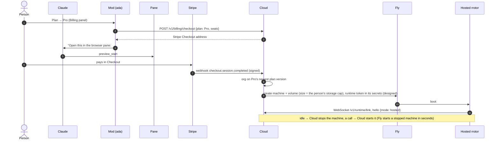

**State:** checkout and webhook built; provisioning designed, not built (hosting is design only for now). The server makes the hosted runtime's token when it provisions the machine and puts it in the machine's secrets; nobody signs in on it.

### 1.4 The Glyphh connector: Claude and its routines allowed to call Glyphh

Routines run on Anthropic's machines, so they reach Glyphh through a connector added once at claude.ai/customize/connectors, signed in with OAuth.


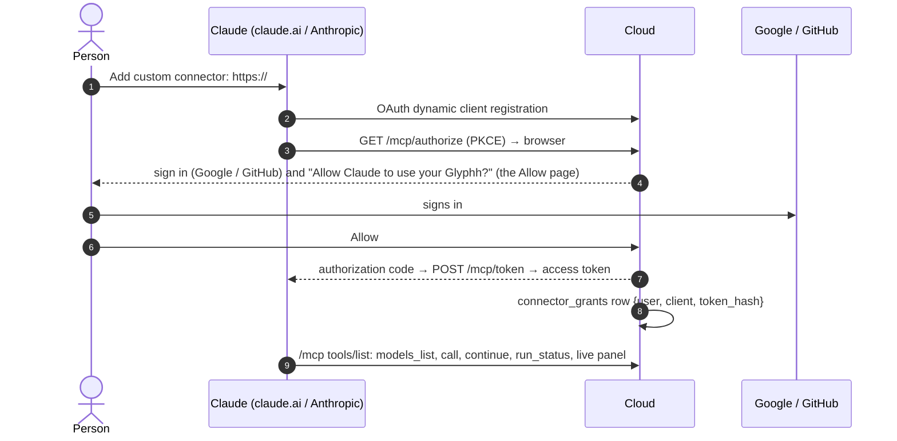

**State:** designed (connector, OAuth endpoints, the Allow page; `connector_grants` table built).

- A grant is revoked one at a time; a revoked grant answers 401.
- The Cloud never holds a Claude login: Claude runs on the person's subscription and calls Glyphh's tools.

## 2. A model, end to end

rrotor runs models; the product that ships them is Ada, whose models are models. `daily_sales` is the sample model the runtime is built and tested with.

**The sample:** `daily_sales`. Every morning it reads yesterday's sales from an analytics API (an API key), adds them up, stores the total and hands back rows for a dashboard in Claude.

```python
from rrotor import Ctx, Result


def start(ctx: Ctx, inputs: dict) -> Result:
    day = inputs.get("day") or ctx.yesterday()
    rows = ctx.http.get(
        "https://api.analytics.example.com/v1/sales", params={"day": day}, key=ctx.secrets["ANALYTICS_KEY"]
    ).json()
    total = sum(r["amount"] for r in rows)
    ctx.db.postgres.execute("insert into daily (day, total) values (%s, %s)", day, total)
    return Result.done({"day": day, "total": total, "rows": rows})
```

Its manifest declares the function `start` (input `day`, optional), the host `api.analytics.example.com`, the secret `ANALYTICS_KEY`, and Postgres.

This full version needs one part beside the base: Postgres. The base edition in `examples/daily_sales/` runs on the base alone, so it is the one tested end to end: it reads the day's sales export from its own folder (`ctx.files`), converts the total with a public exchange-rate API (its one declared host), asks approval for its `write` step and writes the day's total to its ledger.

### 2.1 Build, in Claude, against the local rrotor

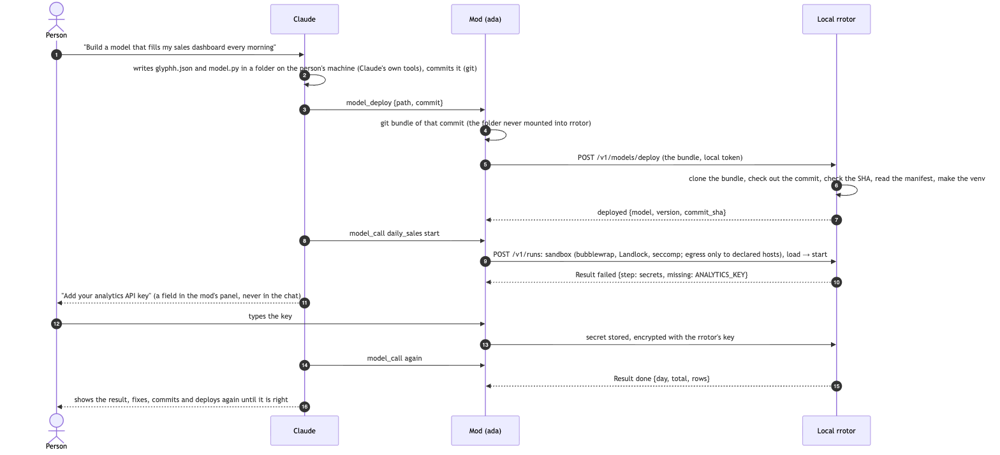

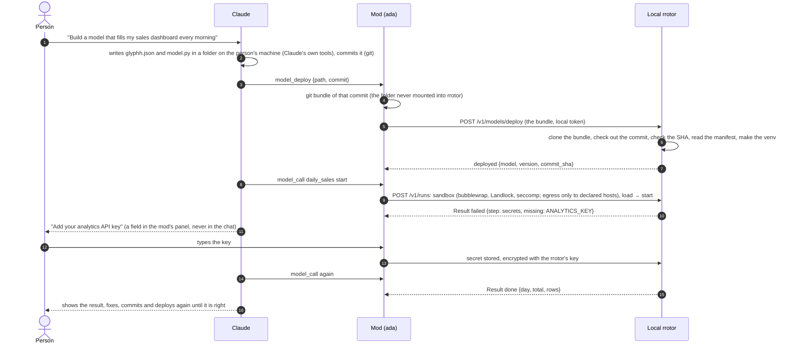

**State:** built (2026-10-15): deploy by commit from a local folder, calls, `continue`, Results (`models_list`, `model_deploy`, `model_call`, `model_continue`, `run_status`, built in the Models mod before it was dropped; the Ada mod carries the same), checked live against rrotor. Designed: the live panel, the secrets vault.

### 2.2 Deploy: to the hosted rrotor, through git, and the routine

Each model is a repo in the person's GitHub account; a version is a commit. Git is required for hosted models (the Glyphh GitHub App installed on their account); local models need none.


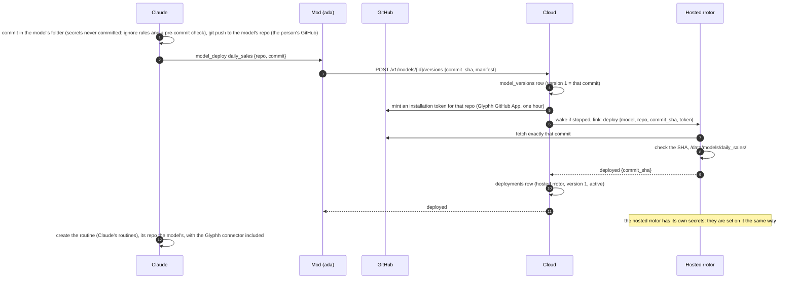

**State:** designed.

### 2.3 Update


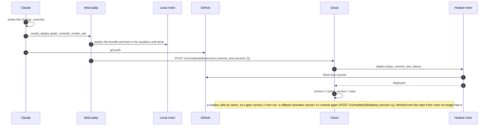

**State:** designed.

### 2.4 Run live, from Claude


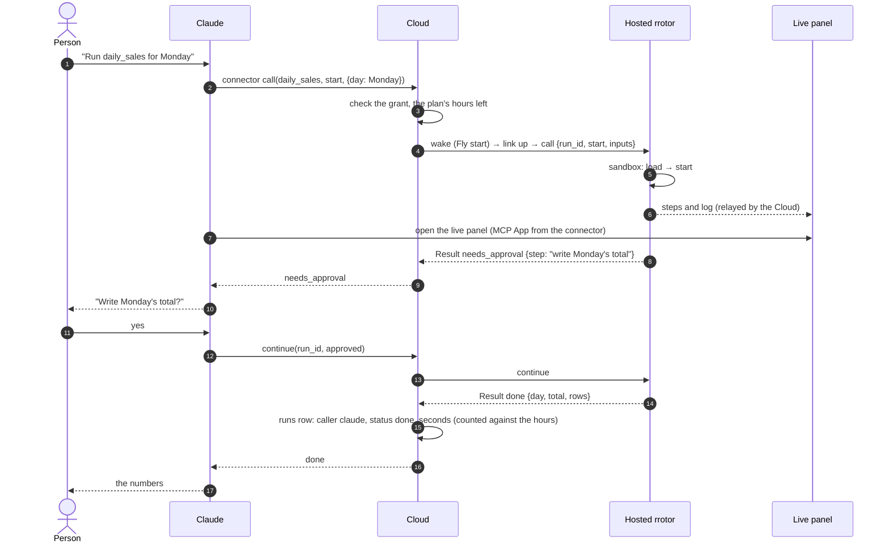

**State:** designed.

### 2.5 Run on a schedule, back through Claude, output to a dashboard

The routine is the runner. Claude in the routine calls the model, answers what it asks, and writes the result to a dashboard (an artifact in Claude with its own database).

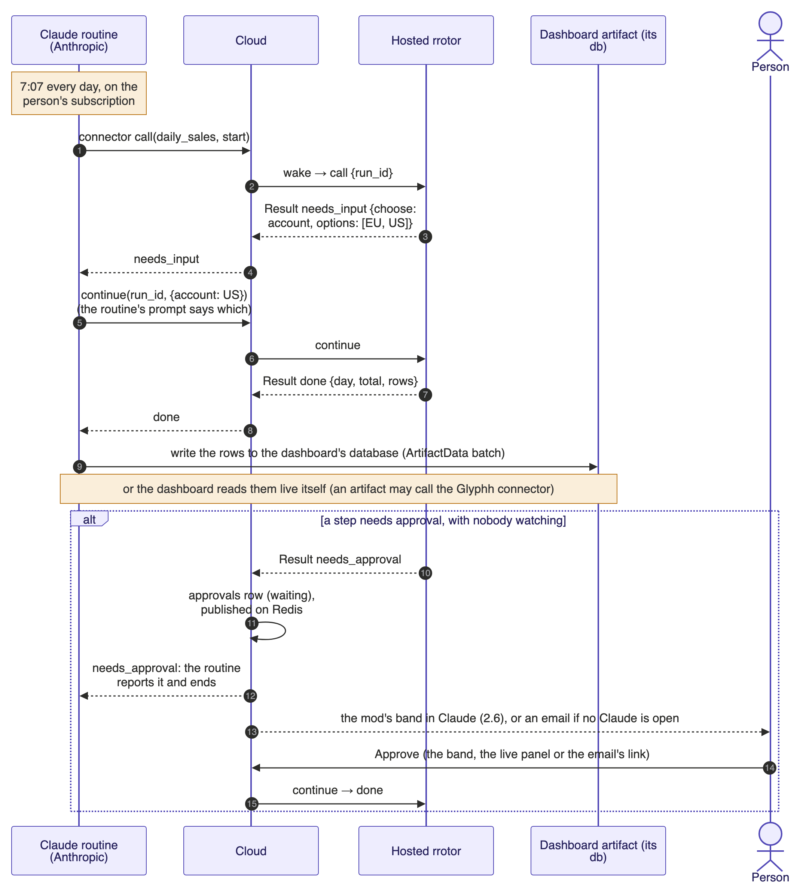

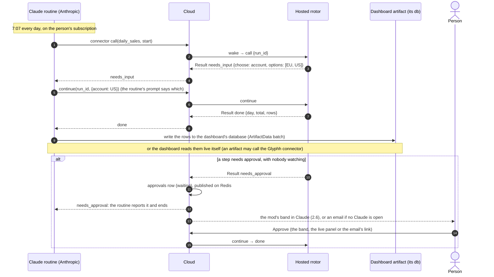

**State:** designed. To prove: a scheduled routine writing to an artifact's database unattended, and an artifact calling a custom connector.

### 2.6 Approvals, shown in Claude

A step that needs approval is a row in `approvals` (the record, kept until answered) and a signal on Redis (pub/sub, to whichever server process holds the person's connection). Redis runs on the server's own Fly machine, beside the server (Chris, 2026-10-14); in development it is a service in the server's `compose.yaml`. The Models mod holds one live connection while Claude is open and shows the approval itself, with no Claude turn; runs called through the local API that wait for approval show in the same band from the local API's `GET /v1/approvals`.


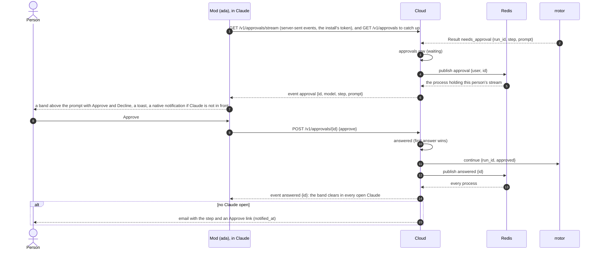

**State:** designed.

### 2.7 The Cloud starting a routine (calls back to Claude)

When something happens on Glyphh's side (a model finished, a page it watches changed, a waiting step was approved), the Cloud can start a routine through the routine's API trigger, with the data as its text.


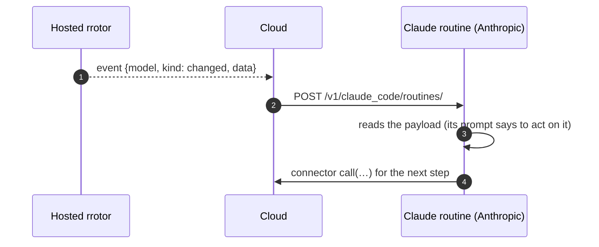

**State:** designed.

**How the Cloud calls a routine.** Through the routine's **API trigger**, the documented way to start a routine from outside Claude (Anthropic's routines documentation, checked 2026-10-14):

1. **The person adds an API trigger** to the routine at claude.ai/code/routines (Edit → Add another trigger → API) and generates its token. The token is shown once and starts **that routine only**: it is not a Claude login, so the Cloud never holds one.
2. **The person gives the Cloud the trigger** (its URL and token) in the Ada mod, as they would a secret. The Cloud keeps it encrypted (`routine_triggers`, see [Server gaps](#server-gaps)).
3. **The Cloud fires it** when the model's event happens (a run finished, a watched page changed, a waiting step was approved):

```
POST https://api.anthropic.com/v1/claude_code/routines/<trigger id>/fire
Authorization: Bearer <the routine's trigger token>
anthropic-beta: experimental-cc-routine-2026-04-01
anthropic-version: 2023-06-01
Content-Type: application/json

{"text": "{\"model\": \"daily_sales\", \"event\": \"changed\", \"data\": {...}}"}
```

4. **Anthropic answers** `{"type": "routine_fire", "claude_code_session_id", "claude_code_session_url"}`; the Cloud records the session URL on the event, so the person can open the run.
5. **The routine runs** on the person's subscription. `text` reaches it wrapped as untrusted data (`<routine-fire-payload>`), so the routine's own prompt must say to act on it ("Act on the event in the payload: …"); the models mod writes that line into the routines it creates.

- **Limits:** 30 fires an hour per routine (shared with Run now), 100 an hour per account; the Cloud holds fires past them and says so. A `401` means the token was regenerated or deleted: the trigger is marked broken and the person is asked for the new one.
- **Research preview:** request and response shapes may change behind a new dated beta header; the two previous header versions keep working, so the Cloud pins one header and moves deliberately.

## 3. What every call carries

| Between | How | Auth |
|---|---|---|
| Mod → Cloud | HTTPS, `/v1/...` | the install's token (Bearer) |
| Browser → Cloud sign-in pages | HTTPS | a short-lived cookie binding the browser to the sign-in |
| rrotor → Cloud | WebSocket `/v1/runtime/link`, outbound only | the runtime's token (Bearer header, never in a URL) |
| Cloud → rrotor | messages down the link: call, continue, cancel, deploy | the link itself |
| Claude / routines → Cloud | MCP over HTTPS, `/mcp` | the connector grant's token (OAuth) |
| Cloud → routine | HTTPS POST to `api.anthropic.com/v1/claude_code/routines/<id>/fire` | the routine's trigger token |
| Mod → local rrotor | HTTP on `127.0.0.1:<port>` (the local API) | the local token (Bearer), only the mod holds it; rrotor keeps its SHA-256 |
| Stripe → Cloud | webhook | Stripe's signature |
| Mod ← Cloud | server-sent events, `/v1/approvals/stream` | the install's token |
| Cloud ↔ Redis | pub/sub, inside the cloud | the cloud's network |

## 4. rrotor, inside

One image, `ghcr.io/glyphh-ai/rrotor`, for both modes; `mode` (`local` or `hosted`) is the only difference, set at start. The image is the **base**; each mod that uses rrotor installs its **part** on top, on `/data` ([Parts](#10-parts)).

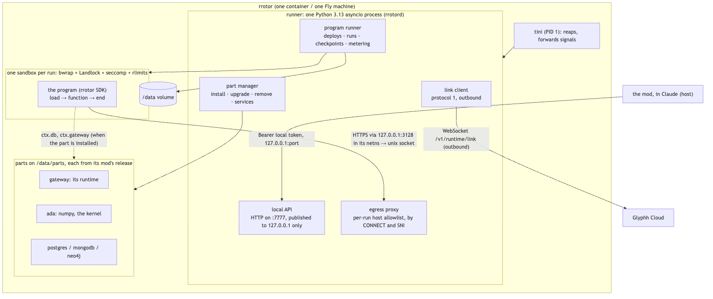

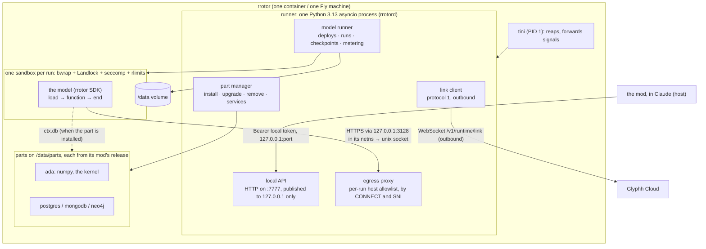

| Piece | Job |
|---|---|
| **link client** | Holds the link (connects out, reconnects with backoff 1 s → 30 s with jitter, replays unacknowledged results and events), takes `call`, `continue`, `cancel`, `deploy`, `activate`, `remove` |
| **local API** | `mode: local`: the HTTP API the mods call on `127.0.0.1:<port>` with the local token: health, the runtime token handed in, models, deploy, call, continue, cancel, run status, run log, approvals waiting ([7](#7-the-mods-and-the-local-rrotor)) |
| **model runner** | Deploys versions (git, a checked SHA, a venv per version), launches each run in its sandbox, keeps runs that wait for `continue` (15 minutes), runs `end` always, counts each run's seconds |
| **egress proxy** | The only network a run has: an HTTP `CONNECT` proxy on a unix socket per run; lets through port 443 of the hosts its manifest declares, checks the TLS SNI matches, refuses addresses that resolve to loopback, private or link-local ranges, refuses and records anything else |
| **part manager** | Installs, upgrades and removes the parts the mods ask for, checks each against its mod's release and the plan's licence, and starts a part's services on demand ([10](#10-parts)) |

The base has no s6: everything above is one process under `tini`, and the part manager starts and stops a part's services (a database) itself, on demand, as the doc always meant them to run.

**The sandbox.** Each run is one worker process started with `bwrap`:

| Layer | What it holds |
|---|---|
| **bubblewrap** | New user, mount, PID, IPC, UTS, cgroup and network namespaces; `--die-with-parent`, `--new-session`, `--clearenv`; read-only `/usr` (and its `/lib`, `/bin` links), the version's code at `/model`, its venv at `/venv`, the SDK at `/opt/rrotor`; `/data/models/<name>/files` writable at `/files`; a private `/tmp`; nothing else of `/data`. The network namespace has only loopback |
| **Landlock** | Applied by the worker before it imports the model: reading only the read-only mounts, writing only `/files` and `/tmp`; on ABI 4 and later, TCP only to `127.0.0.1:3128`; on ABI 6, no abstract unix sockets or signals outside the sandbox. A kernel without Landlock refuses runs |
| **seccomp** | A filter built by the runner (libseccomp) and handed to `bwrap --seccomp`: `ptrace`, `mount`, `unshare`, `setns`, `bpf`, `perf_event_open`, `userfaultfd`, `keyctl`, `io_uring_*`, kernel modules, `kexec`, clocks, `reboot` and others refused; new user namespaces refused; sockets only `AF_UNIX`, `AF_INET`, `AF_INET6`. `no_new_privs` is set |
| **egress proxy** | The only way out: inside the namespace the worker forwards `127.0.0.1:3128` to the run's proxy socket, so `HTTPS_PROXY` works for any library |
| **limits** | `prlimit`: data size (the manifest's `memory_mb`; address space would count thread stacks and allocator arenas), CPU seconds, open files, file size, no core files; the runner's wall clock (`limits.seconds`) kills the run |

- **Every layer is checked at start** and shown in `GET /v1/health`; a layer that cannot work makes rrotor refuse runs (`E_SANDBOX_UNAVAILABLE`, naming the layer and why). Nothing is skipped silently.
- **A uid per model** is the uid inside its user namespace; outside it every run is rrotor's own unprivileged user, so files are kept apart by the mounts and Landlock, not by host uids.
- **cgroups:** a container on Docker Desktop, OrbStack or Apple's `container` gets a read-only cgroup tree, so memory and CPU are held by `prlimit` and the wall clock; on a hosted Fly machine (the image is the VM) the runner holds each run in its own cgroup v2 as well (designed).
- **What a container needs:** bwrap makes namespaces and mounts `/proc`, which a container's default seccomp profile and masked paths refuse, so the mod starts rrotor with `--security-opt seccomp=unconfined --security-opt systempaths=unconfined` (and `apparmor=unconfined` on Linux hosts with AppArmor). rrotor's own seccomp filter then holds each run. On Apple's `container` each container is its own VM, so these are not needed.

**`/data`:**

| Path | What |
|---|---|
| `runtime.json` | The runtime's id and token (0600) |
| `link/` | The sequence counter and the outbox: results and events not yet acknowledged |
| `keys/runtime.key` | The runtime key (secrets at rest), made on first boot (with the vault, designed) |
| `models/<name>/versions/<commit>/` | A deployed version: `src/` (the checkout of that commit), `venv/`, `version.json`; immutable |
| `models/<name>/active.json` | Which version is active |
| `models/<name>/files/` | The model's own folder, the only one it sees |
| `models/<name>/data/` | Persistent data a model's mod keeps outside git, mounted for that model only (Ada's precedent store) |
| `runs/<run_id>/` | Each run's `run.json`, `log.jsonl`, `checkpoints.json` |
| `parts/<mod>/<version>/` | A mod's installed part |
| `secrets/<name>.enc` | A model's secrets, encrypted (the vault, designed) |
| `db/` | The database parts' data |

**The base image:** Debian 13 (trixie) slim; amd64 and arm64; `tini`; Python 3.13 (Debian's, for the runner and models), Node 22 LTS, git, bubblewrap, libseccomp, util-linux (`prlimit`), CA certificates. No browser, no database. A non-root user (`rrotor`, uid 10001); the root filesystem read-only with a tmpfs `/tmp`; everything kept on `/data`. A new version is a new image tag; the mod moves the local one, the Cloud the hosted ones (designed).

## 5. A model

### 5.1 What a model is

A git repo in the person's GitHub account; a version is a commit:

| File | What |
|---|---|
| `glyphh.json` | The manifest (below) |
| `model.py` | The module: `load`, the functions, `end` |
| `requirements.lock` | Its Python dependencies, pinned with hashes; installed into the version at deploy, never at run |
| `files/` | Optional seed files, copied into its folder on first deploy |

### 5.2 The manifest: `glyphh.json`

```json
{
  "name": "daily_sales",
  "version": 2,
  "description": "Yesterday's sales from analytics.example.com, for the sales dashboard",
  "python": "3.13",
  "functions": {
    "start": {
      "description": "Read a day's sales and store the total",
      "inputs": { "type": "object", "properties": { "day": { "type": "string", "format": "date" } } },
      "approvals": ["write"]
    }
  },
  "hosts": ["api.analytics.example.com"],
  "secrets": ["ANALYTICS_KEY"],
  "databases": ["postgres"],
  "limits": { "seconds": 300, "memory_mb": 512 },
  "connectors": ["slack"]
}
```

- **`functions`:** each callable function with a JSON Schema for its inputs and the named steps that need approval; `start` is the default.
- **`hosts`, `secrets`, `databases`:** everything a run may reach; nothing undeclared exists inside the sandbox. A database is a part (`postgres`, `mongodb`, `neo4j`): a run whose part is not installed fails with `E_PART_MISSING` and names the part.
- **`limits`:** per run, capped by the plan.
- **`connectors`:** the Claude connectors its routine needs (written into the routine, never used by the model).
- **`needs`:** the parts the model imports from, by name (`["ada"]`): each must be installed and in the plan, and is mounted read-only at `/opt/parts/<name>` ([10](#10-parts)).
- **`data`:** `true` mounts the model's persistent data folder (`/data/models/<name>/data`, outside git) at `/data` in its sandbox; Ada's models use it for their precedent store.
- A version is **immutable**: a commit, identified by its SHA. A deploy refuses a manifest whose `name` differs from the model's, an unknown key, or a function that is not in `model.py`.

### 5.3 The SDK: `rrotor`

The SDK is the `rrotor` Python package, shipped in the image and mounted read-only into every sandbox at `/opt/rrotor`; models import it and never install it. It uses only the standard library.

```python
from rrotor import Ctx, Result

Result.done(data)                                     # finished: data (JSON)
Result.needs_input(prompt, schema=None, options=None) # a value or a choice
Result.needs_approval(step, prompt)                   # about to act; continue answers it
Result.failed(step, reason)                           # stopped, with why

ctx.inputs              # the call's inputs, checked against the manifest's schema
ctx.answer              # the answer the last continue brought (None on the first call)
ctx.ask_approval(step, prompt) -> bool   # True once approved, False if declined; else the run waits (needs_approval)
ctx.needs_input(prompt, schema=None, options=None) -> value   # the answer once given; else the run waits (needs_input)
ctx.checkpoint(key, fn) # run fn once per run; a resumed run reads the stored value
ctx.http                # HTTPS to declared hosts only, through the egress proxy (any library works too: HTTPS_PROXY is set)
ctx.files               # its folder, a pathlib.Path
ctx.data                # its persistent data folder ("data": true), else None
ctx.home                # where its code is (spec.json beside model.py)
ctx.clearance           # who asks, 0 to 1 (Ada); 1 unless the call says
ctx.caller              # claude, routine, panel, test; rrotor for its own operations
ctx.log(message, **detail)
ctx.db                  # the database parts; E_PART_MISSING without them
rrotor.ada.open(ctx)    # an Ada model: the spec and the store, on the Ada part (9)
ctx.secrets["NAME"]     # declared secrets (the vault, designed)
```

- **Approvals and inputs are re-entrant.** A `continue` calls the same function again with the same inputs: steps already done are skipped by `ctx.checkpoint`, and `ctx.ask_approval(step, …)` now answers the person's decision for that step (`{"approved": true}` from the server's approvals, or from the local API). A step a function asks about must be named in the manifest's `approvals`, else the run fails (`E_STEP_UNDECLARED`).
- **`rrotor.testing`** gives a model's own tests a `Ctx` with no sandbox: inputs, answers, a folder, and an `http` that answers what the test says.

### 5.4 A run

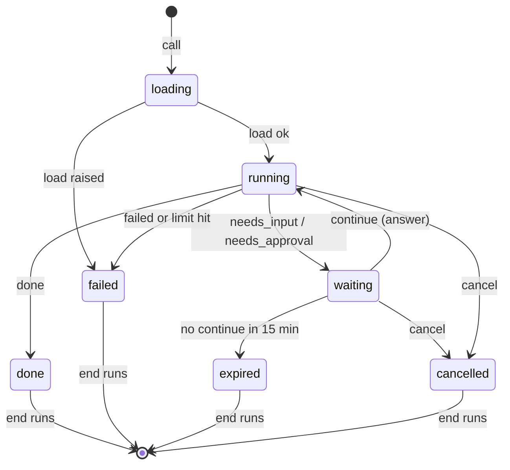

- **One run, many calls:** `call` opens a run (`run_id`); each `continue` resumes the same run, in the same worker while it waits (up to 15 minutes), its checkpoints kept in `/data/runs/<run_id>/checkpoints.json`. If the worker is gone (rrotor restarted), a `continue` starts a new one: `load`, then the function, the checkpoints read back.
- **`end` always runs**, on `done`, `failed`, a limit, a cancel or an expiry.
- **Every call returns a `Result`**, never an exception: a crash is `failed` with the error and the step.
- **Seconds** are the time a run spent running, not waiting.
- **Approvals:** a `needs_approval` the Cloud sees with nobody watching (a routine) waits in `approvals`; the person's answer is a `continue`.

## 6. The link: protocol 1

JSON messages over the WebSocket `/v1/runtime/link`, one per frame, each with `type` and an `id`. The rrotor connects out; the Cloud never connects in.

| Direction | `type` | Carries |
|---|---|---|
| rrotor → Cloud | `hello` | protocol 1, rrotor version, mode, runtime id, deployed versions |
| Cloud → rrotor | `welcome` | accepted, the plan's limits for runs |
| Cloud → rrotor | `call` | `run_id`, model, version (or active), function, inputs, caller, clearance (0 to 1, 1 unless given) |
| Cloud → rrotor | `continue` | `run_id`, answer |
| Cloud → rrotor | `cancel` | `run_id` |
| rrotor → Cloud | `result` | `seq`, `run_id`, `Result` (status, data; `needs_approval` also its step and prompt; `expired` or `cancelled` when a run ends without one), seconds so far |
| Cloud → rrotor | `deploy` / `activate` / `remove` | model, version, repo, commit SHA, a short-lived repo-scoped token (the rrotor fetches that commit from GitHub and checks the SHA) |
| rrotor → Cloud | `deployed` | model, version, commit SHA |
| Cloud → rrotor | `secret_set` | model, name, value encrypted to the rrotor's public key |
| rrotor → Cloud | `event` | `seq`, model, kind, data, and the routine trigger to fire, if any (one of the model owner's) |
| both | `ping` / `pong` | every 20 s |
| both | `ack` | `of`: the `id` it acknowledges (the Cloud acks every result, event and `deployed`) |

- **Order and replay:** results and events carry a sequence number, one rising counter per runtime for both; the rrotor keeps the unacknowledged ones on `/data` and replays them after a reconnect, and the Cloud applies each number once, so nothing is lost or doubled. A new runtime token (a fresh `/data`) starts the counter again.
- **A different protocol** is closed with code 4426 and an update is asked for.
- **Closes:** 4401 the token is not valid or its install was signed out (do not retry with it); 4400 the first message was not a good `hello` for this runtime (sent within 10 s); 4408 nothing heard for three pings; 4409 a newer link of the same runtime took over (do not reconnect); 1011 the Cloud could not record a message (reconnect and replay); 1012 the server is restarting (reconnect).

- **What rrotor does with each close:** 4401 stops the link and shows `refused` (the mod hands in a new token); 4409 stops it (`replaced`); 4426 stops it (`upgrade_needed`); 4400 stops it (`bad_hello`, a bug to report); 4408, 1011, 1012 and any other close or a dropped connection reconnect with backoff. A `welcome` not heard within 10 s after `hello` closes and reconnects.
- **A deploy without a repo** (`repo` and `token` null: a model never pushed to GitHub) names a commit the rrotor already holds from a local deploy; `activate` makes it active, and both answer `deployed`. A deploy that cannot be done (the commit is missing, the SHA does not match, the manifest is refused) answers an `event` of kind `deploy_failed` with `{version, commit_sha, code, message}`, since protocol 1 has no refusal of its own.
- **Not handled yet:** `secret_set` (the vault) is logged with `E_NOT_BUILT` and skipped; the link stays.
- **Runs called through the local API** stay on the machine: the server has no row for them, so their results do not go up the link. Runs the Cloud calls (`call`) answer `result` up the link, with the run id the Cloud gave.

## 7. The mods and the local rrotor

The mods reach the local rrotor through its **local API**: HTTP on `127.0.0.1:<port>` (rrotor listens on `:7777` inside its container; the port is published on the host's loopback only). rrotor serves no MCP: the mod registers the tools Claude sees (`$.tool.register`) and draws the panels, and each tool calls the local API.

**Every request:** `Authorization: Bearer <local token>`, compared by SHA-256 in constant time; `Host` must be `127.0.0.1:<port>` or `localhost:<port>`; a request with any `Origin` is refused (no web page may call it). Refusals are `{"error": {"code", "message"}}` with a stable code.

| Call | Does |
|---|---|
| `GET /v1/health` | Version, mode, runtime id, the link's state (`no_token`, `connecting`, `online`, `backoff`, `refused`, `replaced`, `upgrade_needed`, `bad_hello`), each sandbox layer, runs waiting |
| `PUT /v1/runtime/token` | `{runtime_id, token}`: the runtime token the mod got from `POST /v1/runtime/local`; kept in `/data/runtime.json`; the link (re)connects |
| `GET /v1/models` | Each model, its versions (number, commit, when), the active one, its functions |
| `POST /v1/models/deploy` | `{bundle, commit}`: a git bundle of the commit, base64 (the mod's `$.http.fetch` carries text; up to 64 MB), or `{repo, commit, token}` for a GitHub repo; answers `{model, version, commit_sha}` |
| `POST /v1/runs` | `{model, function, inputs, version?, clearance?}`: opens a run and answers its first `Result` with `run_id` |
| `POST /v1/runs/{id}/continue` | `{answer}`: the next `Result` |
| `POST /v1/runs/{id}/cancel` | Stops it; `end` runs; `cancelled` |
| `GET /v1/runs/{id}` | Status, function, times, seconds, the last `Result` |
| `GET /v1/runs/{id}/log` | The run's log lines |
| `GET /v1/approvals` | Runs waiting for approval: run, model, step, prompt, when |
| `GET /v1/parts`, `POST /v1/parts`, `DELETE /v1/parts/{name}` | The parts installed; install one (`{name, version, sha256, signature, archive \| url}`, checked before it is unpacked); remove one ([10](#10-parts)) |
| `GET /v1/licence`, `PUT /v1/licence` | The plan's licence held; hand one in (`{payload, signature}`, checked with Glyphh's licence key) |

**The mod's tools** (built in the Models mod before it was dropped; the Ada mod carries the same): `models_list`, `model_deploy` (a local folder at a commit, bundled by the mod; or a repo and commit), `model_call`, `model_continue`, `run_status`. A status line shows rrotor's state and the approvals waiting. Designed for later: the live panel (MCP App from the Glyphh connector, or a local page), secrets, versions and activate.

**Deploying goes through git:** locally the mod sends a bundle of the commit (the folder is never mounted into rrotor); for hosted runs the person pushes the commit to the model's repo, the Cloud records it (`POST /v1/models/{id}/versions`) and hands the hosted rrotor the commit and a short-lived token to fetch it.

## 8. The server, checked

Every call above against what the server has (branch `relaunch`):

| Need | Server today |
|---|---|
| Device sign-in, installs by machine, license | Built |
| Identities, linking | Built |
| Plans, mods, Stripe checkout and webhook | Built |
| Tables: `rrotors`, `models`, `model_versions`, `deployments`, `runs`, `approvals`, `connector_grants` | Built (tables only) |
| `/v1/runtime/link` (protocol 1; waking a stopped hosted runtime on Fly not built) | Built; rrotor's link client checked against it live (hello, welcome, deploy, call, results, approvals, continue, acks and sequence numbers) |
| `/mcp` and its OAuth (the account tools) | Built |
| Plan limits for `models` (`models`, `runs_per_day`: placeholders, TBD) | In the seed (2026-10-15, local) |
| `/v1/models`, `/v1/runs`, `/v1/runtime`, the models tools on `/mcp` | Designed, not built |

### Settled in the server's design (2026-10-14)

What the flows needed that the server's design did not have; now in it, so the infrastructure stays fixed while rrotor is built:

1. **Local runtimes:** `POST /v1/runtime/local` gives a local rrotor its runtime token; `rrotors` has a `mode` (`hosted` or `local`) and a local one is keyed by its install.
2. **Routine triggers:** `routine_triggers` (name, fire URL, token encrypted, status) and `/v1/routine-triggers`.
3. **Model events:** `model_events` (kind, the routine trigger it fired, the session URL).
4. **Versions through git:** each model a repo in the person's GitHub; `model_versions.commit_sha` is the version's identity; the Glyphh GitHub App's installation (`github_installations`) mints a short-lived token per deploy. No code is kept in Glyphh's cloud.
5. **Approval email:** `approvals.notified_at`.
6. **The connector's Allow page.**
7. **No bundle storage:** `bundle_ref` is gone.

## 9. Ada

rrotor is not sold. One mod installs into it, Ada, its own product in the plan's licence (`payload.mods.ada.limits`): its part is the Ada kernel and numpy ([10](#10-parts)); its limits `models` and `precedents` (placeholders, TBD). The mod starts rrotor (or finds it already running, by the container's name `glyphh-rrotor`), installs the part, deploys models and calls them, as sections 2, 5 and 7 describe. **The runtime side is built** (2026-10-15); the mod is designed ([9.1](#91-the-ada-mod)).

**An Ada model is a program to rrotor:** a repo with `glyphh.json` (`"needs": ["ada"]`, `"data": true`), `spec.json` (the Ada spec: what a record looks like, its seed and dimension) and `model.py`, whose functions call the kernel through `rrotor.ada`:

```python
from rrotor import Result, ada

def load(ctx):
    ada.open(ctx)                      # the spec read, the store opened; the model on ctx.ada

def record(ctx, inputs):
    return Result.done({"id": ctx.ada.record(inputs["data"], inputs.get("outcome"))})

def query(ctx, inputs):
    return Result.done(ctx.ada.query(inputs["data"], clearance=ctx.clearance).to_json())
```

- **The store** is `precedents.sqlite` in the model's persistent data folder (`/data/models/<name>/data`, mounted at `/data`, outside git), so it outlives every version.
- **A changed encoding** (the spec's `seed` or `dimension`) between the active version and the one deployed makes rrotor run its own operation in the new version's sandbox before it goes active, `rrotor.ada.reencode`: every precedent's glyph rebuilt from its recorded situation under the new spec. When that fails (the store is not readable), the deploy is refused with `E_ADA_ENCODING` and the version before stays active; the new version is not kept. Any other change deploys as usual. The spec is checked at deploy: an Ada model without a data folder or without a readable `spec.json` is refused (`E_MANIFEST`).
- **`clearance`** (0 to 1) comes with the call (`POST /v1/runs {clearance}` on the local API, `call {clearance}` on the link), from the caller's Glyphh identity (the mod's reading of the person's plan and org role), never from the inputs; the model passes `ctx.clearance` to the kernel, which cuts what a reader may see.
- **The example:** `examples/ada_tickets/`, a support-ticket triage model (`record`, `query`, `facts`, `probabilities`, `decide`, which asks for the outcome when no precedent is close enough), with its own tests on `rrotor.testing.Harness` and the kernel the repo's tests carry (`tests/kernel/`).
- **Size:** about 16 KB of RAM per precedent; the part's limits come from the licence.

### 9.1 The Ada mod

**Built** (`glyphh-ai/mods`, `plugins/ada`): signs in on the account (`shared/licence/`), installs and starts rrotor with the two public keys in its environment, hands it the plan's licence as the server signed it (`PUT /v1/licence`, again whenever rrotor's copy is not the current one) and the Ada part (`POST /v1/parts`: from this mod's release assets by URL, or from a developer's build folder set in `/config`), deploys a model from a folder at a commit, calls it and continues it, shows runs and approvals; `/ada [start | stop | part | signin | signout]` and the tools `ada_models`, `ada_deploy`, `ada_call`, `ada_continue`, `ada_run`. The `models` limit is enforced by the mod at deploy; `precedents` by rrotor, from the licence.

## 10. Parts

A **part** is what a mod installs into rrotor beyond the base: Ada's kernel and numpy, and the database parts (Postgres with pgvector, MongoDB, Neo4j) a mod or a model asks for. **Built** (2026-10-15): the part store, the licence gate, the routes, the mounts; the Ada part's build (`parts/ada/`, in CI). The database parts are designed.

- **What a part is:** a gzipped tarball with `part.json` at its top, `{name, version, mod, arch (amd64 | arm64 | any), rrotor (the lowest base version it needs), env: {PYTHONPATH: [folders]}, services}`, and its tree beside it (`lib/` for Python). `scripts/part.py build <folder>` makes one, deterministically, with its SHA-256 and its Ed25519 signature by Glyphh's release key (`RROTOR_RELEASE_KEY` in the mod's CI; `scripts/part.py keygen` makes a pair).
- **Where it comes from:** the mod's own release: the tarball, `<name>-<version>-<arch>.tar.gz`, its `.sha256` and its `.sig`. The Ada part is built by this repo's CI (`parts/ada/build.sh`, both architectures) and carried by the Ada mod's release.
- **Install, upgrade, remove:** the mod asks over the local API: `POST /v1/parts {name, version, sha256, signature, archive (base64) | url}`, `GET /v1/parts`, `DELETE /v1/parts/{name}`. rrotor checks the hash and the signature with the release public key it was started with (`RROTOR_RELEASE_PUBLIC_KEY`) before it unpacks anything, then the manifest (the part asked for, this architecture, this rrotor), unpacks to `/data/parts/<name>/<version>/` beside the version before, and switches `/data/parts/<name>/current` in one rename; the older version then goes. A failed install leaves the one before. Removing a part removes its folder.
- **Licensed by the plan:** the mod hands rrotor its signed licence (`PUT /v1/licence {payload, signature}`, the server's answer as it came); rrotor checks it with Glyphh's licence key (`RROTOR_LICENCE_PUBLIC_KEY`), keeps it on `/data`, and installs a part, or runs a model that needs one, only while the licence names the part's mod (`E_NOT_IN_PLAN` says why: no licence, expired, or not in the plan). The database parts are rrotor's own (`mod: rrotor`) and need no plan.
- **A model asks for a part** in its manifest: `databases`, and `needs` by name (`"needs": ["ada"]`). Each is mounted read-only at `/opt/parts/<name>` in its sandbox, its `env.PYTHONPATH` folders after the SDK's on `PYTHONPATH`, and Landlock lets the model read it. A run whose part is not installed fails with `E_PART_MISSING` naming the part and the mod that brings it.
- **Health** (`GET /v1/health`) lists the parts installed and the licence held.

## 11. Where rrotor runs, and how it is installed

**The mod installs rrotor; there is no separate install** (Chris, 2026-10-15). The first mod that needs it finds a container runtime, pulls `ghcr.io/glyphh-ai/rrotor` at the version that matches the mod, **pinned by digest** (the mod carries the image's digest for each architecture, and the runtime checks the pulled image against it), starts it with `/data` on a named volume (`glyphh-rrotor-data`) and the local API on the host's loopback, and hands in the runtime token (1.2). Updating the mod pulls the new digest and replaces the container; `/data` stays. PyPI carries only the `rrotor` model SDK (and later perhaps a developer CLI), never the runtime.

| | Local | Hosted (designed only) |
|---|---|---|
| How | The mod starts it (below, per system) | The server provisions one Fly machine and its volume, the image as the VM (Firecracker) |
| Token | The mod's sign-in gets it (`POST /v1/runtime/local`) and hands it in | The server makes it at provisioning |
| Reached by | Claude through the mods (local API); the Cloud through the link | The Cloud through the link: routines and other AI clients via the Glyphh connector |
| Sandbox | As section 4; on Docker and OrbStack the container needs seccomp and systempaths unconfined for bwrap; on Apple's `container` and WSL2 it is its own VM | As section 4, plus a cgroup per run |

**macOS.** Apple's `container` first (macOS 26 on Apple silicon: a lightweight VM per container, the closest to the hosted Firecracker machine), then OrbStack (it answers the `docker` command through its own context), then Docker Desktop. With none of them, the mod offers to install Apple's `container`: Apple's signed installer package from its GitHub releases, which macOS installs after the person enters their password once (they approve; the mod never asks for the password itself). On a Mac older than macOS 26, or an Intel Mac, the mod points to OrbStack instead. **Built now:** detection of `container`, OrbStack and Docker, and starting rrotor on Docker or OrbStack; `container` is detected and started with the same arguments, but not tested on this build's Mac (macOS 14).

**Windows** (designed, not built). **WSL2** is the VM: a real Linux kernel, so the sandbox works as on a hosted machine. Preferred: rrotor also ships as a **WSL distribution**, a root filesystem tarball built in CI from the same image (`rrotor-wsl-<version>-<arch>.tar.gz`), imported with `wsl --import Glyphh-rrotor <folder> <tarball>` and started with `wsl -d Glyphh-rrotor`, so no Docker is needed; otherwise Docker Desktop, Podman or Rancher Desktop when one is present. If WSL is not enabled, the mod guides the person through `wsl --install` (an administrator prompt and one restart, which the person does). Localhost from Windows reaches WSL2 by default (NAT mode's localhost forwarding, or mirrored mode); the local API listens on loopback only inside the distribution.

**Linux** (designed). Docker or Podman directly; the same image and arguments (plus `apparmor=unconfined` where AppArmor confines containers). Ubuntu 23.10 and later also restrict unprivileged user namespaces through AppArmor (`kernel.apparmor_restrict_unprivileged_userns=1`): bwrap then cannot bring up its loopback (`Failed RTM_NEWADDR`), so the host needs that set to 0, or an AppArmor profile that allows user namespaces for the container; rrotor's health says so rather than run without it (seen in CI on GitHub's Ubuntu 24.04).

### Platforms, per mod

| Mod | macOS | Windows | Linux | Needs rrotor | Host dependencies today |
|---|---|---|---|---|---|
| Ada (the runtime side works; the mod is designed) | Works on Docker or OrbStack; Apple's `container` detected | WSL2 (designed) | Docker or Podman (designed) | Yes | A container runtime; `git` (bundles a commit); `ioreg` |
| The shared sign-in and licence | Works | To build | To build | No | `ioreg` (the machine id), `scutil` (the computer's name), `open` |

**macOS-only today, and the Windows equivalents to build later:**

| Today (macOS) | Where | On Windows |
|---|---|---|
| `ioreg -rd1 -c IOPlatformExpertDevice` for the machine id (hashed) | the shared licence module, every mod | `HKLM\SOFTWARE\Microsoft\Cryptography\MachineGuid` (hashed the same way) |
| `scutil --get ComputerName` | the shared licence module | `%COMPUTERNAME%` |
| `open <url>` | the shared licence module | `cmd /c start "" <url>` or `explorer <url>` |

## Anthropic's terms

Quoted in the server's `docs/architecture.md` (checked 2026-10-14): third-party developers may not offer Claude.ai login, route requests through someone's subscription, or collect, store or intermediate Claude.ai credentials or session tokens. So: rrotor has no Claude in it; Gateway serves third-party models with the person's own API keys and never a Claude subscription or login; Claude reaches rrotor only as Claude, on the person's own subscription, through the mods' tools or the Glyphh connector.

## Open

- **The live panel's transport:** a run's events over the link and the server's relay.
- **Secrets on the hosted rrotor:** set again there (2.2), or carried from the local one encrypted to the hosted rrotor's key.
- **The Glyphh GitHub App's permissions:** repository contents (read and write, for the person's model repos) and metadata; the person picks which repos it may reach.
- **Per-model isolation in Neo4j:** the free edition holds one database.
- **Part signing:** the release key's custody and rotation; `RROTOR_RELEASE_KEY` lives in this repo's CI for the Ada part today.
- **Ada's limits** in the licence: `models` and `precedents` per plan (placeholders in the seed).
- **Not yet run here:** rrotor on Apple's `container` (needs macOS 26; this build's Mac is on 14) and on OrbStack; both are detected and started by the same steps, and are to be checked on a Mac that has them. How a `container` VM reaches the host's `localhost` (the dev server) is to be confirmed there.
- **To build next:** the secrets vault, the live panel, the Ada mod, hosted rrotor on Fly, and the WSL distribution's install from the Ada mod on Windows.
- **Publishing the image:** CI builds and tests the image on every push and exports the WSL root filesystem, but pushing to `ghcr.io/glyphh-ai/rrotor` waits for an org admin to give this repository write access to the package (its settings, Manage Actions access), then the repository variable `PUBLISH_IMAGES=true`. Until then no mod pins a digest, and a mod's `rrotor image` setting names a local build.
