# rrotor architecture: the flows

How the parts of Glyphh work together, step by step: signing in, the runtimes, the Glyphh connector, and one sample program built, deployed, updated, run live and run on a schedule. The system design (what each part is, the data model, the plans) is in `glyphh-ai/server`, `docs/architecture.md`; this document follows it and shows the calls between the parts.

Each step is marked by its state: **built** (in `glyphh-ai/server` or the mod on branch `relaunch`, working), **designed** (decided in the server's architecture document, not built) or **proposed** (needed to make a flow work, not yet decided: listed under [Open](#open)).

## The parts

| Part | What it is | Where |
|---|---|---|
| **Person** | The user, in Claude | |
| **Claude** | Claude Code (desktop Code tab or CLI), and Claude's routines on Anthropic's machines | Their machine; Anthropic |
| **Mod** | The Glyphh mods: `glyphh` (account), `glyphh-workspaces`, `glyphh-rpa`, `glyphh-programs` | Inside Claude on their machine |
| **Pane** | Claude's own browser pane | Their machine |
| **Local rrotor** | The local runtime: browser and profiles, workspaces, RPA sites, programs | Their machine (Docker, OrbStack, Apple's `container`) |
| **Cloud** | The Glyphh server: API, device sign-in pages, Glyphh connector (`/mcp`), relay | Glyphh's cloud |
| **Hosted rrotor** | The hosted runtime, one per Pro or Team person: programs | Fly, provisioned by the Cloud |
| **Google / GitHub** | Sign-in providers | |
| **Stripe** | Checkout, subscriptions, portal | |

## 1. Signing in

### 1.1 The mod signs this machine in

Started by `/glyphh login`, or by asking Claude to sign in (Claude calls the mod's own tool `glyphh_login`). Both draw the sign-in inline in the chat: the code, then "Signed in as …".

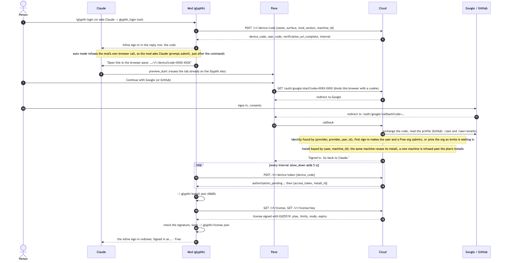

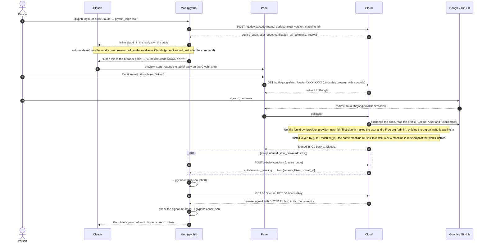

**State:** built, end to end, on 2026-10-14 (Google and GitHub, `/glyphh login`, `glyphh_login`, install reuse by machine).

- `/glyphh logout` revokes this machine's install (`POST /v1/sign-out`) and removes `install.json` and `license.json`.
- **Linking** a second provider to the same account (`POST /v1/me/identities` → the provider's page → the same callback, marked as a link): built.
- The license is refreshed at start and daily; a revoked install answers 401 and the mod signs out.

### 1.2 The local rrotor starts and links

The `glyphh` mod starts the local rrotor once the machine is signed in. The other mods work through it.


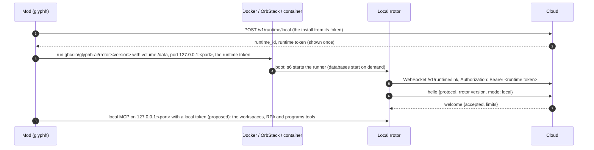

**State:** the Cloud's side built (the runtime token, `/v1/runtime/link`); the local rrotor designed; proposed: how the mods reach it (see [Open](#open)).

### 1.3 The hosted rrotor, on upgrading to Pro or Team

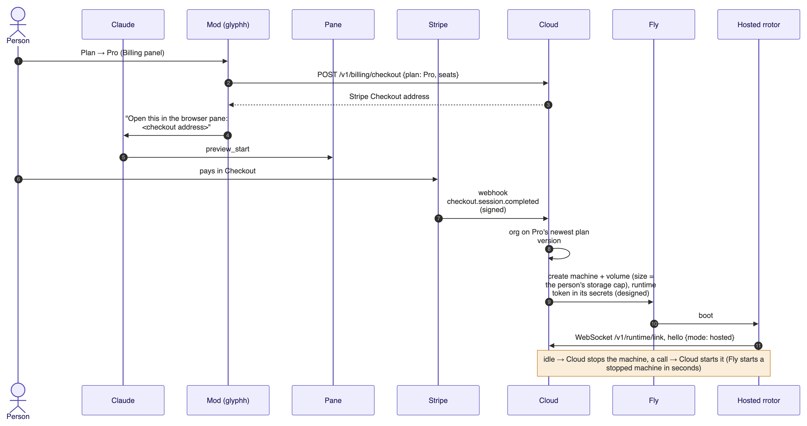

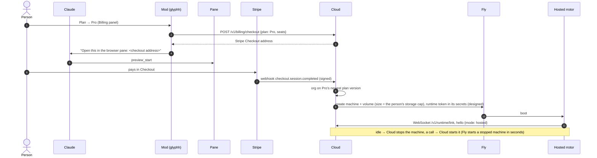

**State:** checkout and webhook built; provisioning designed.

### 1.4 The Glyphh connector: Claude and its routines allowed to call Glyphh

Routines run on Anthropic's machines, so they reach Glyphh through a connector added once at claude.ai/customize/connectors, signed in with OAuth.

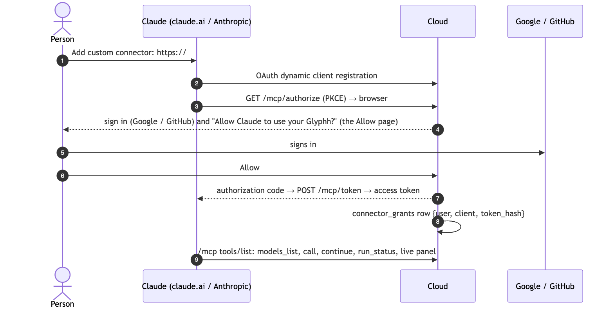

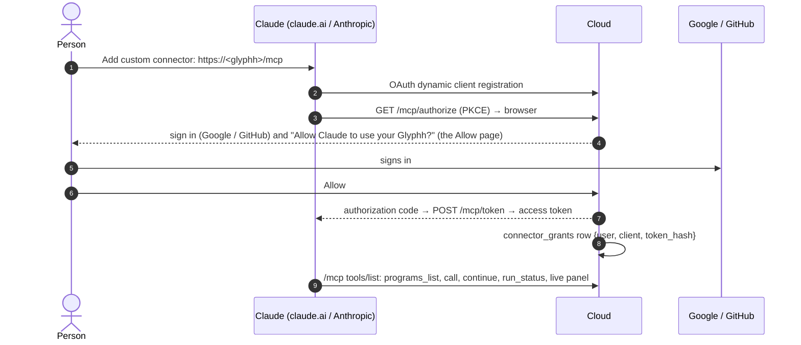

**State:** designed (connector, OAuth endpoints, the Allow page; `connector_grants` table built).

- A grant is revoked one at a time; a revoked grant answers 401.
- The Cloud never holds a Claude login: Claude runs on the person's subscription and calls Glyphh's tools.

## 2. A program, end to end

**The sample:** `daily_sales`. Every morning it reads yesterday's sales from `analytics.example.com` (a site the person signs in to) and its API (an API key), adds them up, and hands back rows for a dashboard in Claude.

```python
from glyphh import Ctx, Result

def load(ctx: Ctx) -> None:
    ctx.page = ctx.browser.open("work", "https://analytics.example.com")

def start(ctx: Ctx, inputs: dict) -> Result:
    if ctx.page.signed_out():
        return Result.needs_signin(profile="work", site="analytics.example.com")
    day = inputs.get("day") or ctx.yesterday()
    rows = ctx.http.get("https://api.analytics.example.com/v1/sales",
                        params={"day": day}, key=ctx.secrets["ANALYTICS_KEY"]).json()
    total = sum(r["amount"] for r in rows)
    ctx.db.postgres.execute("insert into daily (day, total) values (%s, %s)", day, total)
    return Result.done({"day": day, "total": total, "rows": rows})

def end(ctx: Ctx) -> None:
    ctx.page.close()
```

Its manifest declares the function `start` (input `day`, optional), the hosts `analytics.example.com` and `api.analytics.example.com`, the secret `ANALYTICS_KEY`, the profile `work`, and Postgres.

### 2.1 Build, in Claude, against the local rrotor


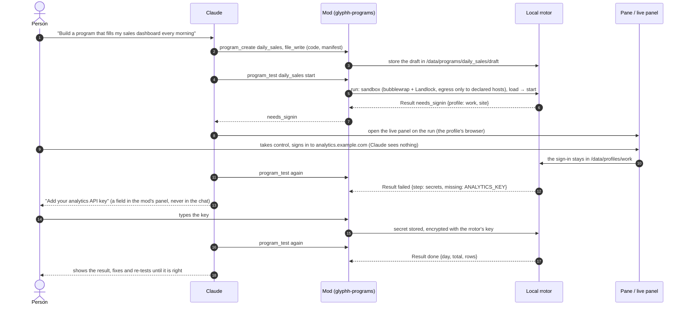

**State:** designed (programs mod and local rrotor not built).

### 2.2 Deploy: to the hosted rrotor, through git, and the routine

Each program is a repo in the person's GitHub account; a version is a commit. Git is required for hosted programs (the Glyphh GitHub App installed on their account); local programs need none.


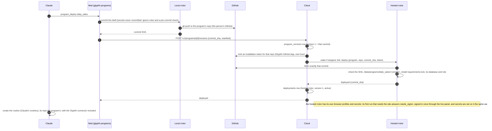

**State:** designed.

### 2.3 Update


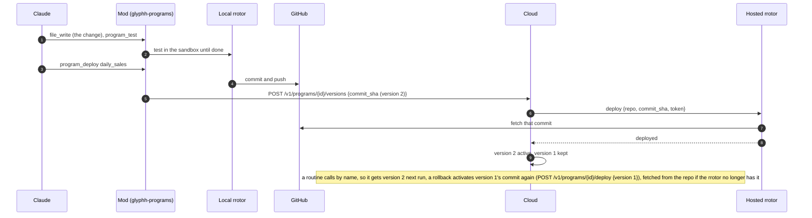

**State:** designed.

### 2.4 Run live, from Claude

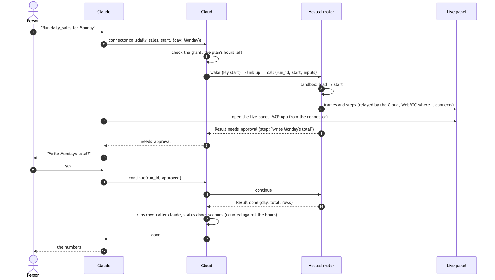

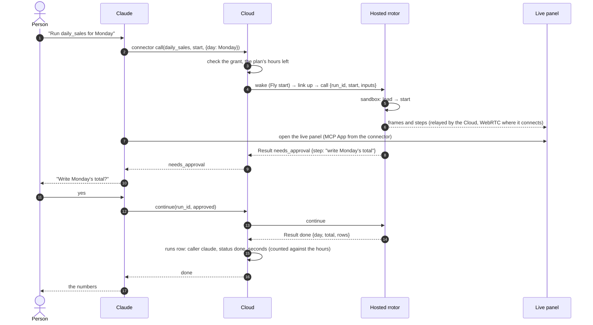

**State:** designed.

### 2.5 Run on a schedule, back through Claude, output to a dashboard

The routine is the runner. Claude in the routine calls the program, answers what it asks, and writes the result to a dashboard (an artifact in Claude with its own database).


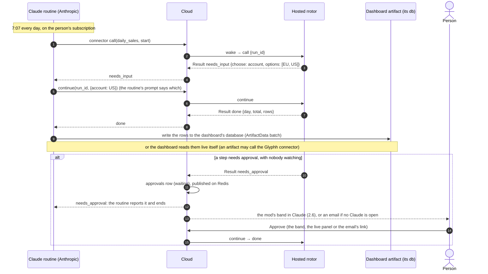

**State:** designed. To prove: a scheduled routine writing to an artifact's database unattended, and an artifact calling a custom connector.

### 2.6 Approvals, shown in Claude

A step that needs approval is a row in `approvals` (the record, kept until answered) and a signal on Redis (pub/sub, to whichever server process holds the person's connection). Redis runs on the server's own Fly machine, beside the server (Chris, 2026-10-14); in development it is a service in the server's `compose.yaml`. The `glyphh` mod holds one live connection while Claude is open and shows the approval itself, with no Claude turn.

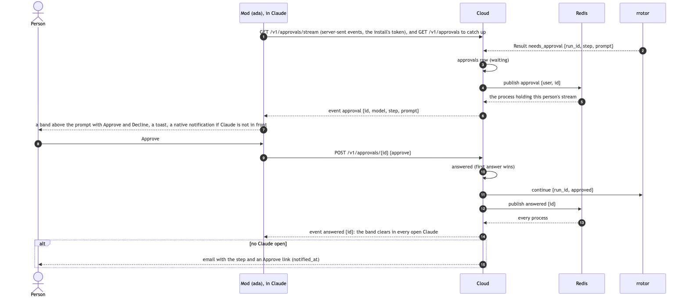

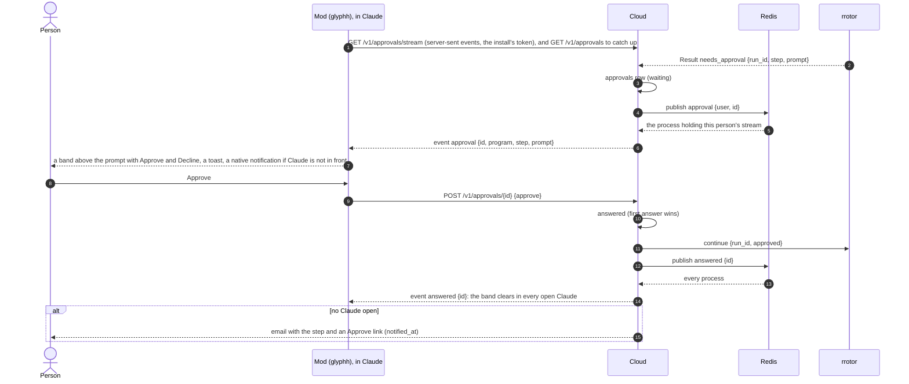

**State:** designed.

### 2.7 The Cloud starting a routine (calls back to Claude)

When something happens on Glyphh's side (a program finished, a page it watches changed, a waiting step was approved), the Cloud can start a routine through the routine's API trigger, with the data as its text.


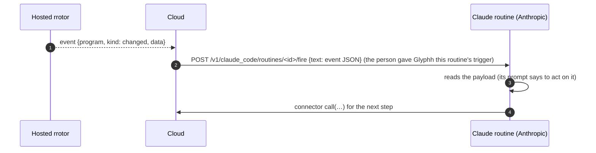

**State:** designed.

**How the Cloud calls a routine.** Through the routine's **API trigger**, the documented way to start a routine from outside Claude (Anthropic's routines documentation, checked 2026-10-14):

1. **The person adds an API trigger** to the routine at claude.ai/code/routines (Edit → Add another trigger → API) and generates its token. The token is shown once and starts **that routine only**: it is not a Claude login, so the Cloud never holds one.
2. **The person gives the Cloud the trigger** (its URL and token) in the programs mod, as they would a secret. The Cloud keeps it encrypted (`routine_triggers`, see [Server gaps](#server-gaps)).
3. **The Cloud fires it** when the program's event happens (a run finished, a watched page changed, a waiting step was approved):

```
POST https://api.anthropic.com/v1/claude_code/routines/<trigger id>/fire
Authorization: Bearer <the routine's trigger token>
anthropic-beta: experimental-cc-routine-2026-04-01
anthropic-version: 2023-06-01
Content-Type: application/json

{"text": "{\"program\": \"daily_sales\", \"event\": \"changed\", \"data\": {...}}"}
```

4. **Anthropic answers** `{"type": "routine_fire", "claude_code_session_id", "claude_code_session_url"}`; the Cloud records the session URL on the event, so the person can open the run.
5. **The routine runs** on the person's subscription. `text` reaches it wrapped as untrusted data (`<routine-fire-payload>`), so the routine's own prompt must say to act on it ("Act on the event in the payload: …"); the programs mod writes that line into the routines it creates.

- **Limits:** 30 fires an hour per routine (shared with Run now), 100 an hour per account; the Cloud holds fires past them and says so. A `401` means the token was regenerated or deleted: the trigger is marked broken and the person is asked for the new one.
- **Research preview:** request and response shapes may change behind a new dated beta header; the two previous header versions keep working, so the Cloud pins one header and moves deliberately.

## 3. What every call carries

| Between | How | Auth |
|---|---|---|
| Mod → Cloud | HTTPS, `/v1/...` | the install's token (Bearer) |
| Browser → Cloud sign-in pages | HTTPS | a short-lived cookie binding the browser to the sign-in |
| rrotor → Cloud | WebSocket `/v1/runtime/link`, outbound only | the runtime's token (Bearer header, never in a URL) |
| Cloud → rrotor | messages down the link: call, continue, cancel, deploy | the link itself |
| Claude / routines → Cloud | MCP over HTTPS, `/mcp` | the connector grant's token (OAuth) |
| Cloud → routine | HTTPS POST to `api.anthropic.com/v1/claude_code/routines/<id>/fire` | the routine's trigger token |
| Mod → local rrotor | MCP on `127.0.0.1` | a local token (proposed) |
| Stripe → Cloud | webhook | Stripe's signature |
| Mod ← Cloud | server-sent events, `/v1/approvals/stream` | the install's token |
| Cloud ↔ Redis | pub/sub, inside the cloud | the cloud's network |

## 4. rrotor, inside

One image, `ghcr.io/glyphh-ai/rrotor`, for both modes; `mode` (`local` or `hosted`) is the only difference, set at start.


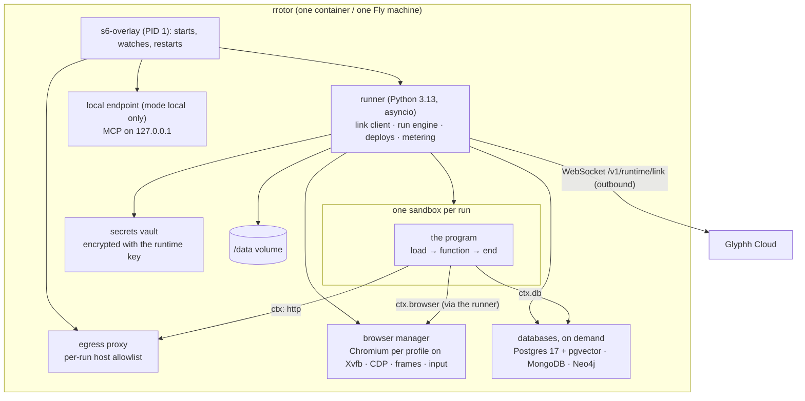

| Process | Job |
|---|---|
| **runner** | Holds the link (connects out, reconnects with backoff 1 s → 30 s, replays unacknowledged results), takes calls, deploys versions, launches each run in its sandbox, keeps runs that wait for `continue`, reports each run's seconds |
| **local endpoint** | `mode: local` only: the MCP server the mods call on `127.0.0.1:<port>` with the local token (programs, workspaces, RPA tools) |
| **egress proxy** | The only network a run has: lets through the hosts its manifest declares (HTTPS, by SNI), refuses and records anything else |
| **browser manager** | One headful Chromium per named profile on its own virtual screen (Xvfb), driven over CDP; started when a run or the live panel needs it, stopped after an hour idle; streams frames, takes the person's input while they hold control |
| **databases** | Started when a run of a program that declares them begins, stopped after; each program its own Postgres database and role, its own MongoDB database and user |
| **secrets vault** | Each program's secrets, encrypted at rest with the runtime key (`/data/keys/runtime.key`, 0600); decrypted into a run's environment only |

**The sandbox.** Each run starts with `bwrap`: new mount, PID, IPC, user and network namespaces; read-only `/usr`, the program's version mounted read-only, `/data/programs/<name>/files` writable, nothing else of `/data`; Landlock inside holds the same folders; `no_new_privs` and a seccomp filter; the only socket is the egress proxy's; a uid per program; memory, CPU and wall-clock limits per run (cgroups, `prlimit`). Tested on Docker Desktop on 2026-10-12 (Landlock ABI 6; bwrap needs `--security-opt seccomp=unconfined --security-opt systempaths=unconfined` in a container; on Fly the image is the VM and needs neither).

**`/data`:**

| Path | What |
|---|---|
| `keys/runtime.key` | The runtime key (secrets at rest), made on first boot |
| `runtime.json` | The runtime's id and token (0600) |
| `programs/<name>/<commit>/` | A deployed version: the checkout of that commit, its manifest and installed dependencies, immutable |
| `programs/<name>/draft/` | The version being built (local) |
| `programs/<name>/files/` | The program's own folder, the only one it sees |
| `secrets/<name>.enc` | Its secrets, encrypted |
| `db/` | Postgres, MongoDB, Neo4j data |
| `profiles/<name>/` | Named Chromium profiles: the sign-ins made in them |
| `runs/<run_id>/` | Each run's log, checkpoints and outputs |
| `workspaces/<slug>.json` | Workspaces (local) |
| `rpa/<slug>.json`, `rpa/log/` | RPA sites and sequences, what ran (local) |

**The image:** Debian 13 (trixie) slim; amd64 and arm64; s6-overlay; Python 3.13 (runner and programs), Node 22 LTS, Postgres 17 with pgvector, MongoDB 8, Neo4j 5 Community, Chromium, Xvfb, bubblewrap. Read-only root; everything kept on `/data`. A new version is a new image tag; the Cloud moves hosted rrotors to it (Fly Machines API), the mod moves the local one.

## 5. A program

### 5.1 What a program is

A git repo in the person's GitHub account; a version is a commit:

| File | What |
|---|---|
| `glyphh.json` | The manifest (below) |
| `program.py` | The module: `load`, the functions, `end` |
| `requirements.lock` | Its Python dependencies, pinned with hashes; installed into the version at deploy, never at run |
| `files/` | Optional seed files, copied into its folder on first deploy |

### 5.2 The manifest: `glyphh.json`

```json
{
  "name": "daily_sales",
  "version": 2,
  "description": "Yesterday's sales from analytics.example.com, for the sales dashboard",
  "python": "3.13",
  "functions": {
    "start": {
      "description": "Read a day's sales and store the total",
      "inputs": { "type": "object", "properties": { "day": { "type": "string", "format": "date" } } },
      "approvals": ["write"]
    }
  },
  "hosts": ["analytics.example.com", "api.analytics.example.com"],
  "secrets": ["ANALYTICS_KEY"],
  "databases": ["postgres"],
  "profiles": { "work": { "sites": ["analytics.example.com"] } },
  "limits": { "seconds": 300, "memory_mb": 512 },
  "connectors": ["slack"]
}
```

- **`functions`:** each callable function with a JSON Schema for its inputs and the named steps that need approval; `start` is the default.
- **`hosts`, `secrets`, `databases`, `profiles`:** everything a run may reach; nothing undeclared exists inside the sandbox.
- **`limits`:** per run, capped by the plan.
- **`connectors`:** the Claude connectors its routine needs (written into the routine, never used by the program).
- A version is **immutable**: a commit, identified by its SHA.

### 5.3 The SDK: `glyphh`

```python
from glyphh import Ctx, Result

Result.done(data)                                     # finished: data (JSON), files, links
Result.needs_input(prompt, schema=None, options=None) # a value or a choice
Result.needs_approval(step, detail)                   # about to act; continue answers it
Result.needs_signin(profile, site)                    # a site signed the program out
Result.failed(step, reason)                           # stopped, with why

ctx.inputs              # the call's inputs, checked against the manifest
ctx.answer              # the answer a continue brought (None on the first call)
ctx.http                # requests to declared hosts only
ctx.browser.open(profile, url)  # a page in a named profile (Playwright-style API)
ctx.db.postgres / ctx.db.mongo / ctx.db.neo4j   # its own databases
ctx.secrets["NAME"]     # declared secrets
ctx.files               # its folder
ctx.checkpoint(key, fn) # run fn once per run; a resumed run reads the stored value
ctx.log(message, **detail)
```

### 5.4 A run

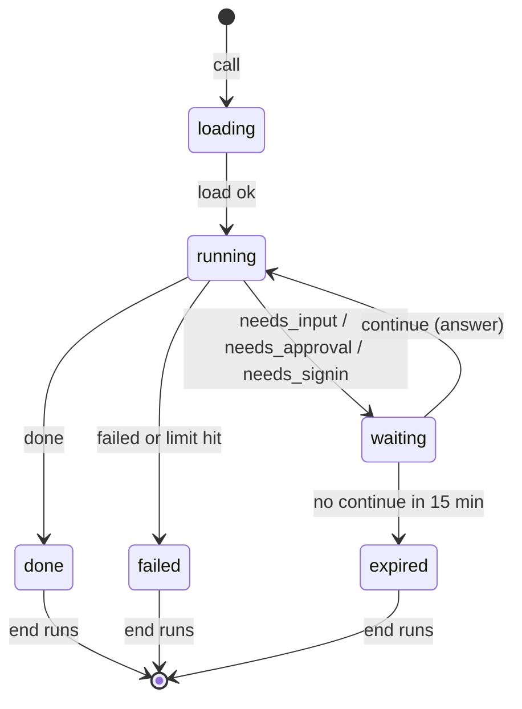

- **One run, many calls:** `call` opens a run (`run_id`); each `continue` resumes the same run, in the same process while it waits (up to 15 minutes), its checkpoints kept in `/data/runs/<run_id>/`.
- **`end` always runs**, on `done`, `failed`, a limit, a cancel or an expiry.
- **Every call returns a `Result`**, never an exception: a crash is `failed` with the error and the step.
- **Approvals:** a `needs_approval` the Cloud sees with nobody watching (a routine) waits in `approvals`; the person's answer is a `continue`.

## 6. The link: protocol 1

JSON messages over the WebSocket `/v1/runtime/link`, one per frame, each with `type` and an `id`. The rrotor connects out; the Cloud never connects in.

| Direction | `type` | Carries |
|---|---|---|
| rrotor → Cloud | `hello` | protocol 1, rrotor version, mode, runtime id, deployed versions |
| Cloud → rrotor | `welcome` | accepted, the plan's limits for runs |
| Cloud → rrotor | `call` | `run_id`, program, version (or active), function, inputs, caller |
| Cloud → rrotor | `continue` | `run_id`, answer |
| Cloud → rrotor | `cancel` | `run_id` |
| rrotor → Cloud | `result` | `seq`, `run_id`, `Result` (status, data; `needs_approval` also its step and prompt; `expired` or `cancelled` when a run ends without one), seconds so far |
| Cloud → rrotor | `deploy` / `activate` / `remove` | program, version, repo, commit SHA, a short-lived repo-scoped token (the rrotor fetches that commit from GitHub and checks the SHA) |
| rrotor → Cloud | `deployed` | program, version, commit SHA |
| Cloud → rrotor | `secret_set` | program, name, value encrypted to the rrotor's public key |
| Cloud → rrotor | `live_open` / `live_close` | `run_id` or profile: start or stop frames |
| rrotor → Cloud | `frame` | `run_id`, image (JPEG), sequence number |
| Cloud → rrotor | `input` | `run_id`, take control and give back, clicks, keys, paste |
| rrotor → Cloud | `event` | `seq`, program, kind, data, and the routine trigger to fire, if any (one of the program owner's) |
| both | `ping` / `pong` | every 20 s |
| both | `ack` | `of`: the `id` it acknowledges (the Cloud acks every result, event and `deployed`) |

- **Order and replay:** results and events carry a sequence number, one rising counter per runtime for both; the rrotor keeps the unacknowledged ones on `/data` and replays them after a reconnect, and the Cloud applies each number once, so nothing is lost or doubled. A new runtime token (a fresh `/data`) starts the counter again.
- **Frames** are best effort: dropped under pressure, never queued.
- **A different protocol** is closed with code 4426 and an update is asked for.
- **Closes:** 4401 the token is not valid or its install was signed out (do not retry with it); 4400 the first message was not a good `hello` for this runtime (sent within 10 s); 4408 nothing heard for three pings; 4409 a newer link of the same runtime took over (do not reconnect); 1011 the Cloud could not record a message (reconnect and replay); 1012 the server is restarting (reconnect).

## 7. The mod and the local rrotor

The programs, workspaces and RPA mods call the local rrotor's MCP endpoint (`mode: local`):

| Tools | For |
|---|---|
| `program_create`, `file_read`, `file_write`, `program_test`, `program_deploy`, `program_versions`, `program_activate` | Building, testing and deploying programs |
| `secret_set`, `profile_list`, `profile_create`, `live_open` | Secrets, profiles, the live panel |
| `workspace_*` | Workspaces |
| `profile_*`, `page_read`, `page_act`, `record_start`, `record_stop`, `site_save`, `sequence_save`, `run`, `log_read` | RPA |

Deploying goes through git: the local rrotor pushes a commit to the program's repo, the Cloud records it (`POST /v1/programs/{id}/versions`) and hands the hosted rrotor the commit and a short-lived token to fetch it.

## 8. The server, checked

Every call above against what the server has (branch `relaunch`):

| Need | Server today |
|---|---|
| Device sign-in, installs by machine, license | Built |
| Identities, linking | Built |
| Plans, mods, Stripe checkout and webhook | Built |
| Tables: `rrotors`, `programs`, `program_versions`, `deployments`, `runs`, `approvals`, `connector_grants` | Built (tables only) |
| `/v1/runtime/link` (protocol 1; waking a stopped hosted runtime on Fly not built) | Built |
| `/v1/programs`, `/v1/runs`, `/v1/runtime`, `/mcp` and its OAuth | Designed, not built |

### Settled in the server's design (2026-10-14)

What the flows needed that the server's design did not have; now in it, so the infrastructure stays fixed while rrotor is built:

1. **Local runtimes:** `POST /v1/runtime/local` gives a local rrotor its runtime token; `rrotors` has a `mode` (`hosted` or `local`) and a local one is keyed by its install.
2. **Routine triggers:** `routine_triggers` (name, fire URL, token encrypted, status) and `/v1/routine-triggers`.
3. **Program events:** `program_events` (kind, the routine trigger it fired, the session URL).
4. **Versions through git:** each program a repo in the person's GitHub; `program_versions.commit_sha` is the version's identity; the Glyphh GitHub App's installation (`github_installations`) mints a short-lived token per deploy. No code is kept in Glyphh's cloud.
5. **Approval email:** `approvals.notified_at`.
6. **The connector's Allow page.**
7. **No bundle storage:** `bundle_ref` is gone.

## Open

- **How the mods reach the local rrotor** (1.2): a local MCP server on `127.0.0.1` with a local token (proposed), or through the Cloud over the same link as the hosted one.
- **The live panel's transport:** frames over the link and the relay first; WebRTC end to end later.
- **Secrets on the hosted rrotor:** set again there (2.2), or carried from the local one encrypted to the hosted rrotor's key.
- **The Glyphh GitHub App's permissions:** repository contents (read and write, for the person's program repos) and metadata; the person picks which repos it may reach.
- **Per-program isolation in Neo4j:** the free edition holds one database.
