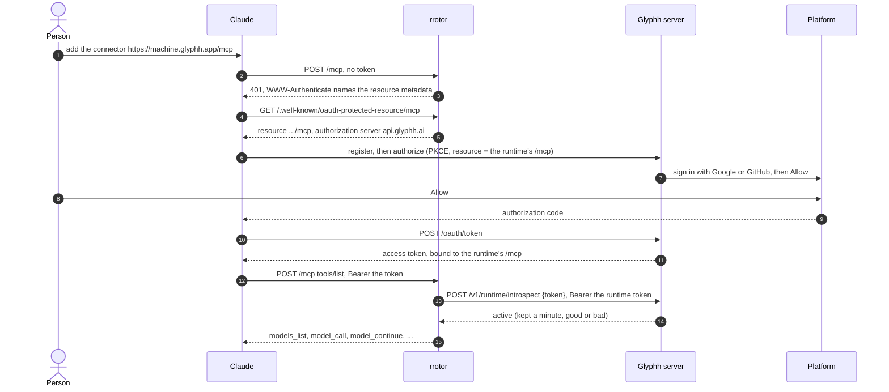
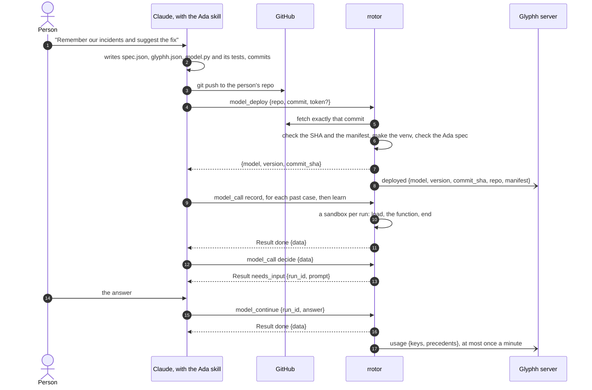
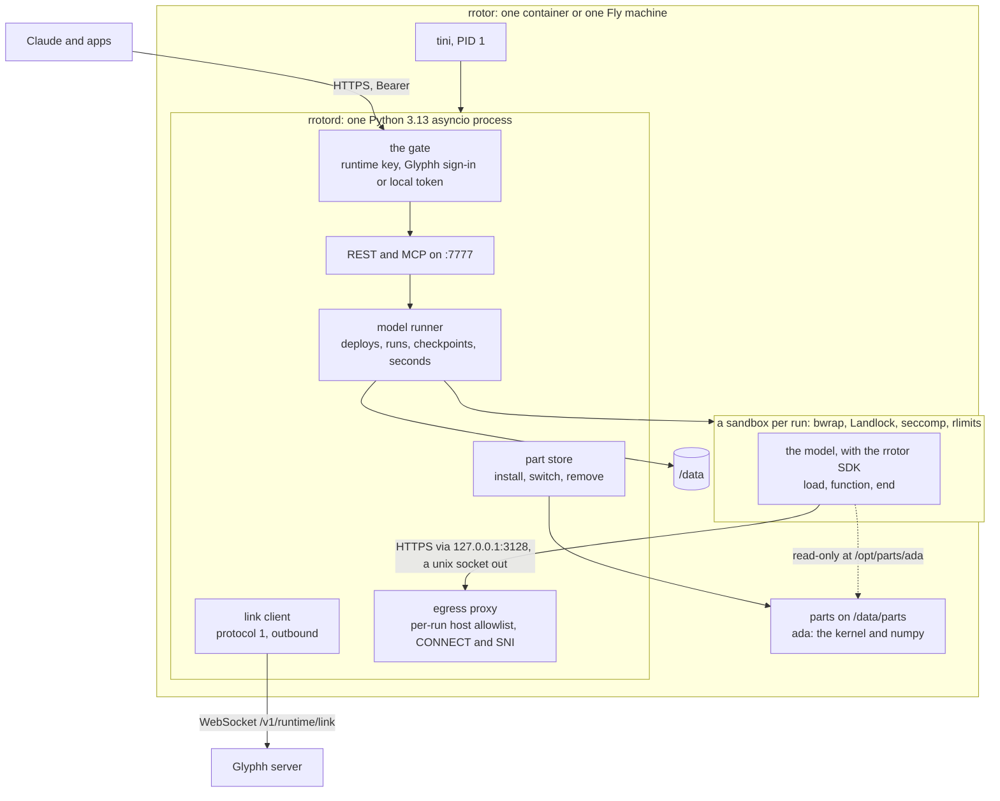
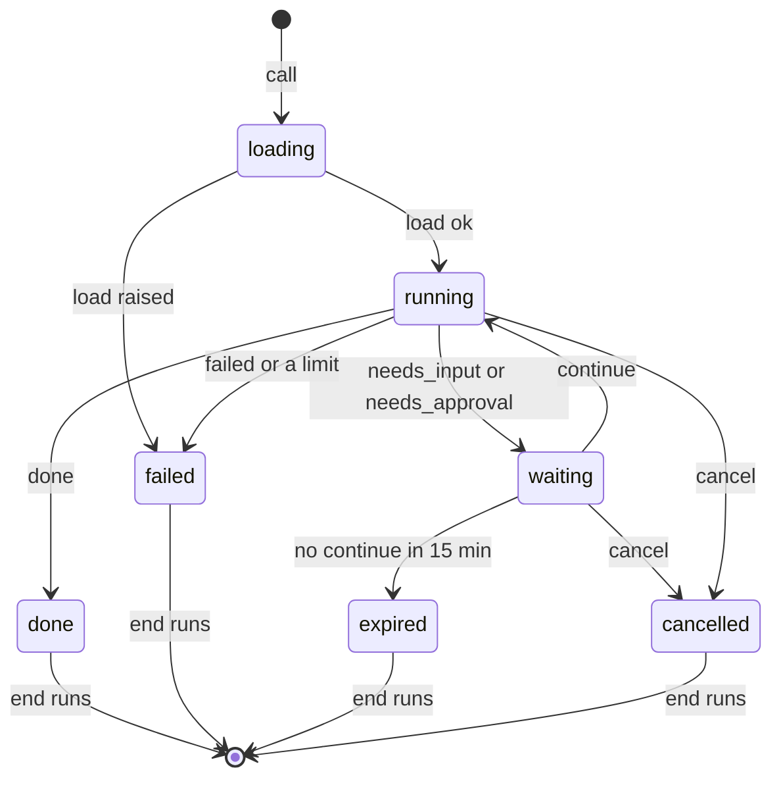

# rrotor architecture

rrotor is the runtime a person's Ada models run in: one headless Linux image that deploys a model by commit, runs
each call in a sandbox with no network but the hosts it declares, and answers over REST and MCP at its own address.
This document is how its parts work and call each other. The system around it (accounts, plans, the data model,
provisioning) is in `glyphh-ai/server`, `docs/architecture.md`; running your own is in
[`self-hosting/`](self-hosting/README.md). What is decided but not built is in [Not built yet](#not-built-yet) and
nowhere else.

## 1. The parts

| Part | What it is |
|---|---|
| **Claude** | Claude Code, the Claude apps or any MCP client. It has the runtime as a connector and, with the `glyphh` plugin (`glyphh-ai/glyphh`), the Ada skill: how to write, deploy and call an Ada model with the runtime's own tools |
| **Apps** | Anyone's software, calling the runtime's REST API with a runtime key, directly or through the SDKs (`glyphh` on PyPI, `@glyphh-ai/glyphh` on npm, both in `glyphh-ai/glyphh`) |
| **rrotor** | This repo: the daemon `rrotord` and the model SDK `rrotor`, in the image `ghcr.io/glyphh-ai/rrotor`. One per volume |
| **The Glyphh server** | `https://api.glyphh.ai`: provisions hosted machines, makes runtime keys and runtime tokens, signs the licence, vouches for a Glyphh sign-in, and holds the runtime's link. Never on the data path |
| **The platform** | `https://platform.glyphh.ai`: where a person makes and starts machines, makes runtime keys, registers a self-hosted runtime and issues an offline licence |
| **Fly** | Hosts the hosted machines: one app, `*.glyphh.app`, a machine and a volume per runtime, and the doorman |

One image, five modes, set by `RROTOR_MODE` at start (`rrotord/config.py`):

| Mode | Where | Reached at | Callers authenticate with |
|---|---|---|---|
| `hosted` | A Fly machine the server made | `https://<machine>.glyphh.app` | A runtime key or a Glyphh sign-in |
| `self` | The owner's own machine, cluster or cloud ([12](#12-self-hosting)) | `https://<public host>`, TLS ended in front | A runtime key or a Glyphh sign-in (a key alone with the link off) |
| `doorman` | One always-on Fly machine per app | Every `*.glyphh.app` request's first hop | Nobody: it only replays ([3](#3-hosted-machines)) |
| `local` (the default) | Any container host | `127.0.0.1:<port>` only | A local token, held as its SHA-256 (`RROTOR_LOCAL_TOKEN_SHA256`); the runtime token is handed in with `PUT /v1/runtime/token` |

rrotor has no sign-in of its own and nothing to log into. It connects out to the server (the link, [6](#6-the-link-protocol-1));
the server never connects in. A call goes from the caller to the runtime and back: nothing of Glyphh's sees its
inputs or its answer.

## 2. A model, end to end

### 2.1 Adding the runtime to Claude

The person adds the runtime's address as a custom connector (Settings, Connectors), once. The runtime is an OAuth
protected resource (RFC 9728) whose authorization server is the Glyphh server, so Claude signs the person in to
Glyphh with one Allow click and no key.




An app sends a runtime key instead (`Authorization: Bearer <key>`), made on the platform's Keys page; rrotor holds
only the keys' SHA-256s ([7](#7-the-api)).

### 2.2 Build, deploy and call

A model is a GitHub repo; a version is a commit. Claude, following the Ada skill, writes the model with the person,
pushes it, and deploys the commit through the runtime's own MCP.




- **Deploy by commit:** `model_deploy` (and `POST /v1/models/deploy`) takes `{repo, commit, token?}`: `repo` is
  `owner/name` on GitHub, `commit` the full 40-character SHA, `token` for a private repo. rrotor fetches that one
  commit (depth 1), checks its SHA, reads `glyphh.json` ([5.2](#52-the-manifest-glyphhjson)), makes a venv from
  `requirements.lock` (binary wheels only, with hashes: no model code runs outside the sandbox, not even a package's
  setup) and makes the version active. The REST route also takes `{bundle, commit}`, a git bundle of the commit in
  base64, up to 64 MB. The server can deploy too, down the link, with a short-lived token from the Glyphh GitHub
  App.
- **Every deploy is reported** up the link as `deployed`, however it was asked for, so the server records every
  model and version on the runtime.
- **The samples:** `examples/ada_incidents/` and `examples/ada_tickets/` are Ada models ([8](#8-ada));
  `examples/daily_sales/` is a model that needs no part, used to test the base end to end: it reads a sales export
  from its folder, converts the total with one declared host, asks approval for its `write` step and writes a
  ledger.

## 3. Hosted machines

A person's hosted runtimes are machines on Fly, made and run from the platform (or the Glyphh connector's
`create_runtime` and `start_runtime`), each named and of a size (small, medium, large). The server makes them; the
sizes, the billing and the machine routes are in the server's `docs/architecture.md`.


- **The address is the machine:** `https://<machine>.<RROTOR_PUBLIC_DOMAIN>` (`glyphh.app`), the machine id from
  Fly's `FLY_MACHINE_ID`. A request for another machine's address is answered `fly-replay: instance=<machine>`;
  Fly's proxy replays it there, starting that machine if it is stopped. The **doorman** (`RROTOR_MODE=doorman`,
  `rrotord/doorman.py`) answers every request that way and `/healthz` itself, so nobody's machine is woken to
  bounce someone else's request. Any other `Host` is 421 `E_HOST`. `fly-replay` carries bodies up to 1 MB.
- **The token and the keys:** the runtime token is in the machine's environment, so nobody hands anything in. The
  runtime keys' SHA-256s arrive in `welcome` and as `keys` whenever they change; the licence arrives in `welcome`.
- **In development**, `RROTOR_PUBLIC_HOST` (an ngrok name, say) is the one exact host instead, and nothing is
  replayed.

## 4. rrotor, inside




| Piece | Job |
|---|---|
| **gate** | Who may call, by mode ([7](#7-the-api)); counts each request a runtime key let in |
| **REST and MCP** | One set of operations (`api/ops.py`) behind both ([7](#7-the-api)) |
| **link client** | Connects out, reconnects with backoff (1 s to 30 s, with jitter), replays what is not acknowledged ([6](#6-the-link-protocol-1)) |
| **model runner** | Launches each run in its sandbox, keeps a waiting run's worker up to 15 minutes, runs `end` always, counts each run's seconds |
| **egress proxy** | A run's only network: an HTTP `CONNECT` proxy on a unix socket per run; lets through port 443 of the hosts the manifest declares when the TLS SNI matches, refuses addresses that resolve to loopback, private or link-local ranges, and records what it refuses |
| **part store** | Checks a part's hash and signature, unpacks it, switches it in one rename ([10](#10-parts)) |

There is no s6 and no other process: everything is `rrotord` under `tini`.

**The sandbox.** Each run is one worker process started with `bwrap`:

| Layer | What it holds |
|---|---|
| **bubblewrap** | New user, mount, PID, IPC, UTS, cgroup and network namespaces; `--die-with-parent`, `--new-session`, `--clearenv`. Read-only `/usr` (and its `/lib`, `/bin` links), the version's code at `/model`, its venv at `/venv`, the SDK at `/opt/rrotor`, each part it needs at `/opt/parts/<name>`; writable `/files` (the model's folder), `/data` (its data folder, when the manifest asks) and a private `/tmp`. The network namespace has only loopback |
| **Landlock** | Applied by the worker before it imports the model: read only the read-only mounts, write only the writable ones; on ABI 4 and later, TCP only to `127.0.0.1:3128`; on ABI 6, no abstract unix sockets or signals outside the sandbox. A kernel without Landlock refuses runs |
| **seccomp** | A filter built with libseccomp and handed to `bwrap --seccomp`: `ptrace`, `mount`, `unshare`, `setns`, `bpf`, `perf_event_open`, `userfaultfd`, `keyctl`, `io_uring_*`, kernel modules, `kexec`, clocks, `reboot` and others refused; new user namespaces refused; sockets only `AF_UNIX`, `AF_INET`, `AF_INET6`. `no_new_privs` is set |
| **egress** | Inside the namespace the worker forwards `127.0.0.1:3128` to the run's proxy socket, so `HTTPS_PROXY` works for any library |
| **limits** | `prlimit`: data size (the manifest's `memory_mb`), CPU seconds, open files, file size, no core files; the runner's wall clock (`limits.seconds`) kills the run |

- **Every layer is checked at start** and shown in `GET /v1/health`; a layer that cannot work makes rrotor refuse
  runs (`E_SANDBOX_UNAVAILABLE`, naming the layer and why). Nothing is skipped silently. A self-hosted rrotor also
  says what its container lacks ([12](#12-self-hosting)).
- **In a container**, bwrap needs seccomp, AppArmor and `/proc` unconfined (`--security-opt seccomp=unconfined
  --security-opt apparmor=unconfined --security-opt systempaths=unconfined`), and on Ubuntu 23.10 and later the
  host's `kernel.apparmor_restrict_unprivileged_userns=0`. rrotor's own seccomp filter then holds each run. Why,
  exactly: [self-hosting](self-hosting/README.md#the-containers-privileges-and-why). A Fly machine is a Firecracker
  VM, so none of this applies there.
- **No cgroups per run:** memory and CPU are held by `prlimit` and the wall clock.

**`/data`**, the one volume:

| Path | What |
|---|---|
| `runtime.json` | The runtime's id and token (0600) |
| `access.json` | The runtime keys' SHA-256s |
| `licence.json`, `licence.token` | The licence held; an offline licence handed in as a file |
| `machine-id` | A self-hosted rrotor's machine id, where the host gives none |
| `link/outbox.json` | The sequence counter and what is not yet acknowledged |
| `models/<name>/versions/<commit>/` | A deployed version: `src/` (the checkout), `venv/`, `version.json`; immutable |
| `models/<name>/active.json` | Which version is active |
| `models/<name>/files/` | The model's own folder, seeded from the commit's `files/` on its first deploy |
| `models/<name>/data/` | Its persistent data, outside git (an Ada model's `precedents.sqlite`) |
| `runs/<run_id>/` | Each run's `run.json` (with its checkpoints) and `log.jsonl` |
| `parts/<name>/<version>/`, `parts/<name>/current` | An installed part, and the version in use |

**The image** (`image/Dockerfile`): Debian 13 (trixie) slim, amd64 and arm64; `tini`, Python 3.13 (Debian's),
Node 22, git, bubblewrap, libseccomp, util-linux (`prlimit`), CA certificates. No browser, no database. It runs as
`rrotor` (uid 10001) on a read-only root with a tmpfs `/tmp`; everything kept is on `/data`. The published image
is the `hosted` target: the base with the Ada part in `/opt/parts-builtin`, installed at boot ([11](#11-the-image-and-ci)).

## 5. A model

### 5.1 What a model is

A git repo; a version is a commit.

| File | What |
|---|---|
| `glyphh.json` | The manifest |
| `model.py` | `load`, the functions, `end` |
| `requirements.lock` | Optional: its Python dependencies, pinned with hashes, installed at deploy, never at run |
| `files/` | Optional: seed files, copied into its folder on the first deploy |
| `spec.json` | An Ada model's spec ([8](#8-ada)) |

### 5.2 The manifest: `glyphh.json`

```json
{
  "name": "incidents",
  "description": "An app's incidents, remembered: the fix for a new error",
  "python": "3.13",
  "functions": {
    "record": { "inputs": { "type": "object", "required": ["data"] } },
    "decide": { "inputs": { "type": "object", "required": ["data"] } },
    "start": {}
  },
  "needs": ["ada"],
  "data": true,
  "limits": { "seconds": 300, "memory_mb": 512 }
}
```

| Key | What |
|---|---|
| `name` | `^[a-z][a-z0-9_]{0,62}$`; a deploy names the model by it |
| `version` | Optional, 1 or more |
| `description`, `python` | Free text; `python` must be `3.13` |
| `functions` | Each callable function: `description`, `inputs` (a JSON Schema the call's inputs are checked against, `E_INPUTS`), `approvals` (the steps that may ask). At least one; `load` and `end` are not functions |
| `hosts` | The hosts a run may reach on 443 (`*.example.com` allowed) |
| `needs` | The parts it imports from, by name (`["ada"]`) ([10](#10-parts)) |
| `data` | `true` mounts its persistent data folder at `/data` |
| `limits` | `seconds` (1 to 3600, default 300) and `memory_mb` (64 to 8192, default 512) per run |
| `secrets`, `databases`, `connectors` | Accepted and kept; nothing uses them yet ([Not built yet](#not-built-yet)) |

A deploy refuses (`E_MANIFEST`) a manifest with an unknown key, a bad value, or a function `model.py` does not
define (read from its syntax tree: no model code runs outside the sandbox).

### 5.3 The SDK: `rrotor`

The `rrotor` package, standard library only, ships in the image and is mounted read-only into every sandbox at
`/opt/rrotor`: models import it and never install it.

```python
from rrotor import Ctx, Result, ada

Result.done(data)                                     # finished, with data (JSON)
Result.needs_input(prompt, schema=None, options=None) # a value or a choice
Result.needs_approval(step, prompt)                   # about to act; a continue answers it
Result.failed(step, reason)                           # stopped, with why

ctx.inputs                    # the call's inputs, checked against the function's schema
ctx.answer                    # what the last continue brought (None on the first call)
ctx.ask_approval(step, prompt) -> bool   # True once approved, False if declined; until then the run waits
ctx.needs_input(prompt, schema=None, options=None, key=None)   # the answer once given; until then the run waits
ctx.checkpoint(key, fn)       # fn runs once per run; a resumed run reads the stored value
ctx.http                      # HTTPS to the declared hosts (any library works too: HTTPS_PROXY is set)
ctx.files                     # its folder, a pathlib.Path
ctx.data                      # its persistent data folder ("data": true), else None
ctx.home                      # its code (spec.json beside model.py)
ctx.clearance                 # who asks, 0 to 1; 1 unless the call says
ctx.caller                    # who called
ctx.limits                    # the plan's limits for the part it uses (Ada: precedents)
ctx.log(message, **detail)
ctx.today(), ctx.yesterday()  # UTC dates, YYYY-MM-DD
ada.open(ctx)                 # an Ada model: the spec and the store, on ctx.ada (8)
```

- **Approvals and inputs are re-entrant.** A `continue` calls the same function again with the same inputs: steps
  done are skipped by `ctx.checkpoint`, and `ctx.ask_approval(step, …)` then answers the decision for that step
  (`{"approved": true}`). A step not named in the function's `approvals` fails the run (`E_STEP_UNDECLARED`).
- **`rrotor.testing`** gives a model's own tests a `Ctx` with no sandbox (`Harness`): inputs, answers, a folder, and
  an `http` that answers what the test says.

### 5.4 A run




- **One run, many calls:** a call opens a run (`run_id`); each `continue` resumes it in the same worker while it
  waits (up to 15 minutes). If the worker is gone (rrotor restarted), a `continue` starts a new one: `load`, then
  the function, its checkpoints read back.
- **`end` always runs**, on `done`, `failed`, a limit, a cancel or an expiry.
- **Every call answers a `Result`**, never an exception: a crash is `failed` with the error and the step.
- **Seconds** are the time a run spent running, not waiting.

## 6. The link: protocol 1

JSON messages over the WebSocket `{RROTOR_SERVER}/v1/runtime/link` (`Authorization: Bearer <runtime token>`, never
in a URL), one per frame, each with `type` and `id`. rrotor connects out; the server never connects in.

| Direction | `type` | Carries |
|---|---|---|
| up | `hello` | protocol 1, rrotor's version, mode, runtime id, the versions deployed |
| down | `welcome` | accepted; for a hosted or self-hosted runtime, the licence (`licence: {payload, signature}`, `kind: link`, 24 hours; `grace_days: 14` for a self-hosted one) and the runtime keys' SHA-256s (`keys`, the whole list) |
| down | `keys` | `hashes`: the whole list again, whenever a key is made, revoked or expires |
| down | `deploy`, `activate`, `remove` | model, version, commit SHA, `repo` and a short-lived `token` (null for a commit the runtime already holds) |
| down | `continue` | `run_id`, `answer` |
| down | `call`, `cancel` | `run_id`, model, version, function, inputs, caller, clearance; `cancel` the `run_id`. Handled; the server sends neither |
| down | `pause`, `resume` | Handled (a paused hosted runtime answers 402 `E_LIMIT` to all but `/healthz`); the server sends neither |
| up | `result` | `seq`, `run_id`, the `Result`, seconds: only for a run a `call` opened |
| up | `deployed` | model, version, commit SHA, `repo` (null unless from a repo), `manifest`; after **every** deploy, by any route; not numbered, kept until acknowledged |
| up | `event` | `seq`, model, kind, data: `deploy_failed` `{version, commit_sha, code, message}` when a `deploy` or `activate` cannot be done |
| up | `usage` | `seq`, `keys` (each runtime key that let a request in: `{key_sha256, calls, last_used_at}`), `precedents` (the runtime's total across its Ada models) |
| both | `ping`, `pong` | every 20 s |
| both | `ack` | `of`: the `id` acknowledged (the server acks every `result`, `event`, `usage` and `deployed`) |

- **Order and replay:** `result`, `event` and `usage` share one rising sequence number per runtime; rrotor keeps
  the unacknowledged ones on `/data` and replays them after a reconnect, and the server applies each number once.
  A new runtime token starts the counter again.
- **Closes:** 4401 the token is not good (rrotor stops: `refused`); 4409 a newer link of the same runtime took over
  (`replaced`); 4426 another protocol (`upgrade_needed`); 4400 the first message was not a good `hello`
  (`bad_hello`); 4408 nothing heard for three pings, 1011 the server could not record a message, 1012 the server is
  restarting, and any other close or a dropped connection: reconnect with backoff. A `welcome` not heard within
  10 s of `hello` closes and reconnects.
- **`usage`, and never more:** the gate counts, in memory, one call per request a runtime key let in (a 401 or 402
  is not a call; a Glyphh sign-in or the local token is no key). Every 60 s, when there were calls or the
  precedents are due, one numbered `usage` goes up; the daemon flushes once more when it stops. Calls in the minute
  before a crash are lost. Never a call's inputs, outputs or the key itself:

  ```json
  {"type": "usage", "id": "<hex>", "seq": 7, "keys": [{"key_sha256": "<hex>", "calls": 2, "last_used_at": "2026-10-18T09:00:00+00:00"}], "precedents": 1200}
  ```

- **`precedents`:** every model with a version that needs `ada` has its store counted without the kernel and
  without writing (`rrotor.ada.count`, `rrotord/precedents.py`), every nine minutes on the minute's tick. The total
  is due once after each start and then whenever it differs from the one last reported (with `keys: []` if there
  were no calls). A store that does not read is logged and the reading before stands; until one has read, `usage`
  carries no `precedents`.
- **`secret_set`** is parsed and logged `E_NOT_BUILT`; the link stays.
- **Runs called at the runtime's address** stay on it: their results never go up the link.
- **The link off** (`RROTOR_LINK=off`, self-hosted only) means no link, no heartbeat and no introspection.

## 7. The API

One API, REST and MCP, behind one gate (`api/gate.py`). Refusals are `{"error": {"code", "message"}}` with a
stable code.

**The gate, by mode:**

- **Hosted and self-hosted:** `Authorization: Bearer` with a **runtime key** (its SHA-256 among those in
  `/data/access.json`: from `RROTOR_KEYS_SHA256` at first, then the whole list from the link; every hash compared
  in constant time) **or a Glyphh sign-in** (the server's token for this runtime's `/mcp`; rrotor asks
  `POST /v1/runtime/introspect` with its runtime token, `rrotord/introspect.py`, and keeps the answer a minute,
  good or bad). With the link off, only a runtime key. A hosted rrotor answers only its own address
  ([3](#3-hosted-machines)); a self-hosted one only `RROTOR_PUBLIC_HOST`; any other `Host` is 421 `E_HOST`.
- **Open:** `GET /healthz`, and `GET /.well-known/oauth-protected-resource` (and `…/mcp`): `{resource:
  https://<address>/mcp, authorization_servers: [RROTOR_SERVER], scopes_supported: [account]}`. A refusal is 401
  with `WWW-Authenticate: Bearer resource_metadata="https://<address>/.well-known/oauth-protected-resource/mcp",
  scope="account"` (and `error="invalid_token"` when a token was sent), which is how Claude finds where to sign in.
- **Local:** `Host` must be `127.0.0.1:<port>` or `localhost:<port>`, an `Origin` other than those is refused (no
  web page may call it), and the bearer is the local token, compared by its SHA-256 in constant time.

**REST:**

| Call | Does |
|---|---|
| `GET /healthz` | `{ok: true}` while the process is up |
| `GET /v1/health` | Version, mode, runtime id, the link's state (`no_token`, `connecting`, `online`, `backoff`, `refused`, `replaced`, `upgrade_needed`, `bad_hello`, `off`), each sandbox layer (self-hosted: `container_needs`), the parts, the licence and its state, the last heartbeat (self-hosted), how many keys it holds, runs waiting for approval, the number of models |
| `GET /v1/models` | Each model, its versions (number, commit, when), the active one, its functions |
| `POST /v1/models/deploy` | `{repo, commit, token?}` or `{bundle, commit}` ([2.2](#22-build-deploy-and-call)): `201 {model, version, commit_sha, deployed_at}` |
| `POST /v1/runs` | `{model, function?, inputs?, version?, clearance?}` (`function` defaults to `start`, `clearance` to 1): opens a run and answers its first `Result`: `{run_id, model, version, function, status, data, step, prompt, seconds}` |
| `POST /v1/runs/{id}/continue` | `{answer}`: the next `Result` |
| `POST /v1/runs/{id}/cancel` | Stops it; `end` runs; `cancelled` |
| `GET /v1/runs/{id}` | Status, function, times, seconds, the last `Result` |
| `GET /v1/runs/{id}/log` | The run's log lines |
| `GET /v1/approvals` | Runs waiting for approval: run, model, step, prompt, when |
| `GET /v1/parts`, `POST /v1/parts`, `DELETE /v1/parts/{name}` | The parts installed; install one (`{name, version, sha256, signature, archive \| url}`); remove one ([10](#10-parts)) |
| `GET /v1/licence`, `PUT /v1/licence` | The licence held; hand one in as `{payload, signature}`, `{token}` or the offline token as the body; `kept: false` when the one held lives longer ([9](#9-the-licence)) |
| `PUT /v1/runtime/token` | `{runtime_id, token}`: a runtime token handed in (a local runtime's way to get one); kept in `/data/runtime.json`, and the link reconnects with it |

**MCP:** `POST /mcp`, Streamable HTTP, stateless, one JSON-RPC message per POST; MCP 2026-07-28 (`server/discover`,
each request's `_meta` naming the version) and the `initialize` revisions 2025-11-25, 2025-06-18 and 2025-03-26
(`api/mcp.py`). Its tools are the same operations as the routes:

| Tool | Does |
|---|---|
| `models_list` | The models, their versions, the active one, its functions |
| `model_deploy` `{repo, commit, token?}` | A commit of a GitHub repo as the model's next version |
| `model_call` `{model, function?, inputs?, version?, clearance?}` | Opens a run: the first `Result`, with its data |
| `model_continue` `{run_id, answer}` | The next `Result` |
| `model_cancel` `{run_id}` | Stops a run |
| `run_status`, `run_log` `{run_id}` | A run's status and last `Result`; its log lines |
| `approvals` | The runs waiting for the person's approval |

A refusal is a tool error carrying the API's `{error}`.

## 8. Ada

An Ada model is a typed spec and a precedent store, run as a model: a repo with `glyphh.json` (`"needs": ["ada"]`,
`"data": true`), `spec.json` (what a case looks like, its `seed` and `dimension`) and `model.py`, whose functions
call the kernel through `rrotor.ada`. How to write one is the Ada skill (`glyphh-ai/glyphh`,
`plugins/glyphh/skills/ada/SKILL.md`); the kernel is `glyphh-ai/ada-private`.

```python
from rrotor import Result, ada

def load(ctx):
    ada.open(ctx)          # the spec read, the store opened: the kernel's Model on ctx.ada

def record(ctx, inputs):
    return Result.done({"id": ctx.ada.record(inputs["data"], inputs.get("outcome"))})

def query(ctx, inputs):
    return Result.done(ctx.ada.query(inputs["data"], clearance=ctx.clearance).to_json())
```

- **The part:** the kernel and numpy, built into the published image and installed at boot ([10](#10-parts)); a
  model imports them because its manifest needs `ada`.
- **The store** is `precedents.sqlite` in the model's data folder (`/data/models/<name>/data`, mounted at `/data`),
  so it outlives every version.
- **Checked at deploy:** an Ada model without `"data": true` or without a readable `spec.json` is refused
  (`E_MANIFEST`). A changed encoding (the spec's `seed` or `dimension`) between the active version and the new one
  makes rrotor run `rrotor.ada.reencode` in the new version's sandbox before it goes active: every precedent's glyph
  rebuilt from its recorded situation. If that fails, the deploy is refused (`E_ADA_ENCODING`), the version before
  stays active and the new one is not kept.
- **`clearance`** (0 to 1) comes with the call (`clearance` on `POST /v1/runs` and `model_call`), never from the
  inputs; the model passes `ctx.clearance` to the kernel, which cuts what a reader below a layer's
  `security_weight` may see.
- **The precedent cap:** the licence's `mods.ada.limits.precedents`, the plan's managed precedents on a hosted
  runtime and null (unlimited) on a self-hosted or local one. rrotor holds the runtime's **total** to it: when an
  Ada run starts, the runner counts the other Ada models' stores and hands the run `limits.precedents_elsewhere`
  beside `limits.precedents`, and `record` is refused (`E_LIMIT_PRECEDENTS`) once the model's own count plus that
  would pass the cap. Nothing is counted on the hot path, so runs of different models at the same time can
  overshoot by what they record meanwhile; the next run of each is refused. A store that does not read counts none
  (logged).
- **Size:** about 16 KB of RAM per precedent.
- **The examples,** each with its tests on `rrotor.testing.Harness` and the kernel in `tests/kernel/`:
  `examples/ada_incidents/` (an app's incidents: the fix for a new error, and the nearest precedent's cause, owner
  and runbook for a cleared caller) and `examples/ada_tickets/` (support-ticket triage). Both have `record`,
  `query`, `facts`, `probabilities`, `learn` (weights and calibration from the store's own precedents),
  `settings` (the model's levers, read or changed live), `decide` (asks for the outcome when no answer is good
  enough) and `start`.

## 9. The licence

The plan's licence, signed by the server with Ed25519 over the payload's canonical JSON, checked by rrotor with
`RROTOR_LICENCE_PUBLIC_KEY` (baked into the published image) and no network request (`rrotord/licence.py`). Its
payload: `user_id`, `org_id`, `install_id` (null), `plan`, `limits` (`machines`), `features`
(`{sync, ha, offline, sso}`, each a flag), `mods` (each active mod with its limits: `ada` with `precedents`),
`expires_at`, and for a runtime `runtime_id`, `licence_id`, `kind` and `grace_days`.

| Comes as | `kind` | Lasts |
|---|---|---|
| `welcome`, on each link connect | `link` | 24 hours; 14 days' grace for a self-hosted runtime |
| The heartbeat, self-hosted with the link on ([12](#12-self-hosting)) | `heartbeat` | 24 hours, 14 days' grace |
| An offline token, Enterprise ([12](#12-self-hosting)) | `offline` | Up to 365 days, 14 days' grace |
| `PUT /v1/licence` | as signed | as signed |

- **Refused** if it does not check, or its `runtime_id` names another runtime. Of the valid licences handed in,
  rrotor keeps the one live longest.
- **Live** until `expires_at` plus `grace_days` (absent: 0): `live`, then `grace` (with `days_left`), then
  `expired`. Expired, a run or an install that needs a licensed mod (an Ada model, the Ada part) is refused
  `E_NOT_IN_PLAN` ("the licence has expired"); everything else is served, and the link and the heartbeat keep
  trying to renew. With no licence, the same refusal says so; a mod the licence does not name is "not in the plan".
- **Features** are shown in `GET /v1/licence` and the health; nothing acts on them yet.

## 10. Parts

A **part** is what a model needs beside the base. One is built: **ada**, the Ada kernel (`glyphh_kernel.py`,
`glyphh_spec.py`, `glyphh_nsm.py`, `glyphh_lexicon.py` and its lexicon) and numpy (`parts/ada/`).

- **What a part is:** a gzipped tarball with `part.json` at its top, `{name, version, mod, arch (amd64 | arm64 |
  any), rrotor (the lowest base version it needs), env: {PYTHONPATH: [folders]}, services}`, and its tree
  (`lib/`). `scripts/part.py build <folder>` makes one, deterministically, with its SHA-256 and its Ed25519
  signature by Glyphh's release key (`RROTOR_RELEASE_KEY`); `scripts/part.py keygen` makes a pair.
- **Where it comes from:** CI builds the Ada part for both architectures and publishes it as the release
  `part-ada-<kernel version>` (`<name>-<version>-<arch>.tar.gz`, `.sha256`, `.sig`); the published image carries it
  in `/opt/parts-builtin` and installs it at boot, this architecture's only.
- **Install, upgrade, remove:** `POST /v1/parts` (the archive in base64, or a URL fetched up to 256 MB), `GET
  /v1/parts`, `DELETE /v1/parts/{name}`. The licence must allow the part's mod. rrotor checks the hash and the
  signature with `RROTOR_RELEASE_PUBLIC_KEY` before it unpacks anything, then `part.json` (the part asked for, this
  architecture, this rrotor); it unpacks to `/data/parts/<name>/<version>/` and switches `current` in one rename, and the older
  version goes. A failed install leaves the one before.
- **A model's parts** (`needs`) are each mounted read-only at `/opt/parts/<name>`, their `env.PYTHONPATH` folders
  after the SDK's. A run whose part is not installed fails `E_PART_MISSING`, naming the part; one whose part's mod
  the licence does not allow fails `E_NOT_IN_PLAN`.

## 11. The image and CI

`.github/workflows/ci.yml`, on every push and pull request:

| Job | What |
|---|---|
| `checks` | ruff (lint and format), mypy strict, pytest with 100% line and branch coverage of `rrotor` and `rrotord`, the examples' tests |
| `deploy` | Compose (and the air-gapped overlay) from `.env.example`, the Caddyfiles, `helm lint --strict` and `helm template` with each `ci/` values file, `terraform fmt -check` and `validate` for both modules and their examples. Nothing is started |
| `image` | Builds the base and runs the sandbox tests inside it; starts the daemon in `local` mode and checks every sandbox layer is ready; starts it self-hosted and air-gapped and checks it answers at its public host only (421 elsewhere), its link `off` |
| `part-ada` (main) | Clones `glyphh-ai/ada-private` at `main` (`ADA_KERNEL_TOKEN`), builds and signs the Ada part for amd64 and arm64 (`RROTOR_RELEASE_KEY`), publishes the release `part-ada-<version>` |
| `image-hosted` (main, `PUBLISH_IMAGES=true`) | The `hosted` target with both public keys baked in: to `registry.fly.io/<FLY_RUNTIME_APP>` (amd64, which the server's machines run) and to `ghcr.io/glyphh-ai/rrotor:<version>` and `:latest` (amd64 and arm64, public) |

The version is `pyproject.toml`'s; a new version is a new image tag.

## 12. Self-hosting

A self-hosted rrotor is the published image in `self` mode on its owner's machine, cluster or cloud, one rrotor per
volume, on HTTP `:7777` behind whatever ends TLS. It is registered on the platform (`POST /v1/runtimes/self`), which
shows its id and token once; it links out as `hello {mode: self}` unless its link is off, and is gated as
[7](#7-the-api) says. The packages (Docker Compose, the Helm chart, the Terraform modules), the environment, the
container's privileges, the outbound connections, backups and upgrades are in
[`self-hosting/`](self-hosting/README.md); the licence's three paths and the heartbeat's exact body in
[`self-hosting/licensing.md`](self-hosting/licensing.md). A setting missing or malformed stops it at start with
`E_CONFIG`, naming the variable.

- **The heartbeat** (`rrotord/heartbeat.py`): at boot and every 24 hours, `POST {RROTOR_SERVER}/v1/license/verify`
  with the runtime token and exactly `{machine, licence_id, version, active_runs}`. A failure is logged and shown
  in the health, and tried again after a minute, doubling to an hour; it never stops rrotor.
- **What the container lacks:** when bwrap cannot start, a self-hosted rrotor reads from `/proc` what is in its way
  (its seccomp mode, its AppArmor profile, mounts over `/proc`, the user-namespace sysctl) and puts it in the
  health as `sandbox.container_needs`, one sentence each with the fix. Runs are refused until it is fixed; the API
  is served.
- **Never paused:** a `pause` is ignored in `self` mode.

## Not built yet

- **Secrets:** a vault for a model's `secrets` (`ctx.secrets` answers `E_NOT_BUILT`; `secret_set` on the link is
  logged and skipped).
- **Database parts:** Postgres with pgvector, MongoDB and Neo4j for a model's `databases` (`ctx.db` answers
  `E_PART_MISSING`).
- **Precedent-store sync across instances, and high availability:** a self-hosted rrotor is one box; a second copy
  of the same runtime takes the link over from the first. The licence's `sync` and `ha` features gate them when
  they are built.
- **SSO and SAML, roles (RBAC) and audit logs** (the licence's `sso` feature).
- **Programs:** coding-agent CLIs run on the runtime.
- **The gateway.**
