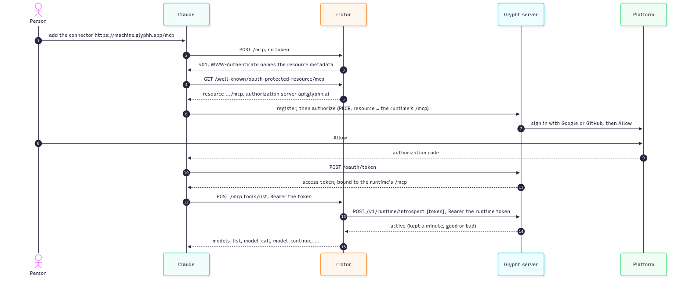
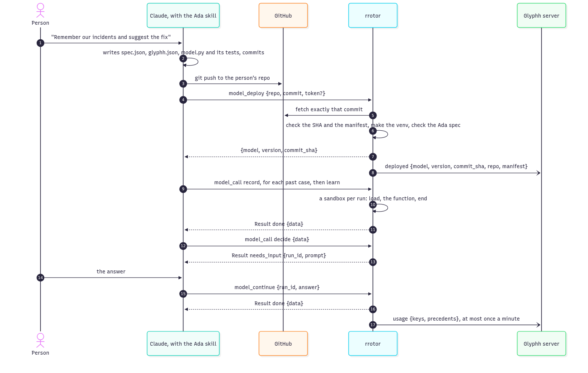
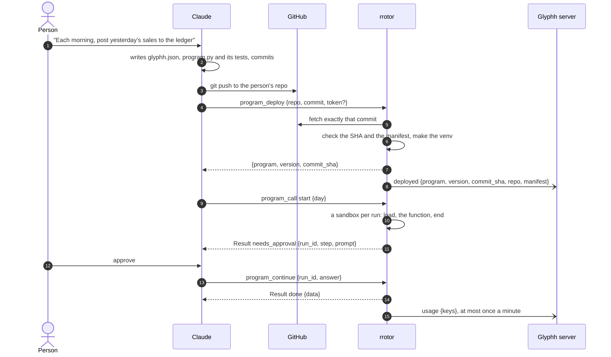
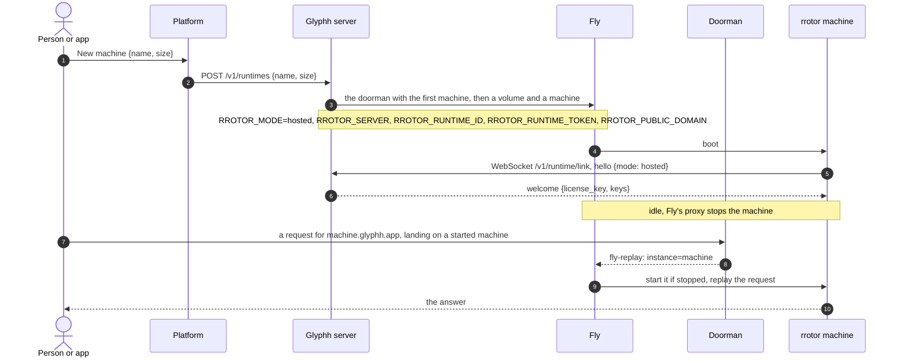
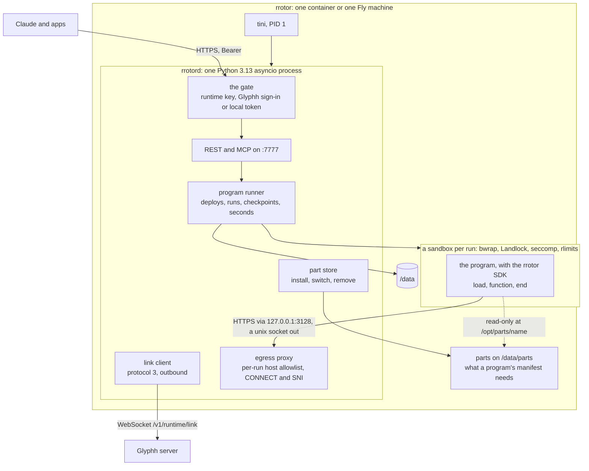
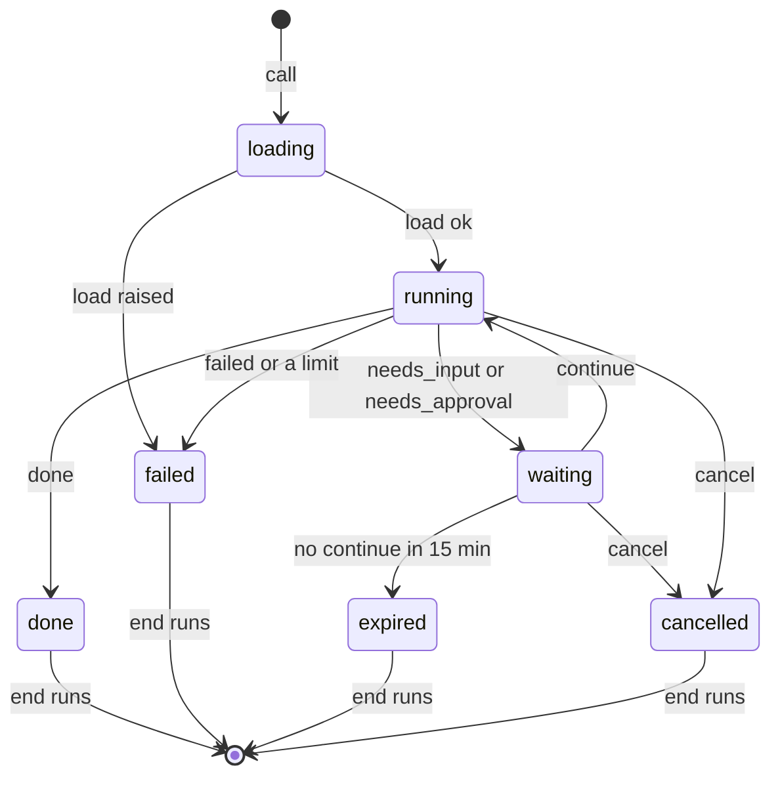
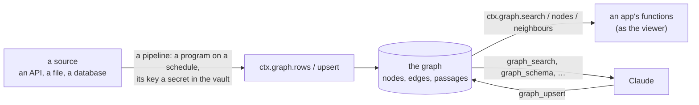

# rrotor architecture

rrotor is a local runtime for a person's programs: one headless Linux image that deploys a program by commit, runs
each call in a sandbox with no network but the hosts it declares, and answers over REST and MCP at its own address.
Ada models are not run here: they run in Ada Cloud, on the Glyphh server.
This document is how its parts work and call each other. The system around it (accounts, plans, the data model,
provisioning) is in `glyphh-ai/server`, `docs/architecture.md`; running your own is in
[`self-hosting/`](self-hosting/README.md). What is decided but not built is in [Not built yet](#not-built-yet), with its build specs in
[`specs/`](specs/), and nowhere else.

## 1. The parts

| Part | What it is |
|---|---|
| **Claude** | Claude Code, the Claude apps or any MCP client. It has the runtime as a connector: it writes, deploys and calls a program with the runtime's own tools |
| **Apps** | Anyone's software, calling the runtime's REST API with a runtime key, directly or through the SDKs (`glyphh` on PyPI, `@glyphh-ai/glyphh` on npm, both in `glyphh-ai/glyphh`) |
| **rrotor** | This repo: the daemon `rrotord` and the program SDK `rrotor`, in the image `ghcr.io/glyphh-ai/rrotor`. One per volume |
| **The Glyphh server** | `https://api.glyphh.ai`: provisions hosted machines, makes runtime keys and runtime tokens, signs the licence key, vouches for a Glyphh sign-in, and holds the runtime's link. Never on the data path |
| **The platform** | `https://platform.glyphh.ai`: where a person makes and starts machines, makes runtime keys, registers a self-hosted runtime and shows its licence key |
| **Fly** | Hosts the hosted machines: one app, `*.glyphh.app`, a machine and a volume per runtime, and the doorman |

One image, four modes, set by `RROTOR_MODE` at start (`rrotord/config.py`):

| Mode | Where | Reached at | Callers authenticate with |
|---|---|---|---|
| `hosted` | A Fly machine the server made | `https://<machine>.glyphh.app` | A runtime key or a Glyphh sign-in |
| `self` | The owner's own machine, cluster or cloud ([12](#12-self-hosting)) | `https://<public host>`, TLS ended in front | A runtime key or a Glyphh sign-in (a key alone with the link off) |
| `doorman` | One always-on Fly machine per app | Every `*.glyphh.app` request's first hop | Nobody: it only replays ([3](#3-hosted-machines)) |
| `local` (the default) | Any container host | `127.0.0.1:<port>` only | A local token, held as its SHA-256 (`RROTOR_LOCAL_TOKEN_SHA256`); the runtime token is handed in with `PUT /v1/runtime/token` |

rrotor has no sign-in of its own and nothing to log into. It connects out to the server (the link, [6](#6-the-link-protocol-3));
the server never connects in. A call goes from the caller to the runtime and back: nothing of Glyphh's sees its
inputs or its answer.

**Glyphh-run hosting is off.** The server's `GLYPHH_HOSTING` flag (default off) decides whether it makes hosted
machines; `hosted` and `doorman` stay in the code, used only if Glyphh turns it on ([3](#3-hosted-machines)).
Customers run rrotor themselves, in `self` mode at their own address ([12](#12-self-hosting),
[`self-hosting/`](self-hosting/README.md)).

## 2. A program, end to end

### 2.1 Adding the runtime to Claude

The person adds the runtime's address as a custom connector (Settings, Connectors), once. The runtime is an OAuth
protected resource (RFC 9728) whose authorization server is the Glyphh server, so Claude signs the person in to
Glyphh with one Allow click and no key.




An app sends a runtime key instead (`Authorization: Bearer <key>`), made on the platform's Keys page; rrotor holds
only the keys' SHA-256s ([7](#7-the-api)).

### 2.2 Build, deploy and call

A program is a GitHub repo; a version is a commit. Claude writes the program with the person, pushes it, and deploys the
commit through the runtime's own MCP.





- **Deploy by commit:** `program_deploy` (and `POST /v1/programs/deploy`) takes `{repo, commit, token?}`: `repo` is
  `owner/name` on GitHub, `commit` the full 40-character SHA, `token` for a private repo. rrotor fetches that one
  commit (depth 1), checks its SHA, reads `glyphh.json` ([5.2](#52-the-manifest-glyphhjson)), makes a venv from
  `requirements.lock` (binary wheels only, with hashes: no program code runs outside the sandbox, not even a package's
  setup) and makes the version active. The REST route also takes `{bundle, commit}`, a git bundle of the commit in
  base64, up to 64 MB. The server can deploy too, down the link, with a short-lived token from the Glyphh GitHub
  App.
- **Every deploy is reported** up the link as `deployed`, however it was asked for, so the server records every
  program and version on the runtime.
- **The sample:** `examples/daily_sales/` is a program that needs no part, used to test the base end to end: it reads
  a sales export from its folder, converts the total with one declared host, asks approval for its `write` step and writes a
  ledger.

## 3. Hosted machines

Built, and off while the server's `GLYPHH_HOSTING` is off ([1](#1-the-parts)).

A person's hosted runtimes are machines on Fly, made and run from the platform (or the Glyphh connector's
`create_runtime` and `start_runtime`), each named and of a size (small, medium, large). The server makes them; the
sizes, the billing and the machine routes are in the server's `docs/architecture.md`.




- **The address is the machine:** `https://<machine>.<RROTOR_PUBLIC_DOMAIN>` (`glyphh.app`), the machine id from
  Fly's `FLY_MACHINE_ID`. A request for another machine's address is answered `fly-replay: instance=<machine>`;
  Fly's proxy replays it there, starting that machine if it is stopped. The **doorman** (`RROTOR_MODE=doorman`,
  `rrotord/doorman.py`) answers every request that way and `/healthz` itself, so nobody's machine is woken to
  bounce someone else's request. Any other `Host` is 421 `E_HOST`. `fly-replay` carries bodies up to 1 MB.
- **The token and the keys:** the runtime token is in the machine's environment, so nobody hands anything in. The
  runtime keys' SHA-256s arrive in `welcome` and as `keys` whenever they change; the licence key arrives in `welcome`.
- **In development**, `RROTOR_PUBLIC_HOST` (an ngrok name, say) is the one exact host instead, and nothing is
  replayed.

## 4. rrotor, inside




| Piece | Job |
|---|---|
| **gate** | Who may call, by mode ([7](#7-the-api)); counts each request a runtime key let in |
| **REST and MCP** | One set of operations (`api/ops.py`) behind both ([7](#7-the-api)) |
| **link client** | Connects out, reconnects with backoff (1 s to 30 s, with jitter), replays what is not acknowledged ([6](#6-the-link-protocol-3)) |
| **program runner** | Launches each run in its sandbox, keeps a waiting run's worker up to 15 minutes, runs `end` always, counts each run's seconds |
| **egress proxy** | A run's only network: an HTTP `CONNECT` proxy on a unix socket per run; lets through port 443 of the hosts the manifest declares when the TLS SNI matches, refuses addresses that resolve to loopback, private or link-local ranges, and records what it refuses |
| **part store** | Checks a part's hash and signature, unpacks it, switches it in one rename ([10](#10-parts)) |
| **logs, audit, drain** | JSON log lines naming the node and the run; audit events, kept on Enterprise; OTLP to the customer's collector and, opt-in, to Glyphh ([13](#13-logs-audit-and-drains)) |

There is no s6 and no other process: everything is `rrotord` under `tini`.

**The sandbox.** Each run is one worker process started with `bwrap`:

| Layer | What it holds |
|---|---|
| **bubblewrap** | New user, mount, PID, IPC, UTS, cgroup and network namespaces; `--die-with-parent`, `--new-session`, `--clearenv`. Read-only `/usr` (and its `/lib`, `/bin` links), the version's code at `/program`, its venv at `/venv`, the SDK at `/opt/rrotor`, each part it needs at `/opt/parts/<name>`; writable `/files` (the program's folder), `/data` (its data folder, when the manifest asks) and a private `/tmp`. The network namespace has only loopback |
| **Landlock** | Applied by the worker before it imports the program: read only the read-only mounts, write only the writable ones; on ABI 4 and later, TCP only to `127.0.0.1:3128`; on ABI 6, no abstract unix sockets or signals outside the sandbox. A kernel without Landlock refuses runs |
| **seccomp** | A filter built with libseccomp and handed to `bwrap --seccomp`: `ptrace`, `mount`, `unshare`, `setns`, `bpf`, `perf_event_open`, `userfaultfd`, `keyctl`, `io_uring_*`, kernel modules, `kexec`, clocks, `reboot` and others refused; new user namespaces refused; sockets only `AF_UNIX`, `AF_INET`, `AF_INET6`. `no_new_privs` is set |
| **egress** | Inside the namespace the worker forwards `127.0.0.1:3128` to the run's proxy socket, so `HTTPS_PROXY` works for any library |
| **limits** | `prlimit`: data size (the manifest's `memory_mb`), CPU seconds, open files, file size, no core files; the runner's wall clock (`limits.seconds`) kills the run |

- **Every layer is checked at start** and shown in `GET /v1/health`; a layer that cannot work makes rrotor refuse
  runs (`E_SANDBOX_UNAVAILABLE`, naming the layer and why). Nothing is skipped silently. A self-hosted rrotor also
  says what its container lacks ([12](#12-self-hosting)).
- **In a container**, bwrap needs seccomp, AppArmor and `/proc` unconfined (`--security-opt seccomp=unconfined
  --security-opt apparmor=unconfined --security-opt systempaths=unconfined`), and on Ubuntu 23.10 and later the
  host's `kernel.apparmor_restrict_unprivileged_userns=0`. rrotor's own seccomp filter then holds each run. Why,
  exactly: [self-hosting](self-hosting/README.md#the-containers-privileges-and-why). A Fly machine is a Firecracker
  VM, so none of this applies there.
- **No cgroups per run:** memory and CPU are held by `prlimit` and the wall clock.

**`/data`**, the one volume:

| Path | What |
|---|---|
| `runtime.json` | The runtime's id and token (0600) |
| `access.json` | The runtime keys' SHA-256s |
| `licence.json`, `licence.token` | The licence key held, `{key, source}`; a key dropped in as a file (as `/etc/rrotor/license.key`) |
| `machine-id` | A self-hosted rrotor's machine id, where the host gives none |
| `link/outbox.json` | The sequence counter and what is not yet acknowledged |
| `programs/<name>/versions/<commit>/` | A deployed version: `src/` (the checkout), `venv/`, `version.json`; immutable |
| `programs/<name>/active.json` | Which version is active |
| `programs/<name>/files/` | The program's own folder, seeded from the commit's `files/` on its first deploy |
| `programs/<name>/data/` | Its persistent data, outside git (`"data": true`) |
| `vault/key`, `vault/<name>.json` | The rrotor's own key (32 bytes, 0600, made on first use); a program's secrets, each encrypted with it ([5.5](#55-secrets)) |
| `graph/graph.sqlite3` | The graph: nodes, edges and the passages search reads ([5.9](#59-the-graph)) |
| `models/` | An earlier release's name for `programs/`: moved to `programs/` when the daemon starts, if `programs/` is not there; its runs' and audit events' `model` reads as `program` |
| `runs/<run_id>/` | Each run's `run.json` (with its checkpoints) and `log.jsonl` |
| `schedules.json` | Each schedule's pause, last run and last skip ([5.6](#56-schedules)) |
| `parts/<name>/<version>/`, `parts/<name>/current` | An installed part, and the version in use |
| `audit/<YYYY-MM-DD>.jsonl`, `audit/.cursor`, `audit/.cursor-glyphh` | Enterprise: the audit log, a file a day; how far the customer's drain and server-side logging have read it ([13](#13-logs-audit-and-drains)) |
| `logging.json` | Whether server-side logging was on at the last start (turning it on or off is an audit event) |

**The image** (`image/Dockerfile`): Debian 13 (trixie) slim, amd64 and arm64; `tini`, Python 3.13 (Debian's),
Node 22, git, bubblewrap, libseccomp, util-linux (`prlimit`), CA certificates, tzdata (a schedule's time zone); in
rrotord's venv, the OpenTelemetry
SDK and its OTLP/HTTP exporter (pinned, about 8 MB with protobuf and requests); the vendors' agent CLIs (Claude
Code, Codex, Gemini, Cursor, Grok, Copilot: about 1.7 GB unpacked, pinned in `image/clis.json`,
[5.7](#57-clis)); the Glyphh SDK for every program and the `glyphh` CLI (`image/sdk.lock`, [5.3](#53-the-sdk-rrotor));
the Claude Agent SDK beside it, for a bot's agent (`image/agent-sdk.lock`: about 32 MB with what it imports, the
360 MB copy of Claude Code its wheel bundles dropped, since the image has Claude Code already);
Glyphh's own programs, `glyphh_bot` and `glyphh_swarm` (`programs/`, [5.10](#510-glyphhs-own-programs-bots-and-projects)).
No browser, no database. It runs as
`rrotor` (uid 10001) on a read-only root with a tmpfs `/tmp`; everything kept is on `/data`. The published image
is the `hosted` target: the base, with no part built in ([11](#11-the-image-and-ci)).

## 5. A program

### 5.1 What a program is

A git repo; a version is a commit.

| File | What |
|---|---|
| `glyphh.json` | The manifest |
| `program.py` | `load`, the functions, `end` |
| `requirements.lock` | Optional: its Python dependencies, pinned with hashes, installed at deploy, never at run |
| `files/` | Optional: seed files, copied into its folder on the first deploy |

An **app** is a kind of program too (`"kind": "app"`, [5.8](#58-apps)): what Claude made (a page, a dashboard, a
document, a diagram, a deck, a design), published from Claude with its files, reviewed in the Glyphh catalogue and
served to the org's people at `/apps/<name>/`.
A **CLI** is a kind of program (`"kind": "cli"`, [5.7](#57-clis)): the same repo, manifest, deploy, sandbox, vault,
egress proxy, approvals, limits and audit, with no `program.py`: its manifest names a command-line tool to install
and the arguments it may be run with.

### 5.2 The manifest: `glyphh.json`

```json
{
  "name": "daily_sales",
  "description": "A day's sales, added up, converted to euros, and written to its ledger once approved",
  "python": "3.13",
  "functions": {
    "start": { "writes": true, "approvals": ["write"], "inputs": { "type": "object" } },
    "summary": { "writes": false }
  },
  "hosts": ["api.frankfurter.dev"],
  "limits": { "seconds": 60, "memory_mb": 256 },
  "schedules": [{ "function": "start", "cron": "15 6 * * *", "name": "each_morning" }]
}
```

| Key | What |
|---|---|
| `name` | `^[a-z][a-z0-9_]{0,62}$`; a deploy names the program by it |
| `kind` | `program` (the default), `cli` (a CLI has a `cli` block and no functions, schedules, data, databases or parts, [5.7](#57-clis)) or `app` (what Claude made, served to the org's people: an `app` block, and functions only when the page calls them, [5.8](#58-apps)) |
| `app` | An app's: `entry` (the file opened at `/apps/<name>/`, in `src/`: `.html`, `.htm`, `.jsx`, `.tsx`, `.md`, `.pdf`, `.mmd`, `.mermaid`, `.svg`, `.png`, `.jpg`, `.jpeg`, `.webp` or `.gif`; default `index.html`), `type` (`page`, `dashboard`, `doc`, `diagram`, `deck` or `design`; absent, the entry's own: `dashboard` and `deck` are never inferred), `title` (1–120 characters), `roles` (the roles that may open it, lower-cased; none: everyone in the org) and `functions` (those of its own the page may call) ([5.8](#58-apps)) |
| `version` | Optional, 1 or more |
| `description`, `python` | Free text; `python` must be `3.13` |
| `functions` | Each callable function: `description`, `inputs` (a JSON Schema the call's inputs are checked against, `E_INPUTS`), `approvals` (the steps that may ask), `writes` (whether it runs on a cluster's head: `true` runs it there, `false` on whichever node the call reaches, read-only there; default whether the program keeps data (`data` or a SQLite database); every call of a program that keeps data runs on the head whatever it says) ([14](#14-the-cluster)). At least one; `load` and `end` are not functions |
| `hosts` | The hosts a run may reach on 443 (`*.example.com` allowed) |
| `needs` | The parts it imports from, by name ([10](#10-parts)) |
| `data` | `true` mounts its persistent data folder at `/data` |
| `databases` | `sqlite`: a SQLite database, `/data/db.sqlite3` in its data folder (mounted, as `data` would), opened as `ctx.db`; it keeps data, so every call runs on a cluster's head. `postgres`, `mongodb`, `neo4j` are parts, not built yet ([10](#10-parts)) |
| `limits` | `seconds` (1 to 3600, default 300) and `memory_mb` (64 to 8192, default 512) per run |
| `secrets` | The secrets it reads by name, `^[A-Z][A-Z0-9_]{0,63}$` ([5.5](#55-secrets)) |
| `optional_secrets` | Of its `secrets`, those a run goes without when they are not set (an optional API key: `ctx.secrets.get` is None); one not in `secrets` is refused |
| `schedules` | Functions the runtime calls by itself: each `{function, cron, tz?, input?, name?}` ([5.6](#56-schedules)) |
| `clis` | The CLIs on this rrotor its functions run with `ctx.cli` (built in or deployed, [5.7](#57-clis)): a deploy naming one this rrotor does not hold is refused (`E_MANIFEST`); every call runs on a cluster's head, where CLIs run |
| `graph` | `read` or `write`: the rrotor's graph as `ctx.graph` ([5.9](#59-the-graph)), to search and walk it, or to write it too (a pipeline). Unset, `ctx.graph` refuses (`E_GRAPH_UNDECLARED`). Every call runs on a cluster's head, which keeps the graph. Not for a CLI |
| `folders` | `true`: a call of it may carry folders of the machine, mounted for the run and told as `ctx.folders` ([5.11](#511-the-machines-folders)). Unset, a call that carries any is refused (`E_FOLDERS_UNDECLARED`). Not for a CLI |
| `connectors` | Accepted and kept; nothing uses them yet ([Not built yet](#not-built-yet)) |

A deploy refuses (`E_MANIFEST`) a manifest with an unknown key, a bad value, or a function `program.py` does not
define (read from its syntax tree: no program code runs outside the sandbox).

### 5.3 The SDK: `rrotor`

The `rrotor` package, standard library only, ships in the image and is mounted read-only into every sandbox at
`/opt/rrotor`: programs import it and never install it.

```python
from rrotor import Ctx, Result

Result.done(data)                                     # finished, with data (JSON)
Result.needs_input(prompt, schema=None, options=None, detail=None) # a value or a choice (detail: more, in data)
Result.needs_approval(step, prompt)                   # about to act; a continue answers it
Result.failed(step, reason, detail=None)              # stopped, with why (detail: more, in data)

ctx.inputs                    # the call's inputs, checked against the function's schema
ctx.answer                    # what the last continue brought (None on the first call)
ctx.ask_approval(step, prompt) -> bool   # True once approved, False if declined; until then the run waits
ctx.needs_input(prompt, schema=None, options=None, key=None, detail=None)   # the answer once given; until then it waits
ctx.checkpoint(key, fn)       # fn runs once per run; a resumed run reads the stored value
ctx.http                      # HTTPS to the declared hosts (any library works too: HTTPS_PROXY is set)
ctx.files                     # its folder, a pathlib.Path
ctx.data                      # its persistent data folder ("data": true, or a SQLite database), else None
ctx.db                        # its SQLite database ("databases": ["sqlite"]): a sqlite3.Connection, see below
ctx.home                      # its code (the folder program.py is in)
ctx.clearance                 # who asks, 0 to 1; 1 unless the call says (the program decides what it means)
ctx.caller                    # who called: "claude", or "schedule" for a run its schedule started (5.6)
ctx.readonly                  # a cluster follower's run: its folders are read-only
ctx.secrets["NAME"], ctx.secrets.get("NAME")   # a secret the manifest declares (5.5)
ctx.cli(name, args, stdin=None) -> CliResult   # a command of a CLI the manifest names: exit_code, stdout, stderr
ctx.graph                     # the rrotor's graph ("graph": "read" or "write"): rows, upsert, search, node, … (5.9)
ctx.folders                   # the machine's folders this run was given: ({"path", "access": "read" | "write"}, …) (5.11)
rrotor.files.Files(ctx.folders, before=None)   # their files, every path checked: list, read, search, write, move (5.11)
ctx.log(message, **detail)
ctx.today(), ctx.yesterday()  # UTC dates, YYYY-MM-DD
```

The image also carries the Glyphh SDK (`glyphh`, pinned with its hash in `image/sdk.lock`) at
`/usr/local/lib/rrotor-sdk`, which the worker puts on `sys.path` after the program's own venv: `import glyphh` works
without a `requirements.lock`, and a program that pins its own version gets its own. The Claude Agent SDK
(`claude_agent_sdk`, and what it imports: `mcp`, `pydantic`, `anyio` and the rest, each pinned with its hashes in
`image/agent-sdk.lock`, resolved from `image/agent-sdk.in`) is there too, for `glyphh_bot`'s agent
([5.10](#510-glyphhs-own-programs-bots-and-projects)); it runs the image's `claude`, not a copy of its own.

- **Approvals and inputs are re-entrant.** A `continue` calls the same function again with the same inputs: steps
  done are skipped by `ctx.checkpoint`, and `ctx.ask_approval(step, …)` then answers the decision for that step
  (`{"approved": true}`). A step not named in the function's `approvals` fails the run (`E_STEP_UNDECLARED`).
- **`ctx.db`** is the standard library's `sqlite3.Connection` on `db.sqlite3` in the program's data folder, opened
  inside the sandbox on first use and closed when the run ends: `with ctx.db:` commits, and what is not committed is
  rolled back. On a cluster's follower it opens read-only (`mode=ro`), though a program with a database runs on the
  head. A program that does not declare it gets `E_DATABASE_UNDECLARED`.
- **`ctx.cli`** runs one command of a CLI on this rrotor that the manifest's `clis` names (else `E_CLI_UNDECLARED`;
  one no longer here, `E_CLI_MISSING`), as that CLI's own run: rrotor runs it in the CLI's sandbox, with its private
  HOME (so a CLI signed in with `cli_login` is signed in here too), its hosts, its env and secrets, by the program
  as its caller (`program:<name>`), an audit `run.call` with `by` (the program's run). The worker asks the runner
  over its channel (`cli`, answered `cli_result`) and waits; the time counts against the program's `seconds`. The
  arguments are checked against the CLI's `allow` first (`E_CLI_DENIED`, never run). One its `approvals` names is a
  step of the program's own run, `cli:<name>:<digest of the command>`: the run answers `needs_approval` with the
  command line, a continue's `{"approved": true}` runs it (`false`: `E_CLI_DECLINED`), and the runner checks that
  approval in the run's own state before it runs the command, so a program cannot skip it. What the command
  answered is a checkpoint of the same key: a resumed run reads it back, never running it twice. A command that
  could not run raises `CliError` with its code (`E_SECRET_MISSING`, `E_LIMIT_SECONDS`, …); a nonzero exit is
  still an answer (`CliResult.ok` is false). A program stopped mid-command leaves the command to end as its own run.
- **`rrotor.testing`** gives a program's own tests a `Ctx` with no sandbox (`Harness`): inputs, answers, a folder,
  an `http` that answers what the test says, `secrets={...}` (with `declared=[...]`, the names the manifest
  declares), `database=<a file>` for `ctx.db`, and `clis={"claude": FakeCli("answer", allow=…, approvals=…)}` for
  `ctx.cli` (stdout, a `CliResult`, or a function of the arguments and stdin; `h.cli_calls` lists what ran), and
  `graph=FakeGraph("write")` for `ctx.graph`: a graph kept in memory (`h.graph.nodes`, `h.graph.edges` hold what the
  program wrote; its search is by plain words, not BM25).
- **`load` and `end` are rrotor's:** it calls a program's `load(ctx)` before every run and `end(ctx)` after, so a
  helper of another shape must not take those names (a pipeline's last step is `store`, not `load`).

### 5.4 A run




- **One run, many calls:** a call opens a run (`run_id`); each `continue` resumes it in the same worker while it
  waits (up to 15 minutes). If the worker is gone (rrotor restarted), a `continue` starts a new one: `load`, then
  the function, its checkpoints read back.
- **`end` always runs**, on `done`, `failed`, a limit, a cancel or an expiry.
- **Every call answers a `Result`**, never an exception: a crash is `failed` with the error and the step.
- **Seconds** are the time a run spent running, not waiting.

### 5.5 Secrets

A program reads an API key or a password as `ctx.secrets["ANALYTICS_KEY"]`; its manifest declares the name
(`"secrets": ["ANALYTICS_KEY"]`), and the person sets the value on the runtime, never in the repo
(`rrotord/vault.py`):

- **Set, listed, deleted** with `PUT /v1/programs/{name}/secrets/{secret}` `{value}`, `GET
  /v1/programs/{name}/secrets` and `DELETE /v1/programs/{name}/secrets/{secret}`, or MCP's `secret_set`,
  `secrets_list` and `secret_delete` ([7](#7-the-api)), behind the same gate as every other route. Listing answers
  each name, whether the active version declares it and whether it is set: never a value. A value is a string of 1
  byte to 64 KB, for a program deployed here.
- **Encrypted at rest** with AES-256-GCM under the rrotor's own key, `/data/vault/key` (32 random bytes, made 0600 on
  first use, never logged, never sent anywhere). Each value has its own nonce, and the program and the name are its
  associated data, so a value moved to another name or program does not open. Another key (a lost or replaced
  `/data/vault/key`) opens nothing: the run fails `E_VAULT` at `step: secrets`, and the secrets are set again.
- **Only the run gets a value:** the runner reads the declared ones when it starts a run's worker and hands them over
  in its start message, on the worker's own socket; a name the manifest does not declare is refused in the program
  (`E_SECRET_UNDECLARED`). A declared secret not set stops the run before `load`:
  `failed {step: secrets, code: E_SECRET_MISSING, missing: ["ANALYTICS_KEY"]}`, so the caller knows what to ask the
  person for.
- **Set by the person, in a form, never in the chat:** MCP's `secrets_form` `{program}` answers the names and which
  are unset, and names a panel (`ui://rrotor/secrets/1`, an MCP App: `rrotord/api/panel.py`) that Claude shows with
  the answer: each secret with a field for its value. What the person types goes from the form to `secret_set`
  through the host, into the vault; it is not in the conversation, and the form tells Claude only which names were
  set or removed. Claude calls it whenever a run fails `E_SECRET_MISSING` or a program that declares secrets was just
  deployed, and never asks for a value. Where no form shows (a client without MCP Apps), the answer says how the
  person sets it themselves, with `PUT …/secrets/{secret}`. The runtime's `resources/list` and `resources/read`
  serve the panel; on MCP 2026-07-28 those and `tools/list` answer `ttlMs: 0, cacheScope: private`.
- **Never kept anywhere else:** no route, tool, run record or audit event carries a value; setting and deleting are
  audit events (`secret.set`, `secret.delete`) naming the program and the secret. A value of 4 characters or more
  that a program prints or logs is masked as `[secret]` in the run's log; what a program returns or checkpoints
  is its own.
- **The server never sets one:** secrets go from the person to the runtime, not through Glyphh.
- **In a cluster, secrets are node-local:** they are not in the replicated log or a snapshot. The head keeps them: a
  follower refuses to set or delete one (503 `E_NOT_HEAD`, naming the head) and asks the head for the list, and every
  call of a program that declares secrets runs on the head ([14](#14-the-cluster)). A node made head has its own
  vault: the secrets are set on it again.

### 5.6 Schedules

A program says when the runtime should call it, in its manifest; the daemon fires each schedule itself
(`rrotord/scheduler.py`), with no Claude and no server involved:

```json
"schedules": [
  { "function": "start", "cron": "15 6 * * *" },
  { "function": "summary", "cron": "0 9 * * MON-FRI", "tz": "Europe/Amsterdam", "input": {}, "name": "weekdays" }
]
```

- **Each schedule:** `function` (one of its functions), `cron`, `tz` (an IANA zone, default `UTC`), `input` (the
  call's inputs, checked against the function's schema at deploy) and `name` (`^[a-z][a-z0-9_]{0,62}$`, the
  function's by default; two schedules of one function need names). A deploy refuses a bad one (`E_MANIFEST`, naming
  `schedules.<n>` and why).
- **Cron** (`rrotord/cron.py`, no dependency): five fields, minute hour day-of-month month day-of-week; each `*`, a
  number, `a-b`, `*/n`, `a-b/n`, `a/n` or a comma list of those; `JAN`-`DEC` and `SUN`-`SAT`, and 7 for Sunday;
  `@hourly`, `@daily`, `@midnight`, `@weekly`, `@monthly`, `@yearly`, `@annually`. When day-of-month and day-of-week
  are both restricted, a day matching either fires (as cron has always read them); when one is `*`, the other
  decides. An expression that can never fire (`0 0 30 2 *`) is refused.
- **Across a change of the clocks** in `tz`: a wall time the clocks skip fires once, as far past the jump as it was
  past the hour (02:30 fires at 03:30); a wall time the clocks pass twice fires once, the first time.
- **Fired as a normal run:** once a minute (just past it) the scheduler starts every schedule of each program's active
  version that came due, through the runner, `caller: schedule`, as `rrotor` with `via: schedule` in the audit log.
  An approval or an input waits like any other run's (`GET /v1/approvals`), and expires after 15 minutes.
- **No overlap:** a schedule whose last run has not ended (still running, or waiting) is skipped that time; the skip
  is kept (`skipped: {at, run_id, count}`), logged and audited (`schedule.skipped`).
- **Nothing is replayed:** fires missed while the daemon was down, or while the node was not the head, are not made
  up; a tick that comes late fires a schedule once, however many times it came due.
- **Listed, paused, resumed:** `GET /v1/schedules` (MCP `schedules_list`): each schedule's `id`
  (`<program>/<name>`), version, function, cron, tz, input, `paused`, `next_at` (none while paused), `last` (`{run_id,
  at, status, code}`, the run's status as it is now; `refused` with its code when the call was refused) and
  `skipped`. `POST /v1/schedules/{program}/{name}/pause` and `…/resume` (MCP `schedule_pause`, `schedule_resume`)
  keep the pause in `/data/schedules.json`, across restarts and new versions; audited `schedule.pause`,
  `schedule.resume`.
- **In a cluster only the head fires** (or the one node an unlicensed cluster serves from). Schedules' state is the
  head's, node-local like the vault: a follower asks the head for the list and refuses a pause (503 `E_NOT_HEAD`).

### 5.7 CLIs

A CLI is a command-line tool (the glyphh CLI, `gh`, `stripe`, a team's own) that rrotor installs at deploy and runs
one command at a time in the same sandbox as programs, so Claude can use the tool without it touching the person's
machine, their files or the open network (`rrotord/clis.py`, the build spec
[`specs/cli-server.md`](specs/cli-server.md)). Examples: `examples/cli_gh/`, `examples/cli_glyphh/`. The vendors'
agent CLIs come built in (below), each signed in from the person's phone with `cli_login`.

```json
{
  "name": "github",
  "kind": "cli",
  "cli": {
    "install": { "url": "https://github.com/cli/cli/releases/download/v2.62.0/gh_2.62.0_linux_amd64.tar.gz", "sha256": "<64 hex>" },
    "command": "gh",
    "allow": ["pr *", "issue *", "repo view *"],
    "approvals": ["pr merge *"],
    "env": { "GH_TOKEN": "secret:GH_TOKEN", "GH_PROMPT_DISABLED": "1" },
    "home": true
  },
  "hosts": ["api.github.com", "github.com"],
  "secrets": ["GH_TOKEN"],
  "limits": { "seconds": 120, "memory_mb": 512 }
}
```

- **`install`**, one source, pinned: `url` (an `https://` release asset on 443: a tarball, `.tar.gz`, `.tgz`,
  `.tar.xz`, `.tar.bz2`, `.tar`, a `.zip`, or else a bare binary), `npm` (`name@1.2.3`, exact), `pypi`
  (`name==1.2.3`, exact) or `image` (a binary already in the image: its name on `PATH` or its path under `/usr`).
  `sha256` is the checksum of what is downloaded, required but for `image` (where, given, it is checked against the
  binary). A deploy downloads it, checks the SHA-256 **before unpacking anything** (`E_CLI_CHECKSUM`, naming the one
  it got), unpacks it under the version's folder (`/data/programs/<name>/versions/<sha>/cli/`; a tarball with the
  `data` filter, a zip refusing any path outside its folder, 1 GB unpacked at most) and writes `installed.json`; a
  new version is a new deploy and rolls back like any program. No code of the CLI runs at install.
  - **url**: `command` is a path inside the archive, or a file name found in it (the nearest the top); a bare binary
    is saved as `command`. Made executable; run directly.
  - **npm**: the package's tarball, `https://registry.npmjs.org/<name>/-/<basename>-<version>.tgz`; `command` is
    one of its `bin` entries, run with the image's `node`. No install scripts run and no dependency is fetched: a
    package with `dependencies` not all in its `bundleDependencies` is refused (`E_CLI_INSTALL`).
  - **pypi**: PyPI's JSON API (`https://pypi.org/pypi/<name>/<version>/json`) names the wheel whose SHA-256 is
    `sha256`; rrotor downloads it from `files.pythonhosted.org`, unpacks it itself into `cli/site/` (its `.data`
    `purelib` and `platlib`, nothing else) and writes `cli/bin/<command>` for the wheel's console script, run with
    the image's Python. Its dependencies come from a `requirements.lock` beside `glyphh.json` (hashed, binary wheels
    only, `--no-deps`, into `cli/site/` by `uv`, as a program's lock goes into its venv). Pin a wheel this runtime can
    import (`py3-none-any`, or CPython 3.13 on Linux of the runtime's architecture).
  - **image**: nothing is downloaded; `command` is the binary's name.
- **Hosts an install reaches:** the manifest's `hosts`, plus what the source implies: a `url`'s own host (and, for
  `github.com`, `objects.githubusercontent.com` and `release-assets.githubusercontent.com`, where GitHub serves
  release assets), `registry.npmjs.org` for npm, `pypi.org` and `files.pythonhosted.org` for PyPI. Every redirect is
  checked against the same list, HTTPS on 443 only, to public addresses only (as the egress proxy does), 512 MB at
  most (`E_CLI_INSTALL` otherwise). A PyPI CLI's `requirements.lock` is fetched by `uv` from PyPI, as a program's is.
- **`command`, `allow`, `approvals`:** there is no shell; the command is the only thing a call can run. The arguments
  are joined as a shell would quote them (`shlex.join`, so one argument with a space is quoted) and matched against
  glob patterns: `allow` empty takes any arguments; otherwise one must match, or the call is refused 403
  `E_CLI_DENIED` (an audit event, never a run). A pattern matches the whole line, so a trailing `*` also takes any
  further flags. One that matches `approvals` makes the run wait, `needs_approval` at step `cli` with the command
  line in its prompt (listed in `GET /v1/approvals`, expiring after 15 minutes); `program_continue` with
  `{"approved": true}` runs it, `false` ends it `failed`, `E_CLI_DECLINED`.
- **`env`:** the process's environment beside rrotor's own (`PATH`, `HOME`, `TMPDIR`, `LANG`, the proxy's
  `HTTPS_PROXY`/`HTTP_PROXY` and `NODE_USE_ENV_PROXY`, which a manifest may not set, nor any `LD_*`). `secret:NAME`
  takes a secret the manifest declares from the vault ([5.5](#55-secrets)), passed in the worker's start message
  only, never written to disk; its value is masked (`[secret]`) in the run's log, its Result, its record and the
  audit event's command line. `secret?:NAME` takes one only when it is set (an optional API key): a secret only ever
  taken that way never stops a run (`E_SECRET_MISSING`), and its variable is left out while it is not set.
- **`home`:** `true` gives the CLI a private `HOME`, mounted at `/home/cli` and kept across calls (its config, a
  login it keeps); otherwise `HOME` is the run's own `/tmp`. **Whose HOME is the caller's:** a Glyphh sign-in's
  subject (the `sub` the server's introspection names, [2.1](#21-adding-the-runtime-to-claude)) gets their own,
  `/data/programs/<name>/homes/<subject>` (a subject that is not a plain name, `[A-Za-z0-9][A-Za-z0-9_.@:-]*` up to
  128, is its SHA-256's first 32 hex), so each person on a rrotor signs the CLI in as themselves and runs it with their
  own account and connections, never another's; a runtime key, the local token, the link and a schedule share the
  CLI's own, `/data/programs/<name>/home`. A program's `ctx.cli` runs the CLI in the HOME of the person the program's
  run is for (the run's `subject`, set when it was called), so a program called by a signed-in person acts as them.
  `clis_list` says whether the CLI is signed in for the caller (`signed_in`: its `login.signed_in` file is in their
  HOME; `null` when it keeps no such file, or on a follower).
- **`interactive`:** only `false`; `true` is refused, `E_MANIFEST` (interactive sessions are not built yet).
- **A run** (`POST /v1/clis/{name}/run`, MCP `cli_run`, `{args, stdin?, files?}`): at most 256 arguments of 8192
  characters, stdin up to 1 MB of text, files up to 64 and 1 MB (by relative path: text, or `{"base64": …}`),
  `E_CLI_INPUTS` otherwise. The files are written to a fresh working folder for the call (`/work`, the command's
  current folder), kept with the run's record while it waits and removed when it ends. The worker starts in the
  sandbox as a program's does (bwrap, seccomp, rlimits, Landlock, the egress proxy for `hosts`), with the CLI's
  install read-only at `/cli`, and runs the command there, timed by the manifest's `limits.seconds` (past it,
  `E_LIMIT_SECONDS`) and cancellable; a command that cannot start is `E_CLI_EXEC`. Landlock lets a CLI's run (and
  everything it starts) execute only the system, its install and the version's venv: nothing it may write
  (`/work`, `/tmp`, its `HOME`). The Result is `done` with `{exit_code, stdout, stderr, stdout_bytes, stderr_bytes,
  truncated, files, files_skipped}`: stdout and stderr each their first 64 KB (all of each goes to the run's log,
  line by line, up to 4 MB each and the log's 2000 lines), `files` the files the command made or changed in its
  working folder (64 and 1 MB at most; past that only named, in `files_skipped`). A nonzero exit is still `done`.
- **Every call is a run**: `run_status`, `run_log` (its `called` line carries the command line, secrets masked), the
  audit log's `run.call` (with `command`) and `run.end`; its function is `cli`. `program_call` on a CLI is refused
  400 `E_NOT_PROGRAM`, and `cli_run` on a program 400 `E_NOT_CLI`.
- **In a cluster** a CLI runs on the head: its install is the head's build (versions replicate their code and venv,
  not `cli/`) and its homes and secrets are the head's; a follower sends every command (and a sign-in) there, with
  the caller as data, so the head runs it in that caller's HOME.

**Built-in CLIs.** The image carries the vendors' agent CLIs, pinned in `image/clis.json` (a version, and for linux
amd64 and arm64 the URL and SHA-256 of the vendor's own download) and installed at build by `image/clis.py`: the
download's checksum checked before anything is unpacked, unpacked under `/usr/local/lib/rrotor-clis/<name>/` (Grok's
brotli-packed binary unpacked with node), its command linked into `/usr/local/bin`, and its manifest written beside
it (`glyphh.json`, installing from the image, and `vendor.json`: vendor, title, version). Nothing downloaded runs at
build. At boot rrotord deploys each (`Deployer.builtin`, `RROTOR_BUILTIN_CLIS` names the folder): when this rrotor has
no program of its name, or as a new version when the image's pins changed and the active one is built-in too; a CLI
of that name the person deployed is theirs and is never replaced. Its commit is the SHA-1 of its manifest and vendor
file (every node of a cluster makes the same), its `src/builtin.json` marks it, `clis_list` shows `builtin`, and the
link's `hello` leaves it out (it is the image's, not the Cloud's).

| Name | CLI | Pinned | Signs in (`login`) |
|---|---|---|---|
| `claude` | Anthropic's Claude Code (`claude`, native build from npm) | 2.1.330 (the version the Claude Agent SDK in the image ships with) | `auth login --claudeai`: the claude.ai account's address and a pasted code; it listens on loopback (`listen`) |
| `codex` | OpenAI's Codex CLI (`codex`, GitHub release, musl) | 0.166.0 | `login --device-auth`: a ChatGPT device code |
| `gemini` | Google's Gemini CLI (`gemini`, npm bundle run with the image's node) | 0.66.0 | the bare command with `NO_BROWSER` and Google sign-in seeded in `~/.gemini/settings.json`: an address and a pasted code; stopped once `~/.gemini/oauth_creds.json` is written |
| `cursor` | Cursor's agent CLI (`cursor-agent`, Cursor's download, its own node) | 2026.10.22-27dcf5f | `login` with `NO_OPEN_BROWSER`: an address it polls (`paste: false`) |
| `grok` | xAI's Grok Build CLI (`grok`, npm, brotli-packed native binary) | 1.0.70 | `login --device-auth`: an xAI device code |
| `copilot` | GitHub's Copilot CLI (`copilot`, native build from npm) | 1.0.105 | `login --device-code`: a GitHub device code |
| `glyphh` | Glyphh's own CLI (`glyphh`, the Glyphh SDK's console script: `image/sdk.lock`, run with the image's Python) | 3.12.0 | `login`: an API key from platform.glyphh.ai, pasted; or the secret `GLYPHH_API_KEY` |

Each vendor's agent keeps its private HOME (`home: true`), allows its one-shot forms only (`-p <prompt>` and the
like, its status, `--version`; a bare command would open its interface and wait), waits for the person's approval to
sign out, reaches its vendor's hosts, runs up to 900 seconds with 4 GB (glyphh: any arguments, approval to delete,
forget or sign out, 300 seconds), and takes the vendor's API key as an optional secret
(`ANTHROPIC_API_KEY`, `CODEX_API_KEY`, `GEMINI_API_KEY`, `CURSOR_API_KEY`, `XAI_API_KEY`, `COPILOT_GITHUB_TOKEN`):
signing in is the way in (Claude's claude.ai sign-in brings the account's connectors; an API key set would take its
place). Self-updates are off where the CLI has a switch; the image is read-only to it anyway. Codex and Copilot ship
their own sandboxes, which cannot nest inside rrotor's: run them with theirs off (`--sandbox danger-full-access`,
`--allow-all-tools`), rrotor's sandbox being theirs.

**Signing in** (`login` in the `cli` block, `POST /v1/clis/{name}/login`, MCP `cli_login`): the person drives rrotor
from their phone, never at the machine, so a sign-in is a run that waits for them, its command kept running across
the wait (`rrotor/_worker/login.py`).

```json
"login": { "args": ["auth", "login"], "listen": true, "paste": true, "signed_in": ".claude/.credentials.json",
           "home_files": {}, "env": {}, "code": null, "seconds": 600 }
```

- The worker starts `args` on a pseudo-terminal (1000 columns, so an address is never wrapped; `TERM` set), in the
  same sandbox as any command of the CLI, with `env` beside the CLI's own and `home_files` written into its HOME
  first where they are not there yet (`login` needs `home: true`). It reads all the command prints, all along (a
  spinner never blocks it), cleaned of terminal codes (a hyperlink's text kept), into the run's log and a tail.
- Once the command shows an `https://` address (not its own loopback one) and settles (a second's quiet, five at
  most), the run answers `needs_input` at step `login`: `data: {url, urls, code, output}` (`code`: a device code shown
  from the address's line on, by `code`'s regex or `XXXX-XXXX`), the prompt saying what to do. The run waits up to
  15 minutes like any other; its command is still running.
- `program_continue` answers it: the text (or `{code}`) is typed into the command, then Enter, unless the sign-in
  is a device or polled one (a code was shown, or `paste: false`), where nothing is typed and the command finds out
  itself. A pasted `http://localhost…` (or `127.0.0.1`, `[::1]`) address, where the phone's browser ended on the
  CLI's own redirect and could not load it, is requested from the CLI's listener inside the sandbox instead, as the
  browser would have. The answer is never kept: not in the run's state (its pending kind is `login`), its log or its
  record, and masked (`[answer]`) where the terminal echoes it.
- The run ends `done` (`{exit_code, signed_in, output}`) when the command exits, or when its `signed_in` file (in
  HOME) is written, the command then stopped (a CLI that stays up once signed in); it asks again (`needs_input`) when
  the command shows a new address, or goes 30 seconds quiet while still running. Its seconds are `login.seconds`
  (its time running, not the wait); a cancel, its expiry or its seconds stop the command and all it started.
- `listen: true` (a CLI that cannot start its sign-in without its loopback listener, as Claude Code) leaves TCP to
  the sandbox: Landlock does not hold its binds and connections to the proxy's port. The sandbox's network
  namespace has only its own loopback, so nothing outside reaches the listener and nothing is reached past the
  proxy. Without it, a bind is refused as for any command.
- `cli_run` with the sign-in's arguments (or the first of them, `auth login`) runs the sign-in the same way, and the
  allow patterns are not asked: the sign-in is the manifest's own command.
- What it signs in to stays in the caller's private HOME (a signed-in person's own, `/data/programs/<name>/homes/<subject>`;
  else the CLI's, `/data/programs/<name>/home`), so that caller's later `cli_run` calls are signed in, and nobody
  else's are.
- **Not enforced** by rrotor: what the command itself does inside the sandbox with the arguments it was allowed
  (a pattern is only as narrow as it is written), and a CLI process's memory is limited per process, so the worker and
  the command each get `limits.memory_mb`.

### 5.8 Apps

An app is what Claude made (a Claude Code artifact: one `.html` or `.md` file and any files beside it; or a React
page, a Markdown document, a diagram, a PDF, an image) published to this rrotor for the org's people, reviewed in
the Glyphh catalogue and served to a browser signed in to Glyphh for this rrotor (`rrotord/apps.py`,
`rrotord/browser.py`, `rrotord/catalogue.py`; the spec is the server's `docs/specs/apps.md`, pointed at by
[`specs/apps.md`](specs/apps.md)). It is a program of `"kind": "app"` ([5.2](#52-the-manifest-glyphhjson)): the
same deploy, versions, sandbox, vault, hosts, CLIs and audit; its page's calls run its functions as the viewer.

- **The entry and its type.** `app.entry` is the file opened at `/apps/<name>/`; its extension, lower-cased, says
  how it is served and what type the app is unless the manifest says one (`rrotord/manifest.py`, `ENTRIES`):

  | Entry | Served as | Default `type` |
  |---|---|---|
  | `.html`, `.htm` | as it is | `page` |
  | `.jsx`, `.tsx` | rrotor's React shell (below) | `page` |
  | `.md` | rrotor's document shell: `marked` from cdnjs renders it; the source as text when the library does not load | `doc` |
  | `.pdf` | as it is (`application/pdf`, `Content-Disposition: inline`: the browser's own viewer) | `doc` |
  | `.mmd`, `.mermaid` | rrotor's diagram shell: `mermaid` from jsDelivr renders it; the source as text when the library does not load | `diagram` |
  | `.svg` | as it is (`image/svg+xml`, inline) | `diagram` |
  | `.png`, `.jpg`, `.jpeg`, `.webp`, `.gif` | rrotor's image shell: the image centred on a page, at its size, with the title | `design` |

  Any other entry is refused (`E_INPUTS` at publish, `E_MANIFEST` from a repo: "entry is a page (.html, .jsx,
  .tsx), a document (.md, .pdf), a diagram (.mmd, .svg) or an image"). `app.type` is one of `page`, `dashboard`,
  `doc`, `diagram`, `deck`, `design`; `dashboard` and `deck` are never inferred, the publisher says them. A
  dashboard is a page whose numbers come from the app's own functions, one per chart, called as the viewer.
- **The React shell** (a `.jsx` or `.tsx` entry: what claude.ai's React artifacts are, one file with ES imports and
  a default export that is the component): an HTML page with an import map for `react`, `react-dom`,
  `react-dom/client`, `react/jsx-runtime`, `recharts`, `lucide-react`, `framer-motion`, `d3`, `three`, `date-fns`,
  `lodash`, `papaparse`, `mathjs` and the common `@radix-ui/*` packages, each at a pinned major (one table,
  `REACT_PACKAGES`), the Tailwind CDN, and `@babel/standalone` from cdnjs transforming the file in the browser:
  the source is inline in one `<script type="text/babel" data-type="module">` with a trailer that mounts the
  default export into `#root` with `createRoot` (the `export default` rewritten to a binding, since a module inline
  in a page exports to nobody; Babel standalone transforms each script on its own, so a second script could not
  import the entry). Two presets are registered before Babel runs: React's with the automatic runtime and, for
  `.tsx`, TypeScript's for any filename. The packages that import React come from esm.sh with `react` and
  `react-dom` external, so the page has one React (jsDelivr's `+esm` bundles pin their own exact React each, which
  gives two and breaks hooks); the libraries that do not import React come from jsDelivr. rrotor builds nothing; a
  package the import map does not name fails in the browser as it would on claude.ai.
- **Publishing** (`POST /v1/apps`, MCP `app_publish`): `{name, title, description?, type?, roles?, files, entry?,
  functions?, program?, hosts?, secrets?, clis?, limits?}`; `files` the app's files by relative path (text, or
  `{base64: …}` for a PDF or an image; 64 files and 16 MiB in all at most; never `glyphh.json`, `program.py`,
  `requirements.lock` or `files/`, which are rrotor's own), `entry` default `index.html`, or the one file when one
  is sent, `type` as above, `functions` as a manifest's (`{name: {description, inputs}}`) with `program` the text of
  `program.py` when any are named. rrotor writes the manifest beside the files, commits them in a scratch repo (the
  commit is the version's SHA; the same files again are the same commit, held already) and deploys the version as
  any (`Deployer.from_files`): activated, unless an **approved** version of the app is active, which keeps serving
  until the catalogue approves the new one (the `approved` message activates the version it names). The answer is
  `{program, version, commit_sha, deployed_at, type, active, state, url}`, `url` where a browser opens it
  (`https://<host>/apps/<name>/`; a local rrotor's `http://127.0.0.1:7777/apps/<name>/`). `deployed` goes up the
  link with the manifest and `by`, the Glyphh subject who published (null for the local token). On a hosted or
  self-hosted rrotor publishing is a person's act: a runtime key is refused 403 `E_FORBIDDEN`; a local rrotor's
  token publishes. A follower sends it to its head.
- **The catalogue's word** (`/data/apps.json`): the server tells this rrotor each app's reviewed version, its
  state (`draft`, `approved`, `rejected`, `retired`) and roles, and the reviewer groups, down the link (`app`
  messages, and the welcome's `apps` and `reviewers`, [6](#6-the-link-protocol-3)), kept across restarts (what a
  0.2.0 left in `/data/artifacts.json` is read once and written as `apps.json`). An app is served only while its
  active version is the approved one; a newer version here is a `draft`, an older one `retired`, one the catalogue
  has not spoken of `unknown`. With the link off (air-gapped) there is no catalogue: the deploy is the approval and
  the manifest's `roles` decide. `GET /v1/apps` (MCP `apps_list`) lists each app: `{name, title, description,
  type, version, active, roles, functions, state, url}`.
- **Serving** (`GET /apps/{name}/`, `GET /apps/{name}/{path}`): the active version's `src/` (`/` the entry, inside
  its shell when it has one; a `.md` fetched by its path is shelled too, so a document may link to another; any
  other file by its path as it is, a `.jsx` or `.tsx` as text), with `Content-Type` by extension (`.html`, `.htm`,
  `.css`, `.js`, `.mjs`, `.json`, `.map`, `.svg`, `.txt`, `.md`, `.csv`, `.mmd`, `.mermaid`, `.jsx`, `.tsx`,
  `.wasm`, `.pdf`, `.png`, `.jpg`, `.jpeg`, `.webp`, `.gif`, `.ico`, `.woff`, `.woff2`; anything else
  `application/octet-stream`), `Cache-Control: no-store`, `X-Content-Type-Options: nosniff` and a
  Content-Security-Policy that lets the page load scripts and styles only from itself (inline too: an artifact is
  one file), the five CDN hosts Claude Code's artifacts use (cdnjs, jsDelivr, the Tailwind and jQuery CDNs, unpkg)
  and esm.sh (the React shell's packages), fonts from Google Fonts, images from itself, `data:` and `blob:`, and
  `fetch` only its own origin. A refusal is a page too, since a browser is reading, its code in `X-Error`: 404
  `E_APP_MISSING` (no such app, a program that is not one, a file not there or rrotor's own), 409 `E_APP_UNREVIEWED`
  (nothing approved yet, or rejected), 403 `E_APP_FORBIDDEN` (the viewer's roles do not open it; the page has a
  sign-out form). A **reviewer** (the org's admin, or a member of a reviewer group) opens any app, any version
  (`?version=N`, to review a draft), whatever its roles.
- **The viewer's sign-in** (`rrotord/browser.py`, a hosted or self-hosted rrotor with the link on): a page asked
  for with no session is sent (302) to `/auth/start?next=…`, which sends the browser to the Glyphh server's
  `/oauth/authorize` with PKCE (rrotor registered itself once as a public client at `POST /oauth/register`, its id
  in `/data/oauth-client.json`; the sign-in in flight in the `rrotor_signin` cookie, signed with a secret in
  `/data/browser-secret`, ten minutes) and `resource` this rrotor's own `/mcp`; `/auth/callback` exchanges the code
  at `/oauth/token` and keeps the tokens in a **session** (`/data/sessions/<id>.json`, private: the access and
  refresh tokens, the subject, when the access token expires), named by the `rrotor_session` cookie (HttpOnly,
  SameSite Lax, Secure, 30 days), then goes on to `next` (a path on this host only). The gate takes the session on
  `/apps/*`, `/auth/*` and `/v1/apps` only (never on `/v1/*` or `/mcp`, which take bearers as before), introspects
  its access token exactly as a bearer (`POST /v1/runtime/introspect`, a minute kept; the answer's `sub`, `role`
  and `groups` are the viewer, [7](#7-the-api)), refreshes an access token about to expire with the refresh token,
  and drops a session that cannot be refreshed or that the Cloud no longer vouches for (the browser signs in again).
  An `Origin` other than this host's is refused `E_ORIGIN`; a page's calls are same-site by the cookie's `Lax`.
  `POST /auth/logout` ends the session. A **local** rrotor has no sign-in to make: its `/apps/*` is served to the
  browser on its own machine with no session, roles ignored (the person's own machine).
- **Roles:** a viewer's `role` (`admin` or `member`) and `groups` (the identity provider's, as the Cloud names them)
  are matched, lower-cased, against the app's `roles`; empty roles open to everyone in the org. The per-person HOME
  a CLI runs in ([5.7](#57-clis)) is the session's subject, as for a bearer sign-in.
- **Calls** (`POST /apps/{name}/call/{function}`, the JSON body the inputs): a run of the app's function as the
  viewer (caller `app`, origin `app`, the run's subject the viewer's), answered as `POST /v1/runs` answers; a
  `needs_input` or `needs_approval` is answered with `POST /apps/{name}/runs/{run_id}/continue` `{answer}`. A
  function `app.functions` does not name is 403 `E_APP_FUNCTION`; a run of another program 404 `E_RUN_MISSING`.
  Every call is a run: `run_status`, `run_log` and the audit log's `run.call` as any.

### 5.9 The graph

The rrotor's semantic layer: **one knowledge graph for the whole rrotor**, which pipelines write and apps, programs
and Claude read (`rrotord/graph.py`, the SDK's `rrotor/graph.py`). It is where the org's data, shaped once, sits
behind everything Claude builds here.



| Thing | What |
|---|---|
| **node** | A type and a key (`deal`, `d-1042`), with a `title`, `props` (a JSON object, 64 KB at most) and `text` (1,048,576 characters at most). The type is `^[a-z][a-z0-9_]{0,62}$`; the key 1 to 256 characters. `(type, key)` names it: writing it again changes it |
| **edge** | `from` a node, a relation (`rel`, named as a type is), `to` a node, with `props`. One per `(from, rel, to)` |
| **passage** | A node's words (its title, its props' plain values as `name: value`, its text) cut into chunks of at most 1,200 characters at paragraphs, each indexed for search |

- **A pipeline is a program.** Its manifest says `"graph": "write"`, declares the source's host and its key as a
  secret ([5.5](#55-secrets)), and names a schedule ([5.6](#56-schedules)). Its steps are plain functions: read the
  source, shape the records, write them. There is no DAG engine: the order is the order the function calls them in,
  and a step that must not run twice in one run is a `ctx.checkpoint`. `examples/hubspot_pipeline` is one.
- **`ctx.graph`** ([5.3](#53-the-sdk-rrotor)): `rows(records, type=, key=, title=, text=, props=, links=)` writes a
  table of records as nodes and edges (`links={"account_id": ("belongs_to", "account")}` turns a column that names
  another record into an edge; a third `"in"` points it the other way; a list links each); `upsert(nodes, edges)`
  writes them as given; `delete(nodes, edges)`; `search(query, types=, limit=, expand=)`; `node(type, key)`;
  `nodes(type, where=, limit=, offset=)`; `neighbours(type, key, rel=, direction=, depth=, limit=)`; `schema()`.
  A program that does not name the graph gets `E_GRAPH_UNDECLARED`; one that says `"read"` and writes,
  `E_GRAPH_READONLY`, in the program and again in the runner, which is what does the call: the worker asks over the
  run's channel (`graph`, answered `graph_result`), so the graph's file is never in the sandbox.
- **A write** is one transaction: all of it or none (at most 2,000 nodes and 10,000 edges; `ctx.graph` sends a
  larger one 500 at a time, or 4 MB, each batch whole). A node written again keeps what the write does not name
  (`title`, `props`, `text`), so a pipeline runs again and again and the graph holds one of each. An edge to a node
  not written yet makes that node, empty, to be filled when its own pipeline runs. Each node and edge carries its
  `source` (the program that last wrote it; empty for Claude and the API) and `updated_at`.
- **Search** is SQLite's FTS5 over the passages (Porter stemming, Unicode), ranked by BM25: any of the query's
  words, the best passages first, one hit a node. A hit is `{type, key, title, props, passage, snippet, chunk,
  score}`: the `passage` is the text to answer from, so a function hands a model the passages and their nodes
  (retrieval-augmented generation), and `expand` adds the nodes each hit is linked to (`out`, `in`, 20 a side), the
  graph around the answer. **No embeddings:** no model runs on rrotor, so search is by words, not by meaning.
- **Reading the rest:** `node` answers one node whole with its edges each way (200 a side, and the totals);
  `nodes` the nodes of a type, the newest first, those whose props equal every value in `where`, with the total;
  `neighbours` the nodes within `depth` edges (1 to 3) with each one's distance and the edges among them, by one
  relation or all, out, in or both; `schema` each type (count, the props its newest 200 nodes carry, the programs
  that wrote them), each relation between two types (count) and the totals: what Claude reads before it writes a
  pipeline or an app.
- **Apps on the graph:** an app whose functions read it is published with `graph: "read"` (`app_publish`), and its
  `program.py` uses `ctx.graph`; the page calls the function as the viewer ([5.8](#58-apps)). The graph is not
  divided by role: who may open the app is who may read what its functions answer.
- **The API:** `GET /v1/graph` (the schema) and `POST /v1/graph/{op}` with the operation's arguments as the body
  (`search`, `node`, `nodes`, `neighbours`, `upsert`, `delete`), and the MCP tools `graph_schema`, `graph_search`,
  `graph_node`, `graph_nodes`, `graph_neighbours`, `graph_upsert`, `graph_delete` ([7](#7-the-api)), behind the same
  gate as every other route. What is misshapen is 400 `E_GRAPH` with why; a node not there, 404 `E_GRAPH_NODE`. A
  write through the API is an audit event (`graph.upsert`, `graph.delete`) with its counts, never its content; a
  program's write is a line in its run's log.
- **Kept** in `/data/graph/graph.sqlite3` (WAL), on this rrotor only. **In a cluster the graph is node-local**, as
  the vault is: it is not in the replicated log or a snapshot. The head keeps it: every call of a program that names
  the graph runs on the head, and a follower sends the API's graph calls to it ([14](#14-the-cluster)). A node made
  head has its own, empty until the pipelines run again.

### 5.10 Glyphh's own programs: bots and projects

A bot or a project the person made in Glyphh can run on a rrotor they choose instead of in Glyphh's cloud. A project
is a crew of bots, one GitHub repo and a set of instructions: the crew has no order and a run no rounds, one bot
works at a time, and the server decides who goes next. The server keeps the bot (its package, its runner's state, its
connections) and the project (its crew, its instructions, its words, whose turn it is); the rrotor does the work, through two programs the image carries (`programs/` in this repo). The server sends `call` for
them over the link ([6](#6-the-link-protocol-3)) with `"version": null` (a built-in sends no `deployed` and the hello
leaves it out, so the server cannot know its versions; null runs the active one), `continue` with the person's
answers, `cancel` to stop one; each run answers its Results up the link like any run a `call` opened.

- **Built in:** each is a folder under `/usr/local/lib/rrotor-programs/` (`RROTOR_BUILTIN_PROGRAMS`): `glyphh.json`,
  `program.py` and its modules, and `vendor.json`. At boot, after the built-in CLIs (`glyphh_bot` runs `claude`),
  rrotord deploys each as it does a built-in CLI (`Deployer.builtin`): when this rrotor has no program of its name,
  or as a new version when the image's files changed and the active one is built-in too; one of that name the person
  deployed is theirs. Its commit is the SHA-1 of its manifest, vendor file and code, so every node of a cluster makes
  the same; `src/builtin.json` marks it and the link's `hello` leaves it out. Their tests run in CI with the Glyphh
  SDK they need beside rrotor.
- **`glyphh_bot`, `agent`** (rrotor 0.9.0; `agent_loop.py`, `agent_tools.py`, `agent_run.py`, `agent_plugins.py`):
  a bot's run as the server makes it now, one conversation turn of a Claude agent, not a loop of steps. The server
  sends `{system, message, tools, plugins, skills, model, effort, limits, resume, tool_url, tool_token, claude,
  file_tools}`: the bot's own system prompt, what the person typed, the server-side tools (`[{name, description,
  input_schema, read_only}]`), the bot's Claude plugins (`[{name, files: {path: text}, code?: [{skill, scripts:
  [path]}]}]`) and its skills (`<plugin>:<skill>`), and `limits` (`turns`, `seconds`, `tokens`). The turn is the
  Claude Agent SDK's (`claude-agent-sdk`, `ClaudeSDKClient`; in the image under `/usr/local/lib/rrotor-sdk`,
  `image/agent-sdk.lock`), which drives the image's own Claude Code (`claude`, the built-in CLI's binary, pinned to
  the version that SDK ships) inside this run's sandbox, on the org's Anthropic key (the secret
  `ANTHROPIC_API_KEY`; `claude` is `api` only: a sign-in lives in the CLI's own HOME, which a program's run does not
  have). A rrotor without the SDK fails the run, `E_SDK`. The program's limits are 1800 seconds and 4 GB (Claude
  Code is a child of the run's worker and has its `prlimit`, as in `glyphh_swarm`).
  - **The agent's tools are exactly these**, as one in-process MCP server named `bot`: each server-side tool (its
    name with anything but letters, digits and `_` made `_`), called by `POST tool_url` `{tool, input}` with the
    bearer `tool_token`, answered `{result}`, `{error}` or `{ask: true, question?}`; with `file_tools` and folders,
    the five file tools of `run` below over `rrotor.files` (a PDF cannot be read here yet: an MCP tool's answer
    carries no document, and the image has no PDF library); and `run_script {plugin, script, args?, stdin?}` when
    a plugin's `code` names scripts. A name of rrotor's own is never taken by a server tool.
  - **Nothing else exists.** The session is given `tools=[]` (`["Skill"]` for a bot with skills), every tool of
    Claude Code's named in `disallowed_tools` as well, `strict_mcp_config` and `setting_sources=[]` (no MCP server,
    settings file, CLAUDE.md, hook or plugin of the machine is read), a `PreToolUse` hook that denies any tool
    that is not one of this run's own (or `Skill`, for a bot with skills), and `permission_mode="default"` with
    `can_use_tool`. Claude Code's environment is the sandbox's with every `GLYPHH_*` and `RROTOR_*` variable
    blanked, its `HOME` and `CLAUDE_CONFIG_DIR` in the run's folder, the key, and updates and telemetry off. The
    program's tests prove the options carry no built-in tool and that the MCP server lists exactly the run's.
  - **The server decides before anything acts.** A tool that is not `read_only` passes `can_use_tool` first, and
    there the server's tool address is called: the server holds the bot's permissions and its Ada decisions.
    `{result}` or `{error}` is kept and the call allowed, so the tool's own call hands that answer on and the
    server is asked once. `{ask: true}` means the server stopped the run with its question: the call is denied
    with `interrupt`, the turn ends, and the Result is `needs_input` (the prompt the server's `question` when it
    sends one). A read-only tool is in `allowed_tools` and calls the server directly; should the server ask
    about one, the turn is interrupted the same way. A write or a move of a file is worked out first with
    nothing touched, then the server's `file_change` is asked as in `run`: `{allowed: true}` makes it,
    `{allowed: false}` stops the run with the question rrotor makes ("Write Notes/Summary.md?", `yes` or `no`,
    `data.approval` true, `data.file` the change), and only a change the server allowed is ever made.
  - **`run_script`** runs one file of a plugin that the plugin's `code` names, by its path in the plugin, and
    nothing else: there is no command line to give. The file's type picks what runs it (`.py` the sandbox's
    Python, `.sh` `/bin/sh`, `.js` and `.mjs` the image's node), as a child of the run's worker, so inside the same
    sandbox, with the run's folders, its working folder the run's own, an environment of `PATH`, `HOME` and the
    proxy only (no key, no token), at most 64 arguments, 1 MB of standard input, 120 seconds, and 64 KB of stdout
    and of stderr given back. The server is asked first (`{tool: "run_script", input: {plugin, script, args}}`,
    never the standard input): `{result: {allowed: true}}` runs it, `{ask: true}` stops the run to ask, anything
    else refuses it.
  - **Waiting and carrying on.** The session's transcript stays on this machine: the run's folder,
    `/data/programs/glyphh_bot/files/agent-runs/<key>/` (`key` from the server's tool address, which names the
    server's run), holds Claude Code's config folder (the transcript), the plugins written from the call, and
    `state.json` (the session's id, the tokens so far, the tools used and the files named). `continue {run_id,
    answer}` resumes the same session (`resume=<session id>`) with `answer` as the message (the server's words;
    `{"approved": bool}` becomes a yes or a no). A fresh `call` with `resume: true` (the rrotor's run expired)
    finds the same folder and resumes with `message`; with no transcript left the turn starts again from
    `message`. The folder is dropped when the run ends `done` or `failed`; one nobody answered is swept after
    seven days.
  - **Limits.** `turns` is the SDK's `max_turns`; `seconds` a go's time (300 when not given, 1500 at most), past
    which the turn is interrupted and the run fails saying so; `tokens` the whole run's, input and output, checked
    when each go ends and before one carries on.
  - **The Result** is `done`, `needs_input` or `failed` (step `agent`, `data.reason`) with `data` `{output,
    steps, files, tokens}`: the agent's final words, the tools it used (`[{tool, ok}]`, by the server's names),
    the files it read and changed (names only) and the tokens of the whole run so far (input counts new input and
    input written to and read from the cache). What a tool answered, what a script printed and what is in a file
    go to Claude and nowhere else.
- **`glyphh_bot`, `run`** (a server that still walks a bot's loop of steps): one go of a bot, the Glyphh SDK's
  runner (`glyphh.bots.remote.go`, SDK 3.12) here.
  Inputs `{package, state, given, answer, ada_base, ada_key, tool_url, tool_token, model, claude, effort, file_tools}`: `package` the
  bot's files by path (bot.json, agent.md, skills/; no code), `state` the runner's runs.sqlite (base64) the last go
  left (null for a bot's first), `given` what the run works on, `answer` an answer to the run waiting in `state`
  (carries it on instead of starting one: for a run whose rrotor run expired), the bot's Ada by `ada_base` and its
  own `ada_key`, its tools at the server (`HttpProgram`: `POST tool_url`, bearer `tool_token`, `{tool, input,
  run_id}`, answered `{result}` or `{error}`; `fetch` is one of them, so the server fetches as it does in the
  cloud), its agent steps on Claude: `claude` `api` (the default) on the org's Anthropic key, this program's secret
  `ANTHROPIC_API_KEY` (optional: a run that needs it and has none fails saying so), over `ctx.http` (the image has no
  `anthropic` package); or `cli`, Claude Code signed in on this rrotor (`ctx.cli("claude", ["-p", …])`). `effort`
  (`low`, `medium`, `high`, `xhigh`, `max`) is how hard Claude works on those steps: the Claude API's
  `output_config.effort`, sent with each request when the step's model takes it (Claude Opus 5.5, Sonnet 5.5 and
  Haiku 5.5 take all five) and left out otherwise, so a run never fails over it; `cli` takes none. Its manifest says
  `"folders": true`: the server's `call` carries the folders of this machine the bot's owner chose
  ([5.11](#511-the-machines-folders)), and the run has exactly those.
  **Its folders' files** (`file_tools: true`, rrotor 0.8.0; `file_agent.py`): with folders given and `claude` `api`,
  an agent step is no longer one request with no tools but a loop of tool use (the Messages API's `tools`,
  `tool_use` and `tool_result`, the assistant's turns sent back as they came, until `end_turn`; at most 40 requests
  a step) with five tools over exactly those folders, by `rrotor.files` ([5.11](#511-the-machines-folders)):
  `list_folder {path?}`, `read_file {path}` (text; a Word `.docx` by the standard library; a PDF handed to Claude
  as a `document`, which reads it itself: the image carries no PDF library; any other type says it cannot be read),
  `search_files {query, under?}`, `write_file {path, content}` and `move_file {path, to}`. No delete, no shell.
  A refusal (a path outside, a link, a read-only folder, a limit) is the tool's `is_error` result, in a plain
  sentence, and Claude carries on. What the person typed for the run (`given`) is put before the step with its own
  words. **A change is made only on the server's word**: before a write or a move the program calls the server's
  tool `file_change` with the change's action and names (`{action, path, name, to?, to_name?}`), answered
  `{allowed: true}` (the bot acts on its own, or the person's yes to this very change was there and is now used
  up) or `{allowed: false}` (the person is to be asked). Then the step stops: the run is `needs_input` ("Write
  Notes/Summary.md?", `yes` or `no`; `data.approval` true, `data.file` the change), and the conversation so far is
  kept beside the leg's result in the run's checkpoint, on this machine. The `continue` carries the same
  conversation on: a yes asks the server again (which takes the yes) and makes the change; a no is the tool's
  refusal, told to Claude. A run whose wait expired (a fresh `call` with `answer`) has no conversation left: the
  step starts again, and a yes the server holds is taken by the same change. Reads never ask. Every Result of such
  a run names the files it read and changed so far, `data.files` (`[{name, did: read | written | moved}]`, `name`
  the folder's name and the way down, `Invoices/2025/March.pdf`). **What is in a file never leaves the machine but
  to Claude**: it is in no step's data, no log line and not in the runner's state; the step's own answer is the
  bot's words, as before. Tokens are counted as a step's always were, every request of the loop added up, input
  read from or written to the prompt cache counted as input. Without `file_tools` (an older server), without
  folders, or with `claude` `cli`, a step is the single request it was.
  Each question the bot asks (a gate, a batch of items, an approval) is the run's `needs_input` (the question its
  prompt; `data` the whole run as `RunResult.to_result` gives it: `run_id`, `step`, `approval`, `options`, `batch`,
  `answer_with`, `log`, `data`, `tokens` and its `state` then) and a `continue` answers it: one of its options, a
  batch's map, or an approval's `{"approved": bool}`. Each go is a checkpoint, so a resumed run never runs one
  twice. At the end the Result is `done` (`data` the same, with `output`) or `failed` (`reason`, and the same; a
  package that does not load fails at step `package` with every `problem`). `tokens` count the whole run. The SDK
  it runs is the image's (`image/sdk.lock`): one older than 3.12 fails the run, `E_SDK`.
- **`glyphh_swarm`:** a project's steps, in the program's data folder (`data: true`), one at a time per repo. The
  program keeps the name it had when a project was called a swarm (deployed servers and rrotors call it by that
  name); what a person sees of it says project (its title, Glyphh project). Who goes next is the server's to say, in
  one of two ways. Wait your turn: the turn is offered to the bot that has waited longest and did not just say it
  has nothing to do (a bot with nothing to do answers PASS and the turn moves on). Orchestrator: before each turn
  the server calls `pick`, and a Claude step reads the repo and the instructions and names the next bot, or says the
  project is done. Either way the run ends once two bots in a row said DONE, or the whole crew in a row had nothing
  to do.
  `turn` `{repo, base, branch, prompt, persona, model, github_token, bot_id?, bot_name?}`: the repo cloned or fetched
  from GitHub (`github_token` is that call's own: the server mints it for each step from the Glyphh GitHub App's
  installation on the repo, for that one repo, with contents and pull requests write, for one hour; it is in git's
  environment and the pull request's API calls, never an argument, a file or the clone's config, and Claude Code is
  not given it), a fresh `branch` off `origin/<base>`,
  Claude Code (`claude -p`, `persona` its system prompt with the clone as its working folder, edits and commands
  allowed: rrotor's sandbox is its sandbox) doing the bot's part on the org's key (the secret `ANTHROPIC_API_KEY`),
  everything committed as the bot (`<bot_name> <bot_id>@glyphhbot.local`, titled `<bot_name>: <its first
  sentence>`), pushed, and opened as a pull request: `{status: open, pr_url, number, head_sha, base_sha, branch,
  base, files: [{path, added, removed}], said, title, done, usage}`; a turn that changed nothing opens none and
  leaves no branch (`status: unchanged`). `usage` is `{input_tokens, output_tokens}`, what the turn's Claude Code
  run reported (the `usage` of its stream's last event, `result`): input counts new input, input written to the
  cache and input read from it together; zeros when none was reported. `pick` `{repo, base, prompt, persona?,
  model?, github_token}`: the
  orchestrator's step, under the same lock: the repo cloned or fetched, `origin/<base>` checked out (no branch),
  Claude Code run in it with `prompt` (the server's question, `swarm_turns.pick_prompt`) and the persona if one is
  given, then the clone put back clean (`reset --hard`, `clean -fdx`: an orchestrator changes nothing, anything it
  did change is dropped, nothing is committed or pushed): `{status: picked, answer, usage}`, `answer` what Claude
  said, which the server reads (`swarm_turns.picked`), not the program. `merge` `{repo, pr_url, github_token,
  delete_branch?}`: merged on GitHub (a merge commit) and its branch deleted, `{status: merged, sha}`, or left open,
  `{status: conflict, reason}`. `reject`: the pull request closed and its branch deleted, `{status: rejected}`.
  GitHub's API stands in for Glyphh Bot's `gh` (the image carries none). `swarm_turns.py` holds the words and rules
  of a project's turns, grown from Glyphh Bot's (the brief, the turn's prompt, the orchestrator's question and how its answer is read, the persona, the transcript, the DONE
  and PASS rules, who is next when bots wait their turn, when the crew is done, the branch name and title), which
  the server mirrors: the server runs the project.
  What a step runs (a turn or a pick) is logged as it runs, in the data folder's `terminal/<owner>__<repo>.jsonl`
  (`terminal.py`): each git command (never its environment, where the token is), each shell command Claude Code ran
  and what it answered (Claude Code's stream, `--output-format stream-json`, read line by line; the same stream's
  last event gives what it said and its `usage`), a note when a step begins and ends. The person reads it from this
  rrotor itself ([7.1](#71-the-work-read-from-the-browser)); it never leaves the machine.

### 5.11 The machine's folders

A run sees nothing of the machine's files but its own folders ([4](#4-rrotor-inside)). A call may carry `folders`,
`[{path, access: "read" | "write"}]`: for a bot, the folders its owner chose on the platform (the server sends them
with each `call` of `glyphh_bot`). The run then has exactly those, and nothing else of the machine
(`rrotord/folders.py`).

- **The owner offers, the bot's owner chooses.** `RROTOR_FOLDERS` names the folders of this machine that may be
  given at all: absolute paths joined by `:`. **The default is none**: until the rrotor's owner names a folder, every
  call that asks for one is refused and the picker lists nothing. rrotor runs in a container, so a folder of the
  computer is offered by mounting it into the container (at the same path, so the person sees the path they know:
  `-v /Users/ana/Documents:/Users/ana/Documents`) and naming it (`RROTOR_FOLDERS=/Users/ana/Documents`). A root is
  never rrotor's own data folder (its vault, its keys), a folder that holds it (`/`), or a path a run's sandbox
  keeps for itself (`/usr`, `/etc`, `/tmp`, `/data`, `/program`, …): rrotor does not start with one (`E_CONFIG`).
- **A call's folders are checked whole, before anything runs.** Each must be a root or lie inside one, exist, be a
  folder, and be named by its real path: `..` is refused, and so is a symlink (a link out of a root is no way in). At
  most 20. A program whose manifest does not say `"folders": true` takes none (403 `E_FOLDERS_UNDECLARED`). A refusal
  is 403 `E_FOLDER_REFUSED` with a plain sentence that reaches the run's `failed` Result and so the person
  ("/Users/ana/Secret is not in a folder this rrotor's owner shares with bots: it shares /Users/ana/Documents.");
  a list that is no list of `{path, access}` is 400 `E_FOLDER`. No run is opened. They are checked again each time
  the run's worker starts (a `continue` after a restart): a folder no longer offered fails the run at step `folders`.
- **Mounted, not merely allowed.** bwrap binds each folder into the run's mount namespace at its own path,
  `--ro-bind` for `read` and `--bind` for `write`, parents before the folders inside them (so a read-only folder
  inside a writable one stays read-only); Landlock is given the same paths, read or read-write. The folder beside
  one given is not in the sandbox at all: the way down to a given folder is bare directories. On a cluster's
  follower every folder is read-only, as the run's own are. `ctx.folders` tells the program what it was given. A
  CLI's run is given none.
- **Their files, for a program that lets a model choose the paths:** `rrotor.files.Files(ctx.folders)` (standard
  library only) lists a folder, reads a file (`Read`: `text`, cut at 200,000 characters and saying so, a Word
  document's text, or a PDF's bytes), searches by name or text, writes a text file whole and moves or renames a
  file. Every call checks its path against the folders given, by its real path: a path outside them, one with `..`,
  and one that is a link or is reached through one are refused, and so is a change in a folder given to read
  (`FileRefused`, `E_FILE_REFUSED`, a plain sentence). There is no delete, and a move never lands on a file that is
  there. `before` is called with each `Change` (`action`, `path`, `name`, `to`) before anything is touched: there a
  program asks the person, or refuses. Bounded: 8 MB read a run, 4 MB a file, 1 MB written a file, 50 matches a
  search. `touched` names what was read and changed (`[{name, did}]`), never what is in it. The sandbox is the hard
  wall (the mounts above); this check is the polite one, which says why. `glyphh_bot` builds a bot's file tools on
  it, for its agent (0.9.0: the same five tools as MCP tools of the agent's turn, `agent_tools.py`) and for the
  loop of steps before it ([5.10](#510-glyphhs-own-programs-bots-and-projects)).
- **The picker.** `GET /v1/folders` lists the roots (those that exist); `GET /v1/folders?under=<path>` the folders
  directly inside `under`, itself a root or inside one, by name: `{folders: [{path, name}]}`. Folders only: no
  file, no hidden folder, no symlink, at most 1,000; nothing of what is in them. The same refusals as a call's.
- **Read by the browser itself.** The platform's page asks this rrotor, not Glyphh's server: what a listing says
  stays between the machine and the person's browser. `rrotord/api/cors.py` names the paths a page of the platform
  may read (`/v1/folders`), `GET` only, for the platform's one origin (`RROTOR_PLATFORM_ORIGIN`, default
  `https://platform.glyphh.ai`): the answer carries `Access-Control-Allow-Origin` for it, and the preflight is
  answered (`GET`, `Authorization`, and `Access-Control-Allow-Private-Network` for a local rrotor on loopback). No
  cookie is taken across origins. The page's bearer is the **work ticket** the work panels use
  ([7](#7-the-api), `rrotord/ticket.py`): the server signs one for the signed-in person and this rrotor alone
  (`POST /v1/bots/places/{id}/ticket`, ten minutes), checked on the machine without the Cloud, on a local rrotor
  too; it opens `GET /v1/folders` and the work routes and nothing else. Every other caller (the local token, a
  runtime key, a sign-in) reads `/v1/folders` as it reads the rest.

## 6. The link: protocol 3

JSON messages over the WebSocket `{RROTOR_SERVER}/v1/runtime/link` (`Authorization: Bearer <runtime token>`, never
in a URL), one per frame, each with `type` and `id`. rrotor connects out; the server never connects in.

| Direction | `type` | Carries |
|---|---|---|
| up | `hello` | protocol 3 (protocol 2, rrotor 0.2.0, said `artifact` and `artifacts` where 3 says `app` and `apps`; the server takes both and answers in the names the runtime said; protocol 1 named a program `model`: the server closes a link of another protocol with 4426), rrotor's version, mode, runtime id, the versions deployed |
| down | `welcome` | accepted; for a hosted or self-hosted runtime, the licence key (`license_key`, [9](#9-the-licence)), in release N also the legacy licence (`licence: {payload, signature}`; the key is preferred), and the runtime keys' SHA-256s (`keys`, the whole list); the catalogue's whole word on this rrotor's apps (`apps: [{program, version, state, roles}]`; protocol 2's `artifacts` is read as the same) and the org's `reviewers` (groups), [5.8](#58-apps) |
| down | `keys` | `hashes`: the whole list again, whenever a key is made, revoked or expires |
| down | `app` | program, version, state (`draft`, `approved`, `rejected`, `retired`), roles: an app's review changed; `approved` activates the version named when this rrotor holds it ([5.8](#58-apps)); protocol 2's `artifact` is read as the same message |
| down | `deploy`, `activate`, `remove` | program, version, commit SHA, `repo` and a short-lived `token` (null for a commit the runtime already holds) |
| down | `continue` | `run_id`, `answer` |
| down | `call`, `cancel` | `run_id`, program, version (null or left out: the active version), function, inputs, caller, clearance, `folders` (null or left out: none; the machine's folders the run is given, [5.11](#511-the-machines-folders)); `cancel` the `run_id`. The server sends them for Glyphh's own programs, `glyphh_bot` and `glyphh_swarm`: a bot or a project run on this rrotor ([5.10](#510-glyphhs-own-programs-bots-and-projects)) |
| down | `pause`, `resume` | Handled (a paused hosted runtime answers 402 `E_LIMIT` to all but `/healthz`); the server sends neither |
| up | `result` | `seq`, `run_id`, the `Result`, seconds: only for a run a `call` opened |
| up | `deployed` | program, version, commit SHA, `repo` (null unless from a repo), `manifest`, `by` (the Glyphh subject who published an app; null otherwise); after **every** deploy, by any route; not numbered, kept until acknowledged |
| up | `event` | `seq`, program, kind, data: `deploy_failed` `{version, commit_sha, code, message}` when a `deploy` or `activate` cannot be done |
| up | `usage` | `seq`, `keys` (each runtime key that let a request in: `{key_sha256, calls, last_used_at}`) |
| both | `ping`, `pong` | every 20 s |
| both | `ack` | `of`: the `id` acknowledged (the server acks every `result`, `event`, `usage` and `deployed`) |

- **Order and replay:** `result`, `event` and `usage` share one rising sequence number per runtime; rrotor keeps
  the unacknowledged ones on `/data` and replays them after a reconnect, and the server applies each number once.
  A new runtime token starts the counter again.
- **Closes:** 4401 the token is not good (rrotor stops: `refused`); 4409 a newer link of the same runtime took over
  (`replaced`); 4426 another protocol (`upgrade_needed`); 4400 the first message was not a good `hello`
  (`bad_hello`); 4408 nothing heard for three pings, 1011 the server could not record a message, 1012 the server is
  restarting, and any other close or a dropped connection: reconnect with backoff. A `welcome` not heard within
  10 s of `hello` closes and reconnects.
- **`usage`, and never more:** the gate counts, in memory, one call per request a runtime key let in (a 401 or 402
  is not a call; a Glyphh sign-in or the local token is no key). Every 60 s, when there were calls, one
  numbered `usage` goes up; the daemon flushes once more when it stops. Calls in the minute before a crash are lost.
  Never a call's inputs, outputs or the key itself:

  ```json
  {"type": "usage", "id": "<hex>", "seq": 7, "keys": [{"key_sha256": "<hex>", "calls": 2, "last_used_at": "2026-10-18T09:00:00+00:00"}]}
  ```

- **No secrets on the link:** the server never sets a program's secret ([5.5](#55-secrets)); an earlier server's
  `secret_set` is an unknown type, skipped like any unreadable message, and the link stays.
- **Runs called at the runtime's address** stay on it: their results never go up the link.
- **The link off** (`RROTOR_LINK=off`, self-hosted only) means no link, no heartbeat and no introspection.

## 7. The API

One API, REST and MCP, behind one gate (`api/gate.py`). Refusals are `{"error": {"code", "message"}}` with a
stable code. What changes the runtime itself (`PUT /v1/runtime/token`, `POST /v1/parts`, `DELETE /v1/parts/{name}`,
`PUT /v1/licence`) answers only on a local rrotor; hosted and self-hosted it is 403 `E_LOCAL_ONLY`, whoever calls:
those take their token, parts and licence from their environment, their image and Glyphh. Whoever the gate lets in
is who the audit log names for what the request does, and every 401 and 403 is an audit event
([13](#13-logs-audit-and-drains)).

**The gate, by mode:**

- **Hosted and self-hosted:** `Authorization: Bearer` with a **runtime key** (its SHA-256 among those in
  `/data/access.json`: from `RROTOR_KEYS_SHA256` at first, then the whole list from the link; every hash compared
  in constant time) **or a Glyphh sign-in** (the server's token for this runtime's `/mcp`; rrotor asks
  `POST /v1/runtime/introspect` with its runtime token, `rrotord/introspect.py`, and keeps the answer a minute,
  good or bad). With the link off, only a runtime key. A hosted rrotor answers only its own address
  ([3](#3-hosted-machines)); a self-hosted one only `RROTOR_PUBLIC_HOST`; any other `Host` is 421 `E_HOST`.
- **Open:** `GET /healthz`, `GET /readyz`, and `GET /.well-known/oauth-protected-resource` (and `…/mcp`): `{resource:
  https://<address>/mcp, authorization_servers: [RROTOR_SERVER], scopes_supported: [account]}`. A refusal is 401
  with `WWW-Authenticate: Bearer resource_metadata="https://<address>/.well-known/oauth-protected-resource/mcp",
  scope="account"` (and `error="invalid_token"` when a token was sent), which is how Claude finds where to sign in.
- **Local:** `Host` must be `127.0.0.1:<port>` or `localhost:<port>`, an `Origin` other than those is refused (no
  web page may call it), and the bearer is the local token, compared by its SHA-256 in constant time; `/apps/*` is
  served to the machine's own browser with no token ([5.8](#58-apps)).
- **A browser's session**, hosted and self-hosted with the link on: on `/apps/*`, `/auth/*` and `/v1/apps` only, the
  `rrotor_session` cookie names a session whose access token is introspected like a bearer, the answer's `sub`,
  `role` and `groups` the viewer; a page asked for with no session is sent to `/auth/start` ([5.8](#58-apps)).
  `/auth/*` is open (the sign-in itself).

**REST:**

| Call | Does |
|---|---|
| `GET /healthz` | `{ok: true}` while the process is up |
| `GET /readyz` | `200 {ready: true}` while this node may take traffic: standalone and up, or a cluster's member in step with its head; else `503 {ready: false, reason, code}`, the reason `joining`, `catching_up`, `refused`, `no_cluster` or `unlicensed` ([14](#14-the-cluster)) |
| `GET /v1/cluster` | This node's cluster: `{cluster_id, node_id, role, status, head, term, commit_seq, applied_seq, tier, max_nodes, ha, members: [{node_id, address, role, voter, applied_seq, lag, last_seen, connected, version, instance, joined_at}], refused: [{node_id, at, code}], refusal}`; `{role: standalone}` with the cluster off, and the reason when the key does not allow it ([14](#14-the-cluster)) |
| `GET /v1/health` | Version, mode, runtime id, the link's state (`no_token`, `connecting`, `online`, `backoff`, `refused`, `replaced`, `upgrade_needed`, `bad_hello`, `off`), each sandbox layer (self-hosted: `container_needs`), the parts, the licence key's view (as `GET /v1/licence`), the last heartbeat (self-hosted), how many keys it holds, runs waiting for approval, the number of programs, `cluster` (`{role: standalone}`, or the cluster's id, this node's role and status, whether it is ready, the head, the term and the members' count), `drains` (per signal: `state` (`off`, `waiting`, `ok`, `failing`), `buffered`, `dropped`, `last_export_at`) and `server_logs` (`on`, and the warning while it is) |
| `GET /v1/programs` | Each program, its versions (number, commit, when), the active one, its functions |
| `POST /v1/programs/deploy` | `{repo, commit, token?}` or `{bundle, commit}` ([2.2](#22-build-deploy-and-call)): `201 {program, version, commit_sha, deployed_at}` |
| `GET /v1/programs/{name}/secrets` | `{program, secrets: [{name, declared, set}]}`: never a value ([5.5](#55-secrets)) |
| `PUT /v1/programs/{name}/secrets/{secret}`, `DELETE …` | `{value}`: a secret set, encrypted with the rrotor's key; deleted. `{program, name, set}` |
| `GET /v1/graph` | The graph's schema: `{types: [{type, count, props, sources}], relations: [{from, rel, to, count}], nodes, edges, chunks}` ([5.9](#59-the-graph)) |
| `POST /v1/graph/{op}` | One operation of the graph, its arguments the body: `search` `{query, types?, limit?, expand?}` → `{hits}`; `node` `{type, key}`; `nodes` `{type, where?, limit?, offset?}` → `{nodes, total}`; `neighbours` `{type, key, rel?, direction?, depth?, limit?}` → `{nodes, edges}`; `upsert` `{nodes?, edges?}` and `delete` `{nodes?, edges?}` → `{nodes, edges}` (how many). 400 `E_GRAPH`, 404 `E_GRAPH_NODE` |
| `GET /v1/schedules` | `{schedules: [{id, program, name, version, function, cron, tz, input, paused, next_at, last, skipped}]}` ([5.6](#56-schedules)) |
| `POST /v1/schedules/{program}/{name}/pause`, `…/resume` | The schedule paused or resumed, kept across restarts: the schedule as listed |
| `GET /v1/folders` | `?under=<path>`: `{folders: [{path, name}]}`, the folders of this machine a bot may be given: the roots its owner offers, or the folders inside `under`. The platform's page reads it from the browser ([5.11](#511-the-machines-folders)). 403 `E_FOLDER_REFUSED`, 400 `E_FOLDER` |
| `POST /v1/runs` | `{program, function?, inputs?, version?, clearance?, folders?}` (`function` defaults to `start`, `clearance` to 1; `folders` `[{path, access}]`, [5.11](#511-the-machines-folders)): opens a run and answers its first `Result`: `{run_id, program, version, function, status, data, step, prompt, seconds}` |
| `GET /v1/apps` | `{apps: [{name, title, description, type, version, active, roles, functions, state, url}]}`: the apps here and the catalogue's word on each ([5.8](#58-apps)) |
| `POST /v1/apps` | `{name, title, description?, type?, roles?, files, entry?, functions?, program?, hosts?, secrets?, clis?, limits?}`: what Claude made published as an app, a new version: `201 {program, version, commit_sha, deployed_at, type, active, state, url}`; a person's act on a public rrotor (a key is 403 `E_FORBIDDEN`) ([5.8](#58-apps)) |
| `GET /apps/{name}/`, `GET /apps/{name}/{path}` | The app's page, or a file beside it, to a browser signed in (`?version=N`: a draft, for a reviewer); a refusal is a page, its code in `X-Error` (404 `E_APP_MISSING`, 409 `E_APP_UNREVIEWED`, 403 `E_APP_FORBIDDEN`) ([5.8](#58-apps)) |
| `POST /apps/{name}/call/{function}`, `POST /apps/{name}/runs/{id}/continue` | The page's call into one of the app's functions as the viewer (the body the inputs): the run's first `Result`, as `POST /v1/runs`; and its answer to a waiting run (`{answer}`); 403 `E_APP_FUNCTION` for a function the page may not call |
| `GET /auth/start?next=`, `GET /auth/callback`, `POST /auth/logout` | The browser's Glyphh sign-in for this rrotor's apps, and its end ([5.8](#58-apps)); hosted and self-hosted with the link on |
| `GET /v1/clis` | `{clis: [{name, description, version, command, install: {source, pinned}, allow, approvals, needs_approval, home, hosts, login, builtin}]}`: `login` `{args}` when it signs in with `…/login`, `builtin` `{vendor, title, version}` for one the image carries ([5.7](#57-clis)) |
| `POST /v1/clis/{name}/run` | `{args, stdin?, files?}`: one command of the CLI, a run: `{run_id, …, status, data: {exit_code, stdout, stderr, stdout_bytes, stderr_bytes, truncated, files, files_skipped}}`, or `needs_approval`; 403 `E_CLI_DENIED` when `allow` does not take the arguments; the arguments of its sign-in (or the first of them) run its sign-in |
| `POST /v1/clis/{name}/login` | The CLI's sign-in, a run: `needs_input` with `data: {url, urls, code, output}` to open on the person's phone, then `…/continue` with the code the page shows (a device code: any answer once signed in): `done` with `{exit_code, signed_in, output}`; 400 `E_CLI_LOGIN` when its manifest has no `login` ([5.7](#57-clis), signing in) |
| `POST /v1/runs/{id}/continue` | `{answer}`: the next `Result` |
| `POST /v1/runs/{id}/cancel` | Stops it; `end` runs; `cancelled` |
| `GET /v1/runs/{id}` | Status, function, times, seconds, the last `Result` |
| `GET /v1/runs/{id}/log` | The run's log lines |
| `GET /v1/approvals` | Runs waiting for approval: run, program, step, prompt, when |
| `GET /v1/parts`, `POST /v1/parts`, `DELETE /v1/parts/{name}` | The parts installed; install one (`{name, version, sha256, signature, archive \| url}`); remove one ([10](#10-parts)); installing and removing are local only |
| `GET /v1/licence`, `PUT /v1/licence` | `{licence}`: the key held, its state and the limits that apply ([9](#9-the-licence)); hand one in as the body (release N: or a legacy `{payload, signature}`, `{token}` or offline token), `{licence, kept}`, `kept: false` when another is held; a bad one is 400 `E_LICENCE`; handing one in is local only |
| `GET /v1/audit` | `?since&until&kind&actor&program&run_id&limit&cursor`: the audit log, newest first, `{events, cursor}` (`limit` 100, at most 1000; `cursor` null at the end); Enterprise only, 403 `E_NOT_IN_PLAN` otherwise; in a cluster, the cluster's, which its head keeps (a follower asks it) ([13](#13-logs-audit-and-drains)) |
| `PUT /v1/runtime/token` | `{runtime_id, token}`: a runtime token handed in (a local runtime's way to get one); kept in `/data/runtime.json`, and the link reconnects with it; local only |

**MCP:** `POST /mcp`, Streamable HTTP, stateless, one JSON-RPC message per POST; MCP 2026-07-28 (`server/discover`,
each request's `_meta` naming the version) and the `initialize` revisions 2025-11-25, 2025-06-18 and 2025-03-26
(`api/mcp.py`). Its tools are the same operations as the routes:

| Tool | Does |
|---|---|
| `programs_list` | The programs, their versions, the active one, its functions |
| `program_deploy` `{repo, commit, token?}` | A commit of a GitHub repo as the program's next version |
| `program_call` `{program, function?, inputs?, version?, clearance?}` | Opens a run: the first `Result`, with its data |
| `program_continue` `{run_id, answer}` | The next `Result` |
| `program_cancel` `{run_id}` | Stops a run |
| `run_status`, `run_log` `{run_id}` | A run's status and last `Result`; its log lines |
| `approvals` | The runs waiting for the person's approval |
| `audit_query` `{since?, until?, kind?, program?, run_id?, limit?}` | `GET /v1/audit` |
| `cluster_status` | `GET /v1/cluster` |
| `secrets_list` `{program}`, `secret_set` `{program, name, value}`, `secret_delete` `{program, name}` | A program's secrets ([5.5](#55-secrets)): names only back, never a value |
| `secrets_form` `{program}` | The secrets form ([5.5](#55-secrets)): `{program, secrets, unset, how}`, shown in the panel `ui://rrotor/secrets/1`, where the person types each value; never a value in the chat |
| `graph_schema`, `graph_search` `{query, types?, limit?, expand?}`, `graph_node` `{type, key}`, `graph_nodes` `{type, where?, limit?, offset?}`, `graph_neighbours` `{type, key, rel?, direction?, depth?, limit?}` | The graph, read: `GET /v1/graph` and `POST /v1/graph/{op}` ([5.9](#59-the-graph)) |
| `graph_upsert` `{nodes?, edges?}`, `graph_delete` `{nodes?, edges?}` | The graph, written directly: `POST /v1/graph/upsert`, `…/delete` |
| `schedules_list`, `schedule_pause` `{program, name}`, `schedule_resume` `{program, name}` | `GET /v1/schedules`; pause and resume ([5.6](#56-schedules)) |
| `apps_list` | `GET /v1/apps` ([5.8](#58-apps)) |
| `app_publish` `{name, title, description?, type?, roles?, files, entry?, functions?, program?, …}` | `POST /v1/apps`: what Claude made (a page, a React page, a Markdown document, a diagram, a PDF, an image) published as an app for the org's people, awaiting the catalogue's review |
| `clis_list` | `GET /v1/clis` ([5.7](#57-clis)) |
| `cli_run` `{cli, args, stdin?, files?}` | `POST /v1/clis/{name}/run`; a command that needs approval is answered with `program_continue` like a program's run |
| `cli_login` `{cli}` | `POST /v1/clis/{name}/login`; answered with `program_continue` (the code the page shows) |

A refusal is a tool error carrying the API's `{error}`.

A node a cluster refused (past `max_nodes`, removed), or one an unlicensed cluster does not serve from, answers 503
with the refusal's code to everything but `/healthz`, `/readyz`, `/v1/health` and `GET /v1/cluster`
([14](#14-the-cluster)).

**In a cluster** ([14](#14-the-cluster)) every route and tool answers the same on every node: a follower sends a
writing call (`"writes": true`, or any call of a program with data), any command of a CLI, a deploy, and anything about a run
another node holds (run ids are `<node id>~<uuid>`) to its head, which does it as the same caller; `GET
/v1/approvals` gathers every node's. A member's answers carry `Rrotor-Cluster-Seq` (the head's last seq, a
follower's applied one); a follower that forwarded a write answers once it has applied it (up to 2 s), and a request
with `Rrotor-Min-Seq: <seq>` is answered from a node at least that far, or by the head. No head, or a head that
refused the request before running anything: 503 `E_NO_HEAD` with `Retry-After: 2` for writes (safe to send again;
the SDKs retry it), reads go on; a head lost with the write in hand (deposed during the call, its connection closed
with the forward in flight, or a writing run in flight when it stepped down): 503 `E_HEAD_LOST`, no `Retry-After`
(the write may have been applied: the SDKs never retry it); with HA, a write the head cannot get
onto a majority of voters within 5 s: 503 `E_NOT_COMMITTED` (it is kept, and committed when they return); a run on a
node no longer in the cluster: 410 `E_RUN_LOST`.

### 7.1 The work, read from the browser

A crew's work on a rrotor (the clones `glyphh_swarm` keeps, [5.10](#510-glyphhs-own-programs-bots-and-projects)) is
looked at from Glyphh's platform: files, a preview, an editor, a diff and a terminal beside the chat. The page reads
all of it **from this rrotor's own address, in the person's browser** (`rrotord/work.py`, `rrotord/api/work.py`).
Glyphh's server is not on that path and keeps none of it; nothing here goes up the link.

| Route | Answers |
|---|---|
| `GET /v1/work` | `{workspaces: [{id, name, kind: "repo", branch, branches}]}`: each clone (`id` is its folder, `<owner>__<repo>`), the branch checked out (null when none), its local branches, newest first, 50 at most |
| `GET /v1/work/{ws}/tree?under=` | `{under, entries: [{name, path, kind: "dir" \| "file", size}], truncated}`: one folder, folders first; never `.git`; 2000 entries at most |
| `GET /v1/work/{ws}/file?path=&ref=` | `{path, size, binary, text, truncated}`: the working tree's file, or as the branch `ref` has it; text to 1 MB. With `raw=1`: its bytes (10 MB at most, else 413 `E_TOO_BIG`) with the content type its name suggests, `X-Content-Type-Options: nosniff` and `Content-Security-Policy: sandbox` |
| `PUT /v1/work/{ws}/file?path=` `{text}` | `{path, size}`: the file saved in the working tree (1 MB at most), an audit event `work.write`. Refused: `.git` and any path that leaves the workspace once its symlinks are followed (400 `E_PATH`); while a turn holds the clone (409 `E_BUSY`: its lock, `repos/<id>.lock`). The next turn starts from GitHub's state, so a save that no turn committed is dropped then |
| `GET /v1/work/{ws}/diff?branch=&base=` | `{base, branch, files: [{path, status: added \| modified \| deleted, added, removed, binary, before, after}], truncated}`: what `branch` (with none, the working tree, its untracked files among it) changed since it left `origin/<base>` (default: the branch GitHub's HEAD is on, else `main`); both sides of each file, 200 files and 400 KB a side at most. Renames are not followed: one shows as a file deleted and a file added |
| `GET /v1/work/{ws}/terminal?after=` | `{lines: [{n, at, kind: cmd \| out \| err \| note, text}], next, live}`: the command log of the turns taken there from line `after` on (the newest 1000), the number to ask from next, and whether a turn is at work now. **Read only**: it is a log, not a shell; nothing is run for a caller |

**Who gets in.** Any bearer the gate takes (the local token, a runtime key, a Glyphh sign-in), or a **work ticket**
(`rrotord/ticket.py`), which is how the platform's page gets in: Glyphh's server, which knows who may use the
runtime, signs `{"kind": "work", "runtime_id", "sub", "expires_at"}` as it signs a licence key
(`<base64url payload>.<base64url signature>`, Ed25519, checked here with the public keys the code carries:
[9](#9-the-licence)). A ticket is good on `/v1/work` and under it, and on `GET /v1/folders`
([5.11](#511-the-machines-folders)), and nowhere else, for this runtime only (a local rrotor's id is
the one its link's credentials carry, `/data/runtime.json`; one with no id yet takes no ticket), until it expires;
it is checked on the machine, without the Cloud, and the audit log names its `sub` as a sign-in. A local rrotor
still answers only on loopback.

**From a page.** The platform's one origin (`RROTOR_PLATFORM_ORIGIN`, `https://platform.glyphh.ai`) may make these
requests across origins (`rrotord/api/cors.py`): `GET` and `PUT` here (and `GET /v1/folders`), with `Authorization`
and `Content-Type`; the preflight is answered before the gate, on a private network too (a local rrotor on
loopback); every answer, a refusal too, carries `Access-Control-Allow-Origin` for that origin and no other. No cookie
crosses origins.

**git, safely.** The daemon runs git with fixed arguments, never a shell: no system or global config, no hooks, no
fsmonitor, no external diff, no textconv, no optional locks, 20 s at most. A clone's own config cannot make a read
run anything.

**In a cluster** the clones are the head's (a program's data folder is the head's alone) and a file's bytes do not
travel node to node: a follower answers 409 `E_HEAD_ONLY`, and the caller asks the head.

## 8. Ada

rrotor runs no Ada models. Ada lives in Ada Cloud, one multi-tenant service on the Glyphh server. There is no Ada
SDK, part, precedent store or precedent cap here.

## 9. The licence

rrotor runs with no key at all, as **Community** (one node, no sync); a signed **licence key**, checked on the node
with no network request, lifts those limits to its own (`rrotord/licence_key.py`, `rrotord/licence.py`). Built as
[`specs/licensing.md`](specs/licensing.md) sections 1 to 4 decide: the node cap is enforced at join and sync is
gated by the key ([14](#14-the-cluster)); HA (a cluster electing its own head) is `tier: enterprise` with sync,
shown as `ha`.

- **The plans** (the server's policy for what it signs; rrotor acts on the key's own numbers): Free $0 (1 node),
  Pro $99/month (3), Team $299/month (10), Enterprise by contract (unlimited, HA, the audit log). Keys expire at the
  end of the paid month and the next arrives at the heartbeat.

- **The key:** `<base64url payload>.<base64url signature>`, base64url without padding; Ed25519 over the payload's
  exact bytes. The payload is UTF-8 JSON: `license_id` (UUID), `tier` (`free`, `pro`, `team`, `enterprise`),
  `max_nodes` (≥ 1, or null), `cluster_sync_enabled`, `issued_at`, `expires_at` (RFC 3339 UTC) and `customer_id`.
  Unknown fields are ignored; one missing or mistyped makes it bad. The server also writes `max_precedents`, Ada
  Cloud's limit: rrotor does not read it.
- **The public key is in the code** (`licence_key.PUBLIC_KEYS`: Glyphh's, and the next during a rotation); a key is
  good if any of them verifies it. `RROTOR_LICENCE_PUBLIC_KEY` is no longer read: whoever sets the environment could
  then sign their own.
- **Where it is read:** `GLYPHH_LICENSE_KEY` (alias `RROTOR_LICENCE`), at start; `/etc/rrotor/license.key` (alias
  `/data/licence.token`), at start, every hour and on `SIGHUP`; the heartbeat's answer and `welcome`
  (`license_key`); `PUT /v1/licence`, local only. The key held is kept in `/data/licence.json` as `{key, source}`.
- **Which is held:** of the good keys found, the newest `issued_at` not past grace (ties: the later `expires_at`);
  with none within grace, the newest, so the health says what expired.
- **Outcomes:** none: Community, logged once (`community: no licence key`). Bad: logged at error with its source at
  every start and re-read (`licence key refused: <why>`), state `bad`, Community; never a failed start. Good: the
  key's limits, `live`; past `expires_at` 14 days' grace (`GRACE_DAYS`, rrotor's constant) with the key's limits,
  `grace` and `days_left`, a warning daily; past that, `expired`, Community, a warning daily.
- **Nothing a licence does refuses a run:** a program runs with no key; the worst case is Community's limits.
- **The legacy licence** (release N only): the server's `{payload, signature}` over canonical JSON, wherever one
  arrives, mapped: `plan` as the tier (unknown: `free`), `max_nodes` from the plan table (Pro 3, Team 10,
  Enterprise unlimited), `features.sync` as `cluster_sync_enabled`, `expires_at`
  plus `grace_days` as `expires_at`; refused if it names another runtime. A key is preferred to it.
- **`GET /v1/licence` and the health:** `{tier, community, license_id, customer_id, source, issued_at, expires_at,
  state (live, grace, expired, bad, none), days_left, max_nodes, cluster_sync_enabled, ha}`, the limits those that
  apply now.

## 10. Parts

A **part** is what a program needs beside the base: the server databases (`postgres`, `mongodb`, `neo4j`, rrotor's
own; SQLite is in the base, no part) or any part a manifest names in `needs`. None is built yet, and the image
carries none.

- **What a part is:** a gzipped tarball with `part.json` at its top, `{name, version, mod, arch (amd64 | arm64 |
  any), rrotor (the lowest base version it needs), env: {PYTHONPATH: [folders]}, services}`, and its tree
  (`lib/`). `scripts/part.py build <folder>` makes one, deterministically, with its SHA-256 and its Ed25519
  signature by Glyphh's release key (`RROTOR_RELEASE_KEY`); `scripts/part.py keygen` makes a pair.
- **Built in:** an image may carry parts in `/opt/parts-builtin` (`<name>-<version>-<arch>.tar.gz` with its
  `.sha256` and `.sig`), installed at boot, this architecture's only; the published image carries none.
- **Install, upgrade, remove** (a local rrotor; hosted and self-hosted take the image's): `POST /v1/parts` (the archive in base64, or a URL fetched up to 256 MB), `GET
  /v1/parts`, `DELETE /v1/parts/{name}`. rrotor checks the hash and the
  signature with `RROTOR_RELEASE_PUBLIC_KEY` before it unpacks anything, then `part.json` (the part asked for, this
  architecture, this rrotor); it unpacks to `/data/parts/<name>/<version>/` and switches `current` in one rename, and the older
  version goes. A failed install leaves the one before.
- **A program's parts** (`needs`) are each mounted read-only at `/opt/parts/<name>`, their `env.PYTHONPATH` folders
  after the SDK's. A run whose part is not installed fails `E_PART_MISSING`, naming the part; no licence refuses one.

## 11. The image and CI

`.github/workflows/ci.yml`, on every push and pull request:

| Job | What |
|---|---|
| `checks` | ruff (lint and format), mypy strict, pytest with 100% line and branch coverage of `rrotor` and `rrotord`, the sample programs' tests, the built-in programs' tests (`programs/`, with the Glyphh SDK and the Claude Agent SDK they need; the agent's tests fake the SDK's client, so no Claude Code runs) |
| `deploy` | Compose (the air-gapped overlay, the cluster file and the per-node file, which refuses to render without its node's settings) from `.env.example`, the Caddyfiles, `helm lint --strict` and `helm template` with each `ci/` values file (one replica, and two clusters of three), `terraform fmt -check` and `validate` for both modules and their examples (one node and a cluster). Nothing is started |
| `image` | Builds the base (with the vendors' CLIs, their downloads checked against `image/clis.json`) and runs the sandbox tests inside it (each vendor CLI deployed as at boot and run in the sandbox; their sign-ins reach the vendors only with `RROTOR_VENDOR_SIGN_IN=1`); starts the daemon in `local` mode and checks every sandbox layer is ready; starts it self-hosted and air-gapped and checks it answers at its public host only (421 elsewhere), its link `off`; with the secret `CI_CLUSTER_LICENSE_KEY` (a key with cluster sync), brings up the three-node Compose cluster and checks every node ready, `rrotor-0` the head of three |
| `image-hosted` (main, `PUBLISH_IMAGES=true`) | The `hosted` target with the release public key baked in: to `registry.fly.io/<FLY_RUNTIME_APP>` (amd64, which the server's machines run) and to `ghcr.io/glyphh-ai/rrotor:<version>` and `:latest` (amd64 and arm64, public) |

The version is `pyproject.toml`'s; a new version is a new image tag.

## 12. Self-hosting

A self-hosted rrotor is the published image in `self` mode on its owner's machine, cluster or cloud, one rrotor per
volume, on HTTP `:7777` behind whatever ends TLS. It is registered on the platform (`POST /v1/runtimes/self`), which
shows its id and token once; it links out as `hello {mode: self}` unless its link is off, and is gated as
[7](#7-the-api) says. The packages (Docker Compose, the Helm chart, the Terraform modules), the environment, the
container's privileges, the outbound connections, backups and upgrades are in
[`self-hosting/`](self-hosting/README.md); where the licence key is read and the heartbeat's exact body in
[`self-hosting/licensing.md`](self-hosting/licensing.md). A setting missing or malformed stops it at start with
`E_CONFIG`, naming the variable.

- **The heartbeat** (`rrotord/heartbeat.py`): at boot and every 24 hours, `POST {RROTOR_SERVER}/v1/license/verify`
  with the runtime token and exactly `{machine, licence_id, version, active_runs, node_id, cluster_id, role}`
  (`node_id` is `RROTOR_NODE_ID`, else the hostname; `cluster_id` and `role` the cluster's and this node's, `head`
  or `follower`, else null and `standalone` ([14](#14-the-cluster))); the answer's `license_key` is offered as a key. A failure is
  logged and shown in the health, and tried again after a minute, doubling to an hour; it never stops rrotor.
- **What the container lacks:** when bwrap cannot start, a self-hosted rrotor reads from `/proc` what is in its way
  (its seccomp mode, its AppArmor profile, mounts over `/proc`, the user-namespace sysctl) and puts it in the
  health as `sandbox.container_needs`, one sentence each with the fix. Runs are refused until it is fixed; the API
  is served.
- **Never paused:** a `pause` is ignored in `self` mode.
- **Several nodes as one runtime:** the cluster's membership, replication, manual failover, elected heads and its
  drain at the head are built ([14](#14-the-cluster)), and the packages run one.

## 13. Logs, audit and drains

Built as [`specs/cluster.md`](specs/cluster.md#7-logging-audit-and-drains) section 7 decides: for one node (build
order steps 3 and 4), and for a cluster, gathered at its head (step 9).
**Everything stays on the rrotor by default:** nothing leaves it unless the customer sets a drain or turns on
server-side logging. The heartbeat and the link's `usage` are licensing, not telemetry, and keep their fixed fields.

- **Log lines** (`rrotord/log.py`): JSON on stdout, `RROTOR_LOG_LEVEL`, tokens masked; every line has `at`, `level`,
  `logger`, `message` and its fields, `node_id` (and `cluster_id` and `role` in a cluster), the run's `run_id`, `program`, `version` and `function` while one is
  handled, and `trace_id` and `span_id` while a span is recorded. The packages rotate them (Docker's `json-file`,
  10 MB, five files; the kubelet). A run's `ctx.log` lines stay in `runs/<id>/log.jsonl`.
- **Audit events** (`rrotord/audit.py`): `{id, at, node_id, cluster_id, kind, actor, client, via, …, outcome,
  seconds}`, one per `run.call`, `run.continue`, `run.cancel` (refused ones too, `outcome.status: refused` with the
  code) and `run.end`, by any route (REST, MCP, the link); `program.deploy`, `program.activate`, `program.remove`,
  `program.deploy_failed`; `keys.changed` (counts, hashes added and removed); `licence.changed`, `licence.expired`,
  `licence.bad`; `access.denied` (a 401 or 403, with the code); `config.server_logs`; `cluster.head`,
  `cluster.join`, `cluster.refused` and `cluster.leave` (the node, the code or the reason, the term; on the head;
  `cluster.head` with its reason: `bootstrap`, `elected`, `promoted` by an operator, `deposed`, `no_majority`). `actor.type` is `key` (its
  SHA-256), `sign-in` (`sub` from the introspection's answer), `local`, `server` (the link), `rrotor` (its own work)
  or `anonymous` (a 401: the SHA-256 of the bearer sent, if any). `client` is the last `X-Forwarded-For` hop, else
  the connection's address; `via` is `rest`, `mcp` or `link`.
- **Kept on Enterprise only** (the key's tier while it counts): `/data/audit/<YYYY-MM-DD>.jsonl`, each event appended
  and fsynced; days past `RROTOR_AUDIT_RETENTION_DAYS` (90) deleted, then, past `RROTOR_AUDIT_MAX_MB` (1024), the
  oldest day first, never today's, each deletion logged. `GET /v1/audit` and `audit_query` read it backwards,
  filtered and paged. Below Enterprise each event is a log line (`logger: rrotor.audit`) and nothing is kept.
- **The drain** (`rrotord/drain.py`, `rrotord/otel.py`): with `OTEL_EXPORTER_OTLP_ENDPOINT` (or a per-signal
  endpoint) set, logs, metrics, traces and audit events go by OTLP over HTTP with protobuf to the customer's
  collector, through OpenTelemetry's own exporters, so `OTEL_EXPORTER_OTLP_*` mean what OpenTelemetry says;
  `OTEL_EXPORTER_OTLP_PROTOCOL=grpc` is `E_CONFIG` at start. `RROTOR_DRAIN_SIGNALS` picks what goes. The resource:
  `service.name` (`OTEL_SERVICE_NAME`, default `rrotor`), `service.version`, `service.instance.id` (the node id),
  `rrotor.runtime.id`, `rrotor.cluster.id` (in a cluster), `rrotor.node.role` (`standalone`, `head` or `follower`,
  as it is when the batch goes), `rrotor.mode`, and `OTEL_RESOURCE_ATTRIBUTES`. Log lines are log records (the
  line's fields as attributes); audit events are log records named `rrotor.audit.<kind>`. Metrics: `rrotor.runs`
  (program, function, status), `rrotor.run.seconds`, `rrotor.link.state`, `rrotor.drain.dropped` (per destination and signal), and on a member `rrotor.cluster.term`
  and, on the head, `rrotor.cluster.lag` (per follower, the seqs it last acknowledged behind the head's log). Traces
  (`OTEL_TRACES_SAMPLER`, default `parentbased_always_on`): a span per API request, a child of the caller's
  `traceparent`, with `rrotor.sandbox.start` and `rrotor.function` under it; on a follower `rrotor.cluster.forward`
  (its `traceparent` carried in the forward, so the head's `rrotor.cluster.forwarded` is of the same trace) and
  `rrotor.cluster.commit_wait` (the wait to have applied the head's seq). Each batch goes as one OTLP export
  request (`otel.encoded`), through the OTLP exporter's own HTTP client, so its retries, headers, certificates and
  compression are OpenTelemetry's.
- **The cluster's drain** (`rrotord/aggregate.py`, `drain.py`): with `RROTOR_DRAIN_AT=head` (the default) a
  follower's logs, metrics and traces go to its head as `telemetry {signal, to, body}` frames over its own cluster
  connection (`body` its export request, `to` the head's destinations it is for: `collector`, and `glyphh` with
  server-side logging). The head buffers each record for those destinations it has, under its buffer's rule, and
  exports it as it came, with its node's resource: one endpoint and one egress, every node's identity intact. A
  follower with no head buffers as for an endpoint that is down, the oldest dropped and counted
  (`rrotor.drain.dropped`, drain `head`); the health's `drains` say `via: head`. `node`: each node exports itself.
  Server-side logging always goes by the head, whatever `RROTOR_DRAIN_AT`: a follower never sends to Glyphh. The
  head's settings say where the cluster's signals go; the packages give every node the same. Each frame carries the
  sender's term and is fenced like the rest of a member's traffic (a lower term refused, a higher one deposing the
  head). The drain follows the head: where a node sends is decided by its role at each batch, so a head that steps
  down stops exporting and sends to the new head (buffering until it finds it), and the new head exports for all.
- **The cluster's audit store** (Enterprise, on the head): `/data/audit/cluster/`, the same day files, retention
  and size, holding every member's kept events: the head's own copied in (every 5 s, and before a query), each
  follower's sent from `/data/audit/.cursor-head` in `telemetry {signal: audit, since, events: [[file, offset,
  event], …]}`. The head answers with how far it holds that node's (`through`, kept in `.through.json`) and keeps
  each event once: one sent again is skipped, and a follower ahead of the head (a store lost, a new head) goes back
  to `through` and sends again, as long as its own retention holds the files. Events are filed by the day they
  arrive, so a drain reading forward never misses one. `GET /v1/audit` and `audit_query` read it on the head, and on
  a follower by way of the head. The head's drain exports it (with `RROTOR_DRAIN_AT=head`, and always to Glyphh) from
  its own cursor, each event under its node's `service.instance.id`; with `node` each node exports its own store.
- **Buffer and drop:** logs, metrics and traces wait in memory, `RROTOR_DRAIN_BUFFER` (10,000) per signal per
  destination, sent every 5 s in batches of 512, a failure tried again after 10 s doubling to a minute; past the
  buffer the oldest go, counted (`rrotor.drain.dropped`, the health) and logged at most once a minute. Audit events
  are never dropped: each destination reads `/data/audit` from its own cursor and moves it only when a batch is
  taken. Below Enterprise they are log records and follow the log rule.
- **Server-side logging** (`RROTOR_SERVER_LOGS=on`, `E_CONFIG` with the link off): the same four signals also go to
  `{RROTOR_SERVER}/v1/otlp/v1/{logs,metrics,traces}`, OTLP protobuf, gzipped, with the runtime token, and never the
  customer's OTLP headers or certificates. rrotor logs at every start, and the health shows: "Server-side logging is
  on: this rrotor's logs, metrics, traces and audit events are sent to Glyphh (api.glyphh.ai) and leave your
  infrastructure. Set RROTOR_SERVER_LOGS=off to keep them here." Turning it on or off is an audit event. In a
  cluster the head sends it for every node. The server keeps what it receives for 7 days and shows it on the
  platform's Settings → Logs (`glyphh-ai/server`).
- **Redaction:** never in a log line, audit event, span or metric: a program's inputs or outputs, `ctx.log`'s fields,
  secrets, tokens or keys (keys as SHA-256 only), request bodies; a drain sends each line exactly as stdout masks it.
  `RROTOR_LOG_PAYLOADS=on` adds inputs and `Result.data` (4 KB each) to the `rrotor.function` span and the kept
  `run.end` event, for the customer's drain only: before anything goes to Glyphh, `client`, `inputs`, `data`,
  `rrotor.inputs` and `rrotor.data` are stripped.

## 14. The cluster

Built as [`specs/cluster.md`](specs/cluster.md) build order steps 5 to 10 decide: membership, replication, manual
failover and elected heads (`rrotord/cluster/`), the cluster's drain and audit store at the head
([13](#13-logs-audit-and-drains)), and the packages that run it. Several self-hosted rrotors of one runtime find and authenticate each other, one
makes the cluster and is its **head**, the rest join it as **followers** up to the key's `max_nodes`. The head is the
single writer of what syncs (the deployed versions, the runtime keys, the licence key, the members) and ships it to
every follower as one ordered log. No program's state replicates: a program with data keeps it in its data folder on the
head, and every call of it runs there. Followers run the reads of programs without data themselves and forward every
write to the head.

- **On, and gated by the key:** `RROTOR_CLUSTER=on` (a self-hosted rrotor only) starts the cluster's transport only
  while the licence key held has `cluster_sync_enabled`. Under Community, or a key without it, the listener never
  starts: rrotor logs `cluster synchronisation disabled under the Community licence` (or `under this licence`) at
  warning.
- **An unlicensed cluster serves from one node, never from divergent copies.** Without sync each node would keep its
  own versions, keys and data behind the one load balancer, and an answer would depend on the node it reached. So with the cluster on
  and no key that allows sync (none, Free, a key without `cluster_sync_enabled`, or past grace) exactly one node
  serves, the **designated head**: the cluster's head as the node last knew it; else `RROTOR_CLUSTER_HEAD`; else the
  lowest node id among the peers (an address's host or its first label; an IP address stands for itself, matched
  against the node's advertised address). Every other node is `unlicensed`: `/readyz` 503 `{reason: "unlicensed",
  code: "E_LICENCE_CLUSTER"}`, so the load balancer leaves it out; everything but `/healthz`, `/readyz`,
  `/v1/health` and `GET /v1/cluster` 503 `E_LICENCE_CLUSTER`, "This cluster has no licence key with sync: only
  `<head>` serves; add a Pro, Team or Enterprise key."; its link down (one link per runtime); its `/data` kept;
  logged at error once. The health's `cluster` and `GET /v1/cluster` show `status` (`standalone` or `unlicensed`)
  and `serving`, the node that serves. The listener still never starts. The gate is looked at every 10 seconds and on
  every licence change, and while it is closed the key files are read again each time (when their text changed): a
  key with sync dropped in clusters the nodes within seconds, from where their logs stand. A head whose key stops
  allowing sync runs on standalone and tells its followers, which become `unlicensed` at once.
- **The transport** (`cluster/transport.py`): a WebSocket on aiohttp on its own listener, `RROTOR_CLUSTER_PORT`
  (7778), never the API's port and never behind the public load balancer. JSON frames with `type` and `id`; a
  request (`hello`, `join`, `ping`, `command`) is answered by an `answer` with its id, `ok` or an `error {code,
  message, status, detail}`; the head pushes `removed` unasked, and asks a follower `append`, `snapshot` and
  `forward` over the follower's own connection. `GET /cluster/v2/versions/<program>/<commit>.tar` and `GET
  /cluster/v2/snapshot` are plain requests on the same listener, for members only. A member's `telemetry` (its
  drain's batches and kept audit events) is the head's to take ([13](#13-logs-audit-and-drains)). Any other type is
  `E_CLUSTER_MESSAGE` (`vote` comes with elections).
- **Mutual TLS from one secret** (`cluster/tls.py`): from `RROTOR_CLUSTER_SECRET` (32 bytes or more, base64) every
  node derives, with HKDF-SHA256, the same Ed25519 cluster CA key and the same CA certificate; at start it makes its
  own key and a leaf from that CA naming its node id. TLS 1.3, a certificate from the cluster CA required on both
  sides, and the node id in the peer's certificate must be the one its `hello` names (`E_CLUSTER_PEER`). A node
  with another secret fails the handshake and logs `cluster: peer certificate not from this cluster`. While a new
  secret rolls out, `RROTOR_CLUSTER_SECRET_PREVIOUS` is trusted too: a node holds a leaf from each CA, dials with the
  current one then the previous, and its listener presents the leaf the dialer's TLS server name asks for
  (`<CA tag>.rrotor-cluster`). No runtime key is ever used between nodes.
- **Finding each other** (`cluster/discovery.py`): `RROTOR_CLUSTER_PEERS` (a static `host:port` list, the same on
  every node) or `RROTOR_CLUSTER_DNS` (a headless Service's name, resolved at most every 10 seconds and dialled on
  the cluster port). A node says hello to every address, itself among them; each answers its id, role, cluster and
  head.
- **Bootstrap:** with no cluster anywhere, the node named by `RROTOR_CLUSTER_HEAD`, else the lowest node id once
  every address has answered, makes it: a new `cluster_id`, term 1, itself head (`cluster.head`). The others wait
  (`no_cluster`); a node that has heard of a cluster never makes one. With a peer down at the very first start and
  no head named, nobody makes it until that peer answers.
- **Joining, and `max_nodes`:** a node that hears of a head asks it to join. The head admits it unless the cluster
  already has the key's `max_nodes` members (`E_CLUSTER_FULL`), a connected member has its id
  (`E_CLUSTER_NODE_ID`; a member that is not connected and comes back with a new disk takes its place), it belongs
  to another cluster (`E_CLUSTER_ID`), or it left and was not asked back (`E_CLUSTER_LEFT`). A refusal is logged and
  audited (`cluster.refused`) on the head and logged at error on the node, which keeps its `/data`, answers 503
  with the code to everything but `/healthz` and `/readyz`, and asks again every minute. A member that reconnects
  (a restart, a lost connection) is let back in without counting again. A follower pings its head every 5
  seconds and is told how far each member is; while the head is away it keeps serving and asks again.
- **Leaving:** `rrotord cluster leave <node>` and `rrotord cluster join` (`cluster/command.py`), run on a node
  (`docker compose exec`, `kubectl exec`), authenticated by the cluster secret: the command makes its own leaf from
  the cluster CA and asks the node's listener on loopback; a follower passes a leave to its head. The node removed is
  told (`removed`, `E_CLUSTER_LEFT`) and does not ask again until `rrotord cluster join` is run on it. The head
  cannot leave (`E_CLUSTER_HEAD`: promote another node first). Not on the API, so no runtime key can change the
  cluster. A member unseen for `RROTOR_CLUSTER_EVICT_AFTER` (24 hours) is removed by the head, and may join again
  when it is back. A key with a smaller `max_nodes` makes the head remove the members joined last (never itself),
  one at a time, until the cluster fits; they become refused (`E_CLUSTER_FULL`). Each removal is `cluster.leave`
  with its reason.
- **Membership is in the log** (`cluster/raft.py`): the head commits a `member` entry for each node it admits,
  removes or evicts, and for a member whose address, version or instance changed, each carrying the members after
  it in order of joining, each a **voter** (the first five) or a **learner**; a node takes the members as soon as it
  holds the entry, and goes back to the ones before if that entry is dropped. Changes go one at a time: the next
  waits until the last, and an entry of the head's own term, are held by a majority (a join meanwhile is
  `E_CLUSTER_BUSY` and asked again; `rrotord cluster leave` waits up to 5 s). A voter removed is replaced by the
  first learner in a change of its own, so no change moves more than one vote. With two members a change needs
  both: a node lost from a two-node cluster stays a member until it returns.
- **State:** `/data/cluster/state.json`: this node's random instance id, the cluster id, the term and the vote
  given in it, the head and its address, the members (id, address, version, instance, joined at, voter), the
  configuration's (seq, term) and the one before it, the nodes that left, the seq applied, and `stale` (a deposed
  head may hold writes no log has). A restarted node finds its head again from it.
- **Terms and fencing** (Raft's rules, `cluster/raft.py`, on our own log and transport): every `append`,
  `snapshot`, `vote`, `join` and `forward` carries the sender's term. A node refuses anything of a lower term,
  answering its own, and takes a higher one at once. A head that sees a higher term (in an answer, a vote, a forward
  or a join, or in a member's hello when it has lost its followers and looks every 5 s) steps down there and then
  (`cluster.head`, `deposed`): its shippers stop, its followers' connections close and they find the new head, its
  writing runs in flight fail `E_HEAD_LOST`, and it marks itself `stale`, so it takes the new head's snapshot before it
  follows: what it wrote that nobody else holds, logged or not, is discarded. A head takes over with a `head` entry
  in its term, and applies all its log holds before it writes.
- **Elected heads, Enterprise (HA)** (`ha` in the licence: Enterprise with sync; `GET /v1/cluster` shows it): the
  first five members by join are **voters**, the rest **learners** that follow and never count or stand. A voter
  that hears nothing from a head for its election timeout (1.5 to 3 s, randomised; the head's appends are heartbeats
  every 250 ms, and a follower taking a snapshot or entries is hearing from it) stands: the next term, its own vote,
  and every other voter asked; a majority of voters elects it (`cluster.head`, `elected`), it applies all its log
  holds and leads, and the others find it. A node that heard from its head within 1.5 s ignores a candidate, so a
  node cut off and back cannot depose a working head. An entry is committed once a majority of voters hold it and
  one of the head's own term is among them, and a write is answered then (`E_NOT_COMMITTED` after 5 s; the entry is
  kept). A head that has not heard from a majority of voters for 1.5 s steps down (`cluster.head`, `no_majority`)
  before anyone else can be elected, so a partition's minority serves reads and refuses writes. While there is no
  head, writes are 503 `E_NO_HEAD` with `Retry-After: 2`. An elected head restarted does not lead again: it follows
  whoever is elected, taking its snapshot first. Followers apply only what is committed. `promote` still moves the
  head, to a voter whose log is as up to date as a majority's; `--force` is refused (`E_CLUSTER_HA`). An Enterprise
  cluster of two nodes behaves like Pro (no majority survives a loss): three or more voters, an odd number.
- **Manual failover, Pro and Team** (`rrotord cluster promote <node> [--force] [--yes]`, `cluster/command.py`): on
  any node, passed to the node named. It asks every member who it is (term, last seq, last term) and shows each one's
  lag behind the longest log; it refuses with fewer than a majority of members reachable (`E_CLUSTER_QUORUM`), a node
  behind another reachable one (`E_CLUSTER_LAG`, unless `--force`: the writes it lacks are lost), and a head that
  does not answer (`E_CLUSTER_CONFIRM`: at a terminal the operator is asked whether it is down; else `--yes`). Then it
  asks each member for its vote at the next term: a vote is given once a term, to a log at least as up to date as the
  voter's own, or, forced, by a member with the same members as the candidate (so two heads never share a term
  whatever is forced); a majority of members makes it head (`cluster.head`, `promoted`, the operator as actor), and
  `E_CLUSTER_VOTES` otherwise (the term has moved, and a head that answered may have stepped down: run it again). A
  head that answers steps down when asked for its vote, so a promotion is also how the head is moved. A head
  restarted leads again in its term unless a member it reaches knows a higher one.
- **What the rest of rrotor sees:** `GET /readyz`, `GET /v1/cluster`, MCP's `cluster_status` and the health's
  `cluster` ([7](#7-the-api)); the heartbeat's `cluster_id` and `role` ([12](#12-self-hosting)); `cluster_id` and
  `role` on every log line and `cluster_id` on every audit event, and the drain's resource
  ([13](#13-logs-audit-and-drains)).
- **Schedules fire on the head only** ([5.6](#56-schedules)), and the node an unlicensed cluster serves from; a
  follower fires none, and a node made head counts from the moment it leads (nothing missed is replayed). Their
  pauses and last results are in the head's `/data/schedules.json`, node-local like the vault.
- **Which calls write** (`manifest.py`): each function's `"writes"`, default the program's `data`. Every call of a
  program with `"data": true` runs on the head (`head_only`), whatever its functions say: its data folder never
  replicates; so does every call of a program that declares `secrets`, which only the head's vault holds
  ([5.5](#55-secrets): node-local, a follower refuses to set one), and of one that names the graph, which only the
  head keeps ([5.9](#59-the-graph)). A follower runs a `false` function of a program
  without data, secrets or the graph itself, with `/files` mounted read-only
  (`--ro-bind`, and Landlock read-only; `ctx.readonly` is true): a function marked `false` that writes fails
  `E_READ_ONLY`, naming it, and the folder is untouched.
- **Forwarding** (`api/forward.py`, `cluster/node.py`): a writing call, a deploy, and continue, cancel, status and
  log of a run another node holds go to the head over the cluster transport (`forward {op, args, who, target,
  deadline}`), with the caller as data (its actor, address and route), and the head does them as that caller: its
  audit events name them, and a forwarded call is audited where it runs, never twice. A run held by another
  follower is passed on by the head (410 `E_RUN_LOST` when that node is not connected). A run's id names its node,
  `<node id>~<uuid>` (a plain UUID is the head's, or a run the link opened). `GET /v1/approvals` gathers every
  node's. A follower with no head answers writes 503 `E_NO_HEAD` and serves reads.
- **The log** (`cluster/log.py`): `/data/cluster/log/` on every node, JSON-line segments named by their first seq,
  each entry `{seq, term, kind, ...}`: `deploy {program, version, commit_sha, manifest}` (any version made
  active, by the API, MCP or the link), `remove`, `keys {hashes}`, `licence {key}`, `member {op, node, members}`,
  `head {node}` (a `rows` entry, an earlier release's Ada store changes, applies as nothing). Committed once on the head's disk (fsynced): Pro and Team. Kept until every member has applied it,
  and never past `RROTOR_CLUSTER_LOG_KEEP` (the oldest segments go; the newest stays; `base` keeps the seq and term
  of the last one gone). Each entry's term is known (runs of one term, read again at start), and a tail that
  diverged from the head's is dropped (`truncate`).
- **Applying** (`cluster/replication.py`): the head ships each follower `append {term, head, prev_seq, prev_term,
  entries, commit_seq}` past what it holds, and waits for new entries when it is in step. The follower takes them
  only if its log holds the entry before them at that term (else it answers where to begin again, its applied seq);
  an entry that conflicts is dropped with all after it, unless it was applied, when it asks for a snapshot. It
  applies what is committed in order: `deploy` by fetching the
  version's `src/` and `venv/` from the head as a tar (no GitHub or PyPI on a follower; a head of another
  architecture is refused, `E_CLUSTER_ARCH`), `remove`, `keys` into the access list, `licence` offered to its own
  licence, which checks the signature itself. `applied_seq` is kept in `cluster/state.json`. An entry that does not
  apply stops the applying there, logged, and the node is not ready until it does.
- **Snapshots and catch-up:** a new node, or one behind what the head's log still holds, is sent `snapshot`: it
  fetches one tar (every version, the keys, the licence key, the members, the seq it stands at), installs it, and
  its log
  starts after that seq. A member that comes back within the log catches up from the log. A follower is
  `catching_up` (`/readyz` 503) until it has applied what the head had committed, and again once behind it for
  more than a second.
- **Read-your-writes:** `Rrotor-Cluster-Seq` on every member's answers, the follower's wait of up to 2 s for a write
  it forwarded, and `Rrotor-Min-Seq` ([7](#7-the-api)). `commit_seq` and `applied_seq` in `GET /v1/cluster` are
  real, and each member's `applied_seq` and `lag` are what it last acknowledged.
- **The head's other jobs:** it exports the cluster's drain and keeps the cluster's audit store
  ([13](#13-logs-audit-and-drains)); only the head opens the runtime's link (a follower's stays `follower`, and closes if
  it was up when it became one); its `hello` names the node, its cluster and its role. Each follower's ping carries
  its runtime keys' calls since the last one, which the head adds to its own: its `usage` is the cluster's. Every
  node still heartbeats.
- **The packages** (`deploy/`, [`self-hosting/`](self-hosting/README.md#a-cluster)): Helm's `cluster.enabled` and
  `replicas` (a Parallel StatefulSet, `RROTOR_NODE_ID` from the pod name, `RROTOR_CLUSTER_DNS` at the headless
  Service with port 7778 and `publishNotReadyAddresses`, the advertised address the pod's name under it, the head
  `<name>-0`, the secret made once and kept with `lookup` or `cluster.existingSecret`, readiness on `/readyz`, a
  NetworkPolicy for 7778 between the release's pods, `maxUnavailable: 1`, a spread across machines and zones);
  Compose's `docker-compose.cluster.yml` (three nodes and Caddy on one machine, to try) and
  `docker-compose.node.yml` (one per machine, peers by private address); Terraform's `node_count` (nodes across
  zones at fixed private addresses, the secret in the cloud's secret store and read at boot with the instance's own
  identity, 7778 between the nodes only, an AWS NLB with ACM or Google's external HTTPS load balancer checking
  `/readyz`, no Caddy). `replicas` and `node_count` of 1 are the single box as before.
- **The seams left for what comes next:** the snapshot is a plain GET on the listener rather than binary frames on
  the WebSocket; a deposed head takes a whole snapshot rather than only the programs it touched; the clients' retry
  of `E_NO_HEAD` (and never of `E_HEAD_LOST`) is the SDKs' (in `glyphh-ai/glyphh`), not this repo's.
- **Proven by simulation** (`tests/daemon/cluster/sim.py`): the nodes' Raft over a seeded network in one thread, no
  clock but the scheduler's: messages delayed, reordered, lost and doubled, partitions, crashes and restarts (log,
  term, vote and store kept), writes, members joining and leaving, compaction, and an operator's promotions, forced
  or not (without HA), elections (with it). After every event it checks at most one head per term, that no node's
  term goes down or takes an append of a lower one, and (HA) that an entry committed anywhere is the same entry
  wherever else it is committed or applied; at the end it heals everything, lets a head emerge, writes once more and
  checks every member holds the head's store and log and (HA) every committed entry is in it. CI runs 1,500 seeds
  without HA and 3,000 with (`RROTOR_SIM_SEEDS` for more), and a test shows a broken rule caught; scripted cases in
  `test_raft.py` show the rules it reaches only by luck (Raft's figure 8).

## Not built yet

- **Database parts:** Postgres with pgvector, MongoDB and Neo4j for a program's `databases` (a run of a program
  that declares one fails `E_PART_MISSING`; `ctx.db` is SQLite, built).
- **The graph, further** ([5.9](#59-the-graph)): search by meaning (embeddings: it is by words, BM25, today); the
  graph replicated across a cluster (it is the head's alone); read access by role inside the graph (an app's roles
  gate what its functions answer); removing what a source no longer holds (a pipeline deletes by key itself);
  connections signed in once and shared by pipelines (each pipeline holds its own secret).
- **SSO and SAML, roles (RBAC).**
- **Interactive CLI sessions:** `cli_start`, `cli_send`, `cli_read`, `cli_stop` on a pseudo-terminal, for tools that
  prompt (`"interactive": true`, refused today) ([`specs/cli-server.md`](specs/cli-server.md), build step 3). A CLI's
  sign-in runs on one already (`login`, [5.7](#57-clis)).
- **Programs:** coding-agent CLIs run on the runtime, scheduled from the cluster's head
  ([`specs/cluster.md`](specs/cluster.md#8-programs-and-the-gateway-later)).
- **The gateway:** programs behind OpenAI- and Anthropic-compatible endpoints, configured at the head
  ([`specs/cluster.md`](specs/cluster.md#8-programs-and-the-gateway-later)).
