# rrotor architecture: the flows

How the parts of Glyphh work together, step by step: signing in, the runtimes, the Glyphh connector, and one sample program built, deployed, updated, run live and run on a schedule. The system design (what each part is, the data model, the plans) is in `glyphh-ai/server`, `docs/architecture.md`; this document follows it and shows the calls between the parts.

Each step is marked by its state: **built** (in `glyphh-ai/server` or the mod on branch `relaunch`, working), **designed** (decided in the server's architecture document, not built) or **proposed** (needed to make a flow work, not yet decided: listed under [Open](#open)).

## The parts

| Part | What it is | Where |
|---|---|---|
| **Person** | The user, in Claude | |
| **Claude** | Claude Code (desktop Code tab or CLI), and Claude's routines on Anthropic's machines | Their machine; Anthropic |
| **Mod** | The Glyphh mods: `glyphh` (account), `glyphh-workspaces`, `glyphh-rpa`, `glyphh-programs` | Inside Claude on their machine |
| **Pane** | Claude's own browser pane | Their machine |
| **Local rrotor** | The local runtime: browser and profiles, workspaces, RPA sites, programs | Their machine (Docker, OrbStack, Apple's `container`) |
| **Cloud** | The Glyphh server: API, device sign-in pages, Glyphh connector (`/mcp`), relay | Glyphh's cloud |
| **Hosted rrotor** | The hosted runtime, one per Pro or Team person: programs | Fly, provisioned by the Cloud |
| **Google / GitHub** | Sign-in providers | |
| **Stripe** | Checkout, subscriptions, portal | |

## 1. Signing in

### 1.1 The mod signs this machine in

Started by `/glyphh login`, or by asking Claude to sign in (Claude calls the mod's own tool `glyphh_login`). Both draw the sign-in inline in the chat: the code, then "Signed in as …".


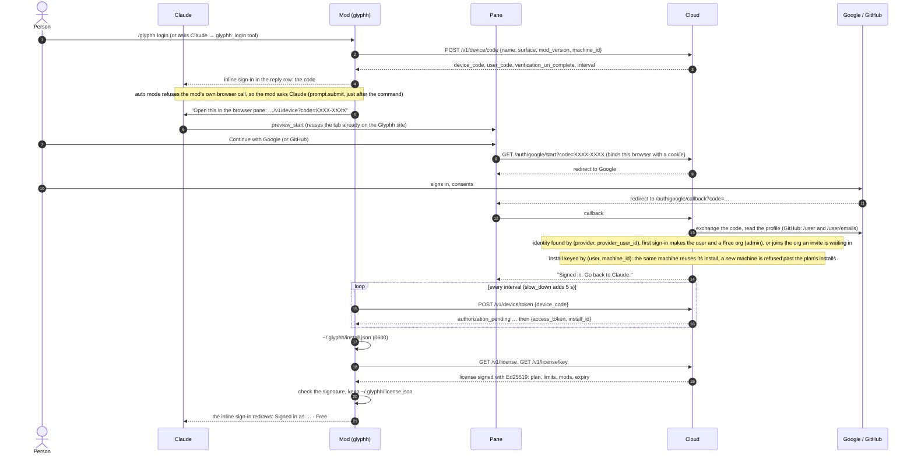

**State:** built, end to end, on 2026-10-14 (Google and GitHub, `/glyphh login`, `glyphh_login`, install reuse by machine).

- `/glyphh logout` revokes this machine's install (`POST /v1/sign-out`) and removes `install.json` and `license.json`.
- **Linking** a second provider to the same account (`POST /v1/me/identities` → the provider's page → the same callback, marked as a link): built.
- The license is refreshed at start and daily; a revoked install answers 401 and the mod signs out.

### 1.2 The local rrotor starts and links

The `glyphh` mod starts the local rrotor once the machine is signed in. The other mods work through it.

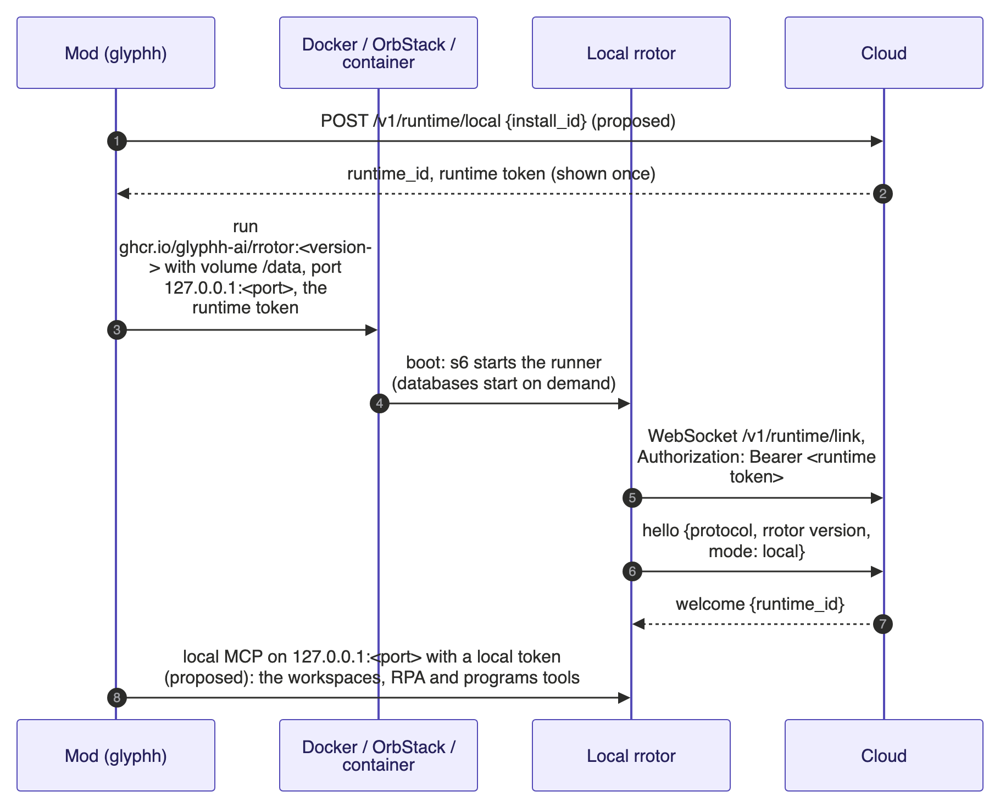

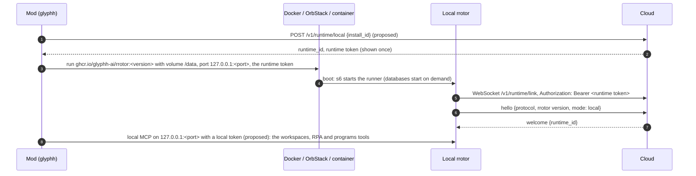

**State:** designed (the local rrotor, the outbound link); proposed: how the local runtime gets its token and how the mods reach it (see [Open](#open)).

### 1.3 The hosted rrotor, on upgrading to Pro or Team


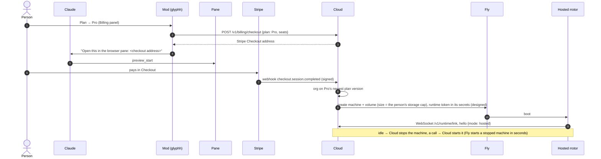

**State:** checkout and webhook built; provisioning designed.

### 1.4 The Glyphh connector: Claude and its routines allowed to call Glyphh

Routines run on Anthropic's machines, so they reach Glyphh through a connector added once at claude.ai/customize/connectors, signed in with OAuth.


**State:** designed (connector, OAuth endpoints, `connector_grants` table built); proposed: the Allow page.

- A grant is revoked one at a time; a revoked grant answers 401.
- The Cloud never holds a Claude login: Claude runs on the person's subscription and calls Glyphh's tools.

## 2. A program, end to end

**The sample:** `daily_sales`. Every morning it reads yesterday's sales from `analytics.example.com` (a site the person signs in to) and its API (an API key), adds them up, and hands back rows for a dashboard in Claude.

```python
from glyphh import Ctx, Result

def load(ctx: Ctx) -> None:
    ctx.page = ctx.browser.open("work", "https://analytics.example.com")

def start(ctx: Ctx, inputs: dict) -> Result:
    if ctx.page.signed_out():
        return Result.needs_signin(profile="work", site="analytics.example.com")
    day = inputs.get("day") or ctx.yesterday()
    rows = ctx.http.get("https://api.analytics.example.com/v1/sales",
                        params={"day": day}, key=ctx.secrets["ANALYTICS_KEY"]).json()
    total = sum(r["amount"] for r in rows)
    ctx.db.postgres.execute("insert into daily (day, total) values (%s, %s)", day, total)
    return Result.done({"day": day, "total": total, "rows": rows})

def end(ctx: Ctx) -> None:
    ctx.page.close()
```

Its manifest declares the function `start` (input `day`, optional), the hosts `analytics.example.com` and `api.analytics.example.com`, the secret `ANALYTICS_KEY`, the profile `work`, and Postgres.

### 2.1 Build, in Claude, against the local rrotor


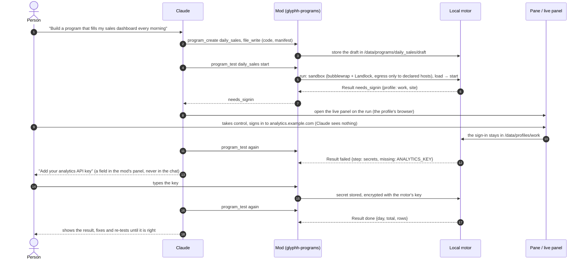

**State:** designed (programs mod and local rrotor not built).

### 2.2 Deploy: to the hosted rrotor, and the routine

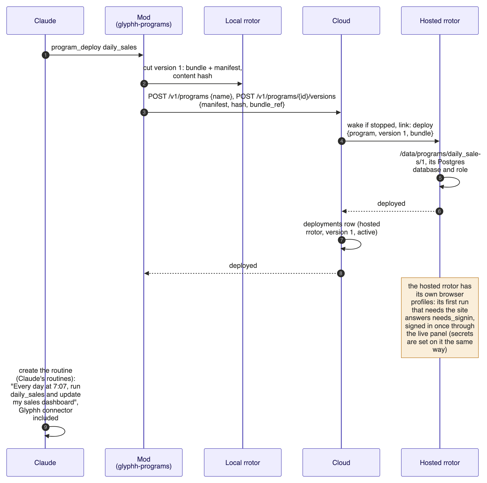

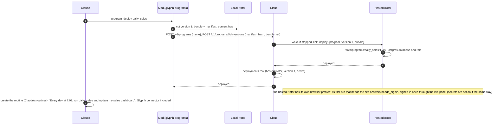

**State:** designed. (Local runs need no deploy: a local program runs where it was built.)

### 2.3 Update

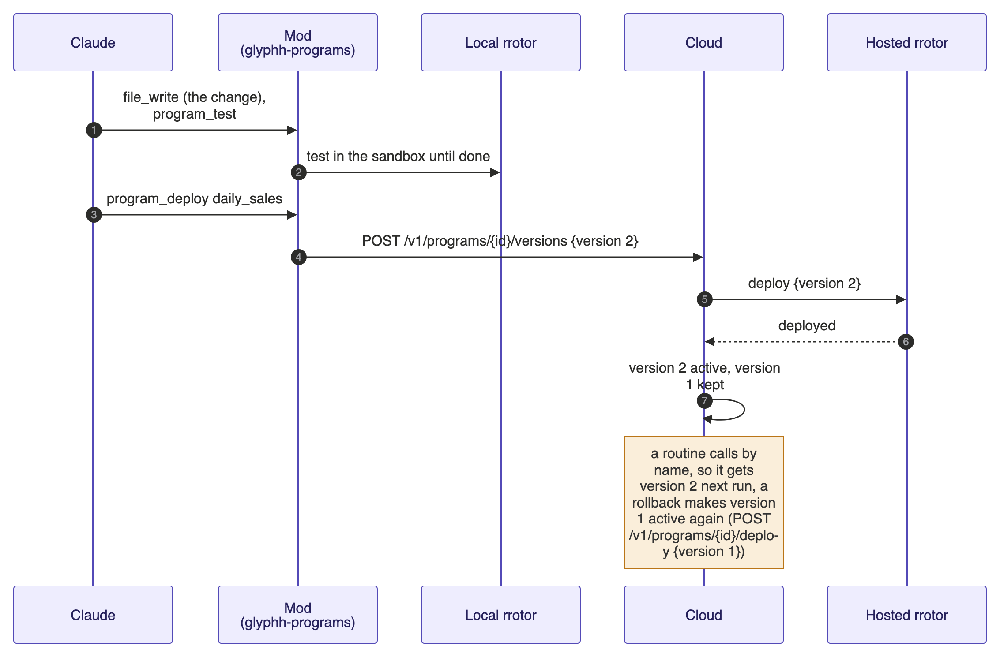

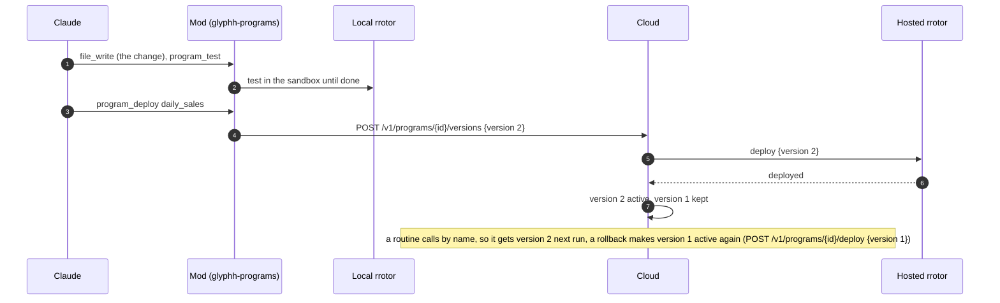

**State:** designed.

### 2.4 Run live, from Claude


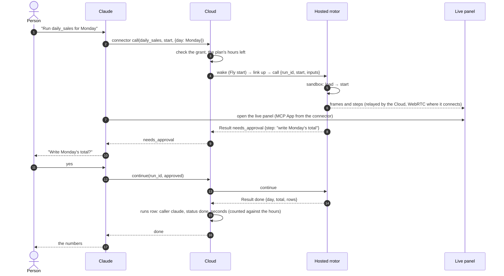

**State:** designed.

### 2.5 Run on a schedule, back through Claude, output to a dashboard

The routine is the runner. Claude in the routine calls the program, answers what it asks, and writes the result to a dashboard (an artifact in Claude with its own database).


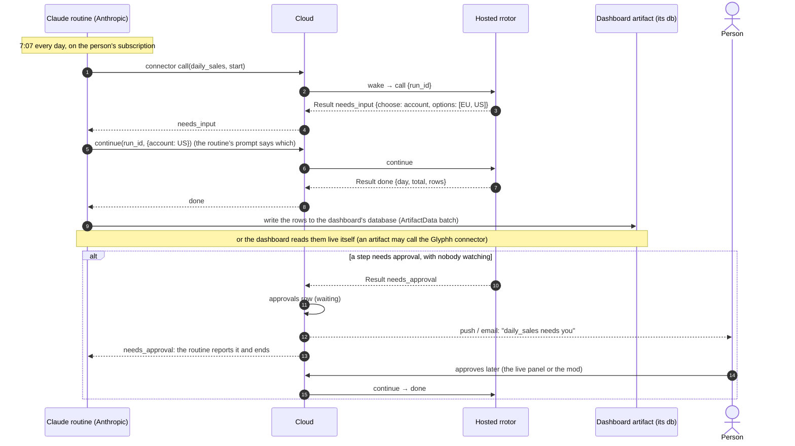

**State:** designed. To prove: a scheduled routine writing to an artifact's database unattended, and an artifact calling a custom connector.

### 2.6 The Cloud starting a routine (calls back to Claude)

When something happens on Glyphh's side (a program finished, a page it watches changed, a waiting step was approved), the Cloud can start a routine through the routine's API trigger, with the data as its text.


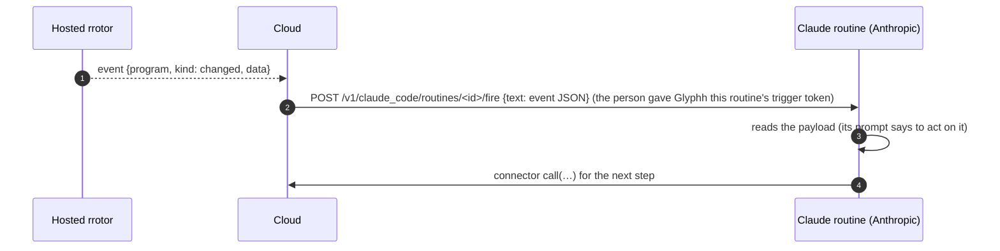

**State:** designed. The routine's trigger token starts that routine only; it is not a Claude login.

## 3. What every call carries

| Between | How | Auth |
|---|---|---|
| Mod → Cloud | HTTPS, `/v1/...` | the install's token (Bearer) |
| Browser → Cloud sign-in pages | HTTPS | a short-lived cookie binding the browser to the sign-in |
| rrotor → Cloud | WebSocket `/v1/runtime/link`, outbound only | the runtime's token (Bearer header, never in a URL) |
| Cloud → rrotor | messages down the link: call, continue, cancel, deploy | the link itself |
| Claude / routines → Cloud | MCP over HTTPS, `/mcp` | the connector grant's token (OAuth) |
| Cloud → routine | HTTPS POST to the routine's `/fire` | the routine's trigger token |
| Mod → local rrotor | MCP on `127.0.0.1` | a local token (proposed) |
| Stripe → Cloud | webhook | Stripe's signature |

## Open

- **The local rrotor's token and reach** (1.2): `POST /v1/runtime/local` for its runtime token; the mods reach it as a local MCP server on `127.0.0.1` with a local token. Or the mods go through the Cloud over the same link as the hosted one.
- **The Allow page** for the connector's OAuth (1.4): one more server page, the only one besides the device page.
- **The live panel's transport:** frames over the link and the relay first; WebRTC end to end later.
- **Secrets on the hosted rrotor:** set again there (2.2), or carried from the local one encrypted to the hosted rrotor's key.
- **Per-program isolation in Neo4j:** the free edition holds one database.
