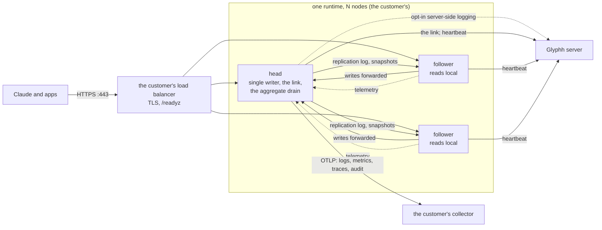

# Spec: clustered rrotor, logging and log drains

Status: decided 2026-10-19; build order steps 5 (the skeleton) and 6 (replication with a fixed head) built, as
[architecture](../architecture.md#14-the-cluster) section 14 describes; steps 7 to 10 not built. Today a self-hosted rrotor is one box ([architecture](../architecture.md));
this is how several become one runtime, and how what they log reaches the customer. The licence key and its caps,
which gate all of this, are [licensing.md](licensing.md).

The rules it keeps: the customer runs every node (Compose on a VM, Helm on Kubernetes behind a load balancer,
Terraform); Glyphh hosts nothing, relays nothing and gives no DNS name; the server is never on the data path and
sees nodes only through the link and the heartbeat; telemetry, audit and logs stay on the rrotor unless the
customer sends them somewhere.

## 1. The shape

A cluster is N rrotors of one runtime (one runtime id and token, one public host) behind the customer's load
balancer, each with its own `/data`. One is the **head**: the single writer of everything that syncs, the holder
of the cluster's link and its aggregate state, and where its drain is exported from. The rest are **followers**:
they serve every read locally from their replica and forward every write to the head.




Free (Community) is one node and has no head: everything here is off and rrotor is today's one box.

## 2. What syncs

| Syncs | What it is on `/data` | How it changes |
|---|---|---|
| **Each Ada model's precedent store** | `models/<name>/data/precedents.sqlite`: the `precedents` table (id, situation, outcome, dim, glyph, author, ts, events) and the `meta` table (`learned`: what `learn` produced, the weights and word tables; `tau`: what `calibrate` fitted; `settings`: what `configure` kept) | Written by the kernel inside the sandbox, by `record`, `learn`, `calibrate`, `configure`, a rewrite after `learn`, a re-encode at deploy |
| **Deployed models and versions** | `models/<name>/versions/<commit>/` (source and venv), `active.json` | Deploy, activate, remove |
| **Runtime keys** | `access.json` | The link's `keys` (the head's link only) |
| **The licence key** | `licence.json` | The head's heartbeat or link, its file or environment |
| **Cluster state** | `cluster/state.json` (cluster id, term, members, voters), `cluster/log/` | Membership, election |

**Never syncs:** runs (`runs/<id>/`: their records, checkpoints and logs: a run lives on the node that ran it),
sandbox state and `/tmp`, parts (each node's come from its image), `runtime.json` (every node has the same id and
token from its own environment), `machine-id`, the link's outbox (the head's alone), the local audit store (each
node's own, gathered at the head, [7](#7-logging-audit-and-drains)), and any data-folder file but
`precedents.sqlite`.

**A model that keeps other state** (a non-Ada model with `"data": true`, or one that writes its `files/` folder)
runs on the head only: every call to it is forwarded. Only the Ada store has a replication format.

## 3. Replication

### The head is the single writer

Writes are forwarded to the head; the head runs them, captures what changed, orders it and ships it.

Chosen over "each node appends locally to a log the head orders" because:

- **The cap and `learn` need one store.** The per-node cap is on the synced store; with writers on every node no
  one sees the total until the head has ordered it, so the cap could only be enforced after the fact. `learn` run
  on two nodes over two different stores computes two different weight tables.
- **Read-your-writes.** A `decide` that asks for the outcome and records it, then a `query`, sees its own precedent;
  with local appends the next call through the load balancer may not.
- **Latency is one LAN hop**, paid on writes only; reads, the bulk of an Ada model's traffic, stay local.
- **A head outage stops writes, not reads**, and the store cannot diverge while it lasts. With local appends a
  partition lets every side grow its own store, and someone has to merge them.

### Which calls write

A new manifest key, per function: `"writes": true | false`. Default `true` for a function of a model with
`"data": true` (safe: it is forwarded), `false` otherwise. The Ada skill and the examples mark `query`, `facts` and
`probabilities` `"writes": false`; `record`, `learn`, `settings`, `decide` and `start` write.

The sandbox enforces it: on a follower a run's `/data` (and `/files`) is mounted **read-only** and the SDK opens the
store with the kernel's read-only mode (`Space(path, readonly=True)`: `file:…?mode=ro`, no `journal_mode` pragma,
no schema made, a rewrite or re-encode on open kept in memory only; kernel 3.10, `glyphh-ai/ada-private`). A
function marked `false` that writes fails loudly (`E_READ_ONLY`, naming the function) instead of diverging.

A follower that receives a writing call (`POST /v1/runs`, `model_call`, deploy, activate, remove) forwards the
request, with its caller already authenticated, to the head over the cluster transport ([6](#6-transport)), and
answers what the head answers. Forwarding carries the caller (key hash or sign-in), the clearance and a deadline.

### Capturing changes on the head

The kernel writes SQLite from inside the sandbox; the daemon never sees the calls. So the daemon installs, in each
Ada store on the head, a change table and triggers:

```sql
CREATE TABLE IF NOT EXISTS _rrotor_changes (n INTEGER PRIMARY KEY AUTOINCREMENT, tbl TEXT, op TEXT, key TEXT);
CREATE TABLE IF NOT EXISTS _rrotor_capture (on_ INTEGER);   -- one row; 0 while a follower applies
-- AFTER INSERT / UPDATE / DELETE on precedents (key: id) and meta (key: key),
--   WHEN (SELECT on_ FROM _rrotor_capture) = 1: INSERT INTO _rrotor_changes (tbl, op, key)
```

The store is made by the kernel on the model's first run; the daemon installs the triggers before every run on the
head (`CREATE … IF NOT EXISTS`, a few milliseconds) and, for a store that had none, ships a snapshot first. After a
writing run ends (and every second while one runs), the daemon reads `_rrotor_changes` past its cursor, reads the
current row for each key, and appends one **entry** per run to the replication log:

```json
{"seq": 1042, "term": 3, "kind": "rows", "model": "incidents",
 "rows": [{"tbl": "precedents", "op": "upsert", "row": {"id": "…", "situation": "…", "outcome": "…", "dim": 4096, "glyph": "<b64>", "author": "…", "ts": 0, "events": null}},
          {"tbl": "meta", "op": "upsert", "row": {"key": "learned", "value": "…"}}]}
```

Then it deletes the captured change rows. Every change goes this way: a record, `learn`'s `learned` and the rows
it rewrites, `calibrate`'s `tau`, `configure`'s `settings`, a re-encode's every row. **`learn` results are
distributed** as any other rows; a follower's next run reads them from `meta` when it opens the store.

The other entry kinds: `deploy {model, version, commit_sha, manifest}`, `activate`, `remove`, `keys {hashes}`,
`licence {key}`, `member {add | remove, node}`, `snapshot_marker`.

### The log

`/data/cluster/log/` on every node: segment files of JSON lines, each entry with `seq` (one rising number per
cluster) and `term` (the head's, [4](#4-membership-and-the-head)). The head appends; a follower appends what it
receives and applies it in order. Kept until every member has applied it and a snapshot covers it, at most
`RROTOR_CLUSTER_LOG_KEEP` (1 GiB); past that a lagging follower catches up from a snapshot.

**A follower applies** each entry in one SQLite transaction on the replica (`_rrotor_capture` set to 0 for it), then
records `applied_seq` in `cluster/state.json`. Followers keep their replicas in `journal_mode=DELETE` and the
applier sets a `busy_timeout`: a run reading the store sees it before an entry or after, never half. A run that is
waiting keeps the store as it opened it, as today's worker does. A `deploy` entry makes the follower fetch the
version from the head (`GET /cluster/v1/versions/<model>/<commit>.tar`: `src/` and `venv/`, the head's build, so no
follower needs GitHub or PyPI); a node of another architecture than the head's refuses it (`E_CLUSTER_ARCH`): one
cluster, one architecture.

### Commit

| | When the head answers the call | A head lost before followers have it |
|---|---|---|
| **Pro, Team** | Once the entry is on the head's disk (asynchronous) | Lost writes are possible, of the last moments; the promotion command shows each follower's lag and refuses a lagging one without `--force` |
| **Enterprise** | Once a majority of voters hold the entry (`E_NOT_COMMITTED` 503 after 5 s, the entry kept and committed when they return) | No acknowledged write is lost |

**Read-your-writes through one node:** the head's answer carries `Rrotor-Cluster-Seq`; a follower that forwarded a
write waits (up to 2 s) until it has applied that seq before answering. A caller that moves between nodes may send
`Rrotor-Min-Seq: <seq>`; a node behind it waits up to 2 s, then forwards the read to the head.

### Catch-up

A new node, or one past the head's log: the head sends a **snapshot**: each Ada store via SQLite's online backup
(`sqlite3.Connection.backup`, consistent inside one read transaction, with the change cursor it reached mapped to a
seq), each deployed version's tar, `access.json`, the licence and the cluster state, as one stream; then the log
from the snapshot's seq. The node is **not ready** (`/readyz` 503) until it has applied to within one second of
the head; the load balancer sends it nothing until then.

### Runs and the node that holds them

A run lives on the node that runs it. In a cluster its id carries that node: `<node id>~<uuid>`. Any node forwards
`continue`, `cancel`, `GET /v1/runs/{id}` and its log to the holder. A holder that is gone answers `E_RUN_LOST`
(410): the run is lost as on a restart today. `GET /v1/approvals` on any node gathers every node's.

### What a caller sees when the head changes

| | Reads (`writes: false`) | Writes |
|---|---|---|
| Head alive | Local, every node | Forwarded, answered by the head |
| Head lost, Enterprise | Local, uninterrupted | 503 `E_NO_HEAD`, `Retry-After: 2`, for the election (1 to 3 s) |
| Head lost, Pro and Team | Local, uninterrupted | 503 `E_NO_HEAD` until the head restarts or is promoted by hand |
| A run on the lost head | `E_RUN_LOST` | `E_RUN_LOST` |

The SDKs retry `E_NO_HEAD` with backoff for up to 10 s. MCP returns it as a tool error, which Claude retries.

## 4. Membership and the head

### Finding each other

| Setting | Where |
|---|---|
| `RROTOR_CLUSTER_PEERS=rrotor-0:7778,rrotor-1:7778,rrotor-2:7778` | Compose, Terraform: a static list, the same on every node |
| `RROTOR_CLUSTER_DNS=rrotor-headless.rrotor.svc.cluster.local` | Kubernetes: the StatefulSet's headless Service (`publishNotReadyAddresses: true`); rrotor resolves it every 10 s and dials every address on `RROTOR_CLUSTER_PORT` |

The list or the DNS answer is only how nodes **find** each other. **Membership** is in the log: a node is a member
once the head has committed its `member add`. Each node has an id (`RROTOR_NODE_ID`, default the hostname: the pod
name `rrotor-0`), kept in `cluster/state.json`; two nodes with one id are refused.

### Joining, and `max_nodes`

A node with `RROTOR_CLUSTER=on` and a licence with `cluster_sync_enabled` dials its peers, finds the head (any
member answers who it is) and asks to join. The head admits it unless the cluster has `max_nodes` members
(`E_CLUSTER_FULL`), commits `member add`, and sends it a snapshot. A refused node logs it at error, keeps its
`/data`, answers 503 `E_CLUSTER_FULL` to everything but `/healthz` (so `/readyz` keeps it out of the load balancer)
and asks again every minute: an upgrade or a removed member lets it in. Leaving is `rrotord cluster leave <node>`
(or a member unseen for `RROTOR_CLUSTER_EVICT_AFTER`, default 24 h, removed by the head). Changes go one node at a
time.

**Bootstrap:** the first time, with no member state anywhere, the node named by `RROTOR_CLUSTER_HEAD` (default:
the lowest node id among the peers) makes the cluster: a new `cluster_id` (UUID), term 1, itself head. Every other
node waits for it.

### The election: terms, a hand-written Raft, no external dependency

| Option | For | Against |
|---|---|---|
| A lease in an external store (etcd, Redis, a database) with fencing tokens | Simple to write | A dependency Compose does not have, and the lease is only as safe as that store |
| A Kubernetes Lease object | Native on Kubernetes | Kubernetes only; RBAC and a client in the image; Compose and Terraform still need something else |
| A Raft library (PySyncObj and the like) | Election written already | Its own TCP transport and serialisation (pickle, in PySyncObj), its own threads; neither aiohttp nor asyncio nor our mTLS; its log is not ours |
| **Raft's election and log rules, in `rrotord/cluster/`, on our own transport and log** | One mechanism everywhere; terms are the fencing tokens; the log above is already Raft's shape (term, seq) | We own its correctness: a deterministic simulation test (below) |

**Chosen: the last.** What it is, exactly: Raft's terms, `RequestVote` with the log-up-to-date rule, `AppendEntries`
with (term, seq) matching and truncation of a diverged tail, commit by majority of voters (Enterprise), snapshots,
single-node membership changes. **Voters** are the first five members (by join); the rest are non-voting learners,
so a large Enterprise cluster's commits wait on five, not on all.

**Fencing.** Every entry, forward and apply carries the term. A node refuses anything from a lower term; a head
that sees a higher term steps down at once, fails its in-flight writing runs (`E_NO_HEAD`) and, on rejoining,
discards any entries past the new head's log for the models they touched by taking those models' snapshot.

**Split brain.** Enterprise: a head that has not heard from a majority of voters within the election timeout
(1.5 s) stops accepting writes before any other node can be elected (timeouts 1.5 to 3 s, randomised; heartbeats
every 250 ms). A partition's minority side serves reads and refuses writes. Pro and Team: there is no automatic
election, so there is never a second head unless an operator promotes one; `rrotord cluster promote` requires a
majority of members reachable and asks the operator to confirm the old head is down when it is unreachable (its
higher term then fences the old head when it returns).

### What HA means, by tier

| | Head | When the head is lost | Writes need |
|---|---|---|---|
| **Pro, Team** | Fixed: the bootstrap head, until moved | The cluster serves reads; writes wait for the head to restart (Kubernetes and `restart: unless-stopped` do this in seconds) or for `rrotord cluster promote <node>` | The head |
| **Enterprise** | Elected | Another voter is elected in 1.5 to 3 s; writes resume | A majority of voters |

An Enterprise cluster of two nodes behaves like Pro (no majority survives a loss); three or more voters are
recommended, an odd number.

### The head's other jobs

It holds the runtime's **link** (followers do not link: there is one link per runtime, as today, so a follower
never takes it over); server-sent deploys arrive there. It gathers the followers' `usage` key counts once a minute
and sends one `usage`. It exports the cluster's **drain** ([7](#7-logging-audit-and-drains)) and keeps the cluster's
audit store. It answers `GET /v1/cluster`. A new head takes all of these over; the link reconnects from it.

## 5. Licensing in a cluster

- **One key per cluster.** Each node is started with the same key (the packages put it in the cluster's Secret),
  and the head propagates the newest it holds (from its heartbeat or link) as a `licence` entry. **Every node checks
  the signature itself**; a node never takes the head's word for a key.
- **The head checks the limits:** `max_nodes` at join, `cluster_sync_enabled` before anything replicates, the
  precedent cap on every write (it is the only writer).
- **The cap is per node, on the synced store:** every node holds the whole store, so a Pro cluster holds 50,000
  precedents across its models, the same 50,000 on each of its three nodes. It is not 3 × 50,000.
- **A downgrade:** a key with a smaller `max_nodes` makes the head remove the members joined last until the cluster
  fits (never the head); they become refused nodes, `/data` kept. A smaller `max_precedents` refuses growth, as on
  one node ([licensing.md](licensing.md#over-the-cap-after-a-downgrade)).
- **Past grace, or Community:** sync stops. The head runs on as a standalone node with Community limits; the
  followers become refused (`E_LICENCE_CLUSTER`), their data kept at their applied seq. A new key resumes the
  cluster from there.
- **Every node heartbeats** with its `node_id`, `cluster_id` and `role` ([licensing.md](licensing.md#5-the-heartbeat)),
  so the server sees every node, synced or not.

## 6. Transport

| | gRPC | **WebSocket on aiohttp** |
|---|---|---|
| Dependencies | `grpcio` and `protobuf`, about 30 MB in the image per architecture, a code generator, stubs for mypy | None new: aiohttp is the server and the link's client already |
| Patterns in the code | New: a second server stack, its own asyncio integration | The link: JSON frames, `type` and `id`, `ack`, `ping`; the outbox; reconnect with backoff |
| Streams | Native | One long-lived WebSocket per pair of nodes, binary frames for snapshots and tars |
| mTLS | Yes | Yes (`ssl.SSLContext` with `CERT_REQUIRED` on both sides) |
| HTTP/2 | Yes | No (aiohttp's server is HTTP/1.1); not needed: one connection per pair, multiplexed by message ids |

**Chosen: WebSocket on aiohttp**, on its own listener, `:7778` (`RROTOR_CLUSTER_PORT`), never on 7777 and never
behind the public load balancer. Messages: `hello`, `vote`, `append` (entries), `ack {seq}`, `snapshot` (binary
chunks), `forward {request}`, `answer`, `telemetry` (OTLP batches, [7](#7-logging-audit-and-drains)), `ping`.
`GET /cluster/v1/versions/…` is a plain request on the same listener.

**The cluster's credentials: one secret, mTLS from it.** `RROTOR_CLUSTER_SECRET` (32 bytes or more, base64) is the
only thing the operator makes. From it every node derives, with HKDF-SHA256, the same Ed25519 **cluster CA** key
and a fixed CA certificate; at start each node makes its own key and issues itself a leaf certificate (its node id
in the SAN) from that CA, with `cryptography` (a dependency already). Both ends require a certificate from the
cluster CA and check the peer's node id. So: mutual TLS between every pair, no certificate to issue or rotate by
hand, and rotation is a new secret, rolled node by node with `RROTOR_CLUSTER_SECRET_PREVIOUS` accepted meanwhile.
Anyone with the secret can join (up to `max_nodes`), which is the point of it: keep it as the runtime token is
kept. **Never a runtime key:** runtime keys are callers' credentials; a node-to-node request carries the caller's
identity as data, inside the cluster's own TLS.

## 7. Logging, audit and drains

**Everything stays on the rrotor by default.** Nothing below leaves it unless the customer sets a drain (their
collector) or turns on server-side logging (Glyphh). The heartbeat and the link's `usage` are licensing, not
telemetry, and keep their fixed fields.

### What rrotor logs

JSON lines on stdout, as today (`rrotord/log.py`: `at`, `level`, `logger`, `message`, fields; tokens masked),
level `RROTOR_LOG_LEVEL`. Added to every line: `node_id`, and `cluster_id` and `role` in a cluster; `run_id`,
`model`, `version`, `function` where there is one; `trace_id` and `span_id` when tracing. Kept locally by the
container runtime: the packages set Docker's `json-file` driver to `max-size: 10m`, `max-file: 5`; on Kubernetes the
kubelet rotates. A run's own `ctx.log` lines stay in `runs/<id>/log.jsonl` as today.

### Audit events (Enterprise)

One per thing that happened, who did it and how it ended:

```json
{"id": "<uuid>", "at": "2026-10-19T09:00:00Z", "node_id": "rrotor-1", "cluster_id": "…",
 "kind": "run.call", "actor": {"type": "key", "key_sha256": "3f2a…9c"},
 "client": "10.0.4.17", "model": "incidents", "version": 3, "function": "record", "run_id": "rrotor-0~…",
 "outcome": {"status": "done", "code": null}, "seconds": 0.21}
```

| `kind` | When |
|---|---|
| `run.call`, `run.continue`, `run.cancel`, `run.end` | Every call, by any route (REST, MCP, the link); `run.end` with the final status |
| `model.deploy`, `model.activate`, `model.remove`, `model.deploy_failed` | Every deploy and its outcome |
| `keys.changed` | The runtime keys' list changed (counts and the hashes added and removed) |
| `licence.changed`, `licence.expired`, `licence.bad` | A key taken, past grace, refused |
| `cluster.join`, `cluster.refused`, `cluster.leave`, `cluster.head` | Membership and head changes, with the term |
| `access.denied` | A 401 or 403, with the code |
| `config.server_logs` | Server-side logging turned on or off |

`actor.type` is `key` (its SHA-256, never the key), `sign-in` (the subject the server's introspection names), `local`,
`server` (a link `deploy`) or `rrotor` (its own work, a re-encode). `client` is the request's address (the last
`X-Forwarded-For` hop the packages' proxy sets), kept locally and in the customer's drain only.

**Kept** in `/data/audit/<YYYY-MM-DD>.jsonl`, one file a day, appended and fsynced per event; deleted past
`RROTOR_AUDIT_RETENTION_DAYS` (90) or when the folder passes `RROTOR_AUDIT_MAX_MB` (1024), oldest first, which
itself is logged. In a cluster each node keeps its own and sends its events to the head, which keeps the cluster's
in the same form under `/data/audit/cluster/`. `GET /v1/audit` reads the head's. Below Enterprise there is no audit
store: the same events are ordinary log lines (`logger: rrotor.audit`) and are not kept by rrotor.

### Drains: OpenTelemetry to the customer's collector

The recommended setup: each rrotor (or the head, for the cluster) exports logs, metrics, traces and audit events by
**OTLP** to the customer's own collector, never through Glyphh.

- **The protocol:** OTLP over HTTP with protobuf (`http/protobuf`), with the OpenTelemetry Python SDK and its
  `opentelemetry-exporter-otlp-proto-http` exporter (pure Python, a few MB). OTLP over gRPC is not offered: it needs
  `grpcio` (see [6](#6-transport)); a collector takes HTTP and forwards gRPC if the backend wants it.
  `OTEL_EXPORTER_OTLP_PROTOCOL=grpc` is refused at start (`E_CONFIG`).
- **The settings are OpenTelemetry's own:** `OTEL_EXPORTER_OTLP_ENDPOINT` (and the per-signal `…_LOGS_ENDPOINT`,
  `…_METRICS_ENDPOINT`, `…_TRACES_ENDPOINT`), `OTEL_EXPORTER_OTLP_HEADERS`, `OTEL_EXPORTER_OTLP_CERTIFICATE`,
  `OTEL_RESOURCE_ATTRIBUTES`, `OTEL_SERVICE_NAME` (default `rrotor`), `OTEL_TRACES_SAMPLER` and
  `OTEL_TRACES_SAMPLER_ARG` (default `parentbased_always_on`). No endpoint, no drain. `RROTOR_DRAIN_SIGNALS`
  (default `logs,metrics,traces,audit`) picks what goes.
- **Resource attributes** rrotor sets: `service.name`, `service.version`, `service.instance.id` (the node id),
  `rrotor.runtime.id`, `rrotor.cluster.id`, `rrotor.node.role`, `rrotor.mode`.
- **Logs:** every line above as an OTLP log record. **Audit events:** OTLP log records with
  `event.name = rrotor.audit.<kind>` and the event's fields as attributes. **Metrics:** `rrotor.runs` (counter: model,
  function, status), `rrotor.run.seconds` (histogram), `rrotor.precedents` (gauge per model, and the cap),
  `rrotor.link.state`, `rrotor.cluster.lag` (seqs behind the head, per follower), `rrotor.cluster.term`,
  `rrotor.drain.dropped`. **Traces:** a span per API request; child spans for the forward to the head, the sandbox's
  start, the function, the commit wait; the caller's `traceparent` honoured.
- **Per node or at the head:** `RROTOR_DRAIN_AT=head` (the default in a cluster): followers send their OTLP batches
  to the head over the cluster transport and the head exports them as they are (each keeps its own
  `service.instance.id`), so the collector sees one endpoint and the customer opens one egress. `node`: each node
  exports itself. A follower that cannot reach the head buffers, as below, and sends when it can.
- **Buffer and drop:** logs, metrics and traces wait in memory, up to `RROTOR_DRAIN_BUFFER` records (10,000) per
  signal, sent in batches every 5 s with retry and backoff; when full the **oldest** are dropped, counted in
  `rrotor.drain.dropped` and logged once a minute. **Audit events are never dropped from the drain:** the export
  reads the audit files from a cursor (`/data/audit/.cursor`) and resumes there, so an endpoint that is down for a
  day gets the day's events when it is back, as long as retention still holds them. Below Enterprise the audit
  events are log records and follow the log rule.

### Opt-in server-side logging

`RROTOR_SERVER_LOGS=on` (default `off`) sends the same OTLP signals, in addition to any drain, to
`{RROTOR_SERVER}/v1/otlp/v1/{logs,metrics,traces}` with the runtime token, so the platform can show them. At every
start and in `GET /v1/health` rrotor says plainly:

> Server-side logging is on: this rrotor's logs, metrics, traces and audit events are sent to Glyphh
> (api.glyphh.ai) and leave your infrastructure. Set RROTOR_SERVER_LOGS=off to keep them here.

It is refused with the link off (`E_CONFIG`: an air-gapped rrotor sends nothing). It never sends what the next
section keeps back, and never `client` addresses, even when the customer's own drain gets them. In a cluster the
head sends it for the cluster.

### Redaction

Never in a log line, audit event, span or metric: a model's inputs, its outputs (`Result.data`, prompts, answers),
`ctx.log`'s fields, secrets, tokens or keys (keys as SHA-256 only), the bodies of requests. Run ids, model names,
function names, statuses, codes, durations and counts are what is sent. `RROTOR_LOG_PAYLOADS=on` (default `off`)
adds inputs and `Result.data` to the run's span attributes and `run.end` audit events, truncated to 4 KB each, **for
the customer's drain only**; server-side logging never carries them. The existing token mask stays on everything.

## 8. Programs and the gateway, later

**Programs** (coding-agent CLIs run on the runtime) will be scheduled from the head: it is the one place that knows
every node's load and which node holds what. What this design leaves for it: the head's job list
([4](#4-membership-and-the-head)) is a registry new jobs join; members report their free CPU, memory and running
runs in `ping`; the `forward` message can name a target node, not only the head; a run's id names its holder, so a
Program's session can live on one node and be reached from any. No placement, queue or Program state is designed
here.

**The gateway** (models behind OpenAI- and Anthropic-compatible endpoints) will be configured once at the head and
replicated as its own entry kind, then served on every node like any read. What this leaves for it: the log's entry
kinds are open (a node refuses a kind it does not know only by failing readiness, so an upgrade rolls out before
the head writes new kinds); the forward path and the read path are already separate, so a gateway route can be
local or head-only per route.

## 9. Failure cases

| Case | What happens |
|---|---|
| The head dies mid-write | The run is lost with it; the caller gets a dropped connection or `E_NO_HEAD`. Enterprise: an uncommitted entry is gone from the cluster; the old head discards it on rejoin (snapshot of the models it touched). Pro and Team: entries the followers did not get are lost if another node is promoted; kept if the head restarts |
| The head dies between runs | Enterprise: a new head in 1.5 to 3 s. Pro and Team: writes 503 until it restarts or is promoted |
| A network partition | Enterprise: the majority side elects (or keeps) a head and takes writes; the minority side serves reads at its last applied seq and refuses writes; on healing the minority catches up. Pro and Team: the side without the head serves reads only |
| A follower falls behind or restarts | Catches up from the log, or from a snapshot past `RROTOR_CLUSTER_LOG_KEEP`; not ready until within a second of the head |
| A node past `max_nodes` | Refused at join (`E_CLUSTER_FULL`), not ready, data kept, asks again every minute |
| Two nodes with one node id | The second is refused (`E_CLUSTER_NODE_ID`) |
| A node of another architecture | Refuses the first `deploy` entry (`E_CLUSTER_ARCH`), not ready |
| The cluster secret differs on one node | Its TLS handshakes fail; it logs `cluster: peer certificate not from this cluster` and stays not ready |
| The licence expires mid-run | Runs in flight finish. Within 14 days nothing changes. Past grace: sync stops, the head runs alone on Community limits, followers are refused (data kept) |
| A function marked `"writes": false` writes | `E_READ_ONLY` on a follower; the store is untouched |
| The disk fills on a follower | Apply fails; the node stops applying, goes not ready and logs it; the head keeps its entries until it returns or is evicted |
| The drain's endpoint is down | Logs, metrics, traces buffered to `RROTOR_DRAIN_BUFFER` per signal, oldest dropped and counted; audit events resume from the cursor when it is back |
| The head is down, `RROTOR_DRAIN_AT=head` | Followers buffer as above; the new head (or the old one, restarted) takes the batches |
| Glyphh unreachable | Nothing in the cluster changes: no part of replication, election or drains uses the server. The key holds to its expiry plus grace |

## 10. Settings and interfaces

### Settings

Every new variable (the licence's are in [licensing.md](licensing.md#where-it-is-read)). A setting missing or
malformed stops rrotor at start with `E_CONFIG`, naming it.

| Variable | Default | Meaning |
|---|---|---|
| `RROTOR_CLUSTER` | `off` | `on`: join or make a cluster (needs a key with `cluster_sync_enabled`) |
| `RROTOR_NODE_ID` | the hostname | This node's name in the cluster: `[a-z0-9-]{1,63}` |
| `RROTOR_CLUSTER_PEERS` | | `host:port,…`: where the members are (Compose, Terraform) |
| `RROTOR_CLUSTER_DNS` | | A name whose A/AAAA records are the members (Kubernetes' headless Service); one of this and `PEERS` |
| `RROTOR_CLUSTER_PORT` | `7778` | The cluster listener |
| `RROTOR_CLUSTER_ADVERTISE` | `<node id>:<port>` | How the other nodes reach this one |
| `RROTOR_CLUSTER_SECRET` | | Required with the cluster on: 32 or more bytes, base64 |
| `RROTOR_CLUSTER_SECRET_PREVIOUS` | | Accepted too, while a new secret rolls out |
| `RROTOR_CLUSTER_HEAD` | the lowest node id | Which node makes the cluster at bootstrap |
| `RROTOR_CLUSTER_LOG_KEEP` | `1g` | The log kept for catch-up before a snapshot is needed |
| `RROTOR_CLUSTER_EVICT_AFTER` | `24h` | A member unseen this long is removed by the head |
| `RROTOR_AUDIT_RETENTION_DAYS` | `90` | Days of audit kept (Enterprise) |
| `RROTOR_AUDIT_MAX_MB` | `1024` | Size of the audit folder, oldest deleted first |
| `RROTOR_DRAIN_SIGNALS` | `logs,metrics,traces,audit` | What the drain sends |
| `RROTOR_DRAIN_AT` | `head` in a cluster | `head` or `node` |
| `RROTOR_DRAIN_BUFFER` | `10000` | Records held per signal while the endpoint is down |
| `RROTOR_SERVER_LOGS` | `off` | `on`: also send them to Glyphh, with the warning above |
| `RROTOR_LOG_PAYLOADS` | `off` | `on`: inputs and results in the customer's drain |
| `OTEL_EXPORTER_OTLP_*`, `OTEL_RESOURCE_ATTRIBUTES`, `OTEL_SERVICE_NAME`, `OTEL_TRACES_SAMPLER`, `OTEL_TRACES_SAMPLER_ARG` | | The drain, as OpenTelemetry defines them |

### API and MCP

| Call | Does |
|---|---|
| `GET /readyz` (open) | 200 when this node may take traffic: standalone and up; or a member applied to within a second of the head. 503 with the reason otherwise (`joining`, `catching_up`, `refused`, `no_cluster`) |
| `GET /v1/cluster` | `{cluster_id, node_id, role, head, term, commit_seq, applied_seq, tier, max_nodes, ha, members: [{node_id, address, role, voter, applied_seq, lag, last_seen, version}], refused: [{node_id, at, code}]}`; standalone: `{role: "standalone"}` |
| `GET /v1/audit?since&until&kind&actor&model&run_id&limit&cursor` | The cluster's audit events, newest first, paged; on a follower, answered by the head; Enterprise only (403 `E_NOT_IN_PLAN` otherwise) |
| `GET /v1/health` | Adds `cluster` (as above, short), `drains` (per signal: `state`, `buffered`, `dropped`, `last_export_at`), `server_logs` (on or off, with the warning), the licence as [licensing.md](licensing.md#replacing-todays-licence-the-migration) shows it |
| MCP `cluster_status` | `GET /v1/cluster` |
| MCP `audit_query` `{since?, until?, kind?, model?, run_id?, limit?}` | `GET /v1/audit` |

Not on the API, on purpose: joining, leaving and promoting. They are `rrotord cluster join | leave <node> | promote
<node> [--force]`, run on a node (`docker compose exec`, `kubectl exec`) and authenticated by the cluster secret,
so no runtime key can change the cluster.

### The link and the heartbeat

- **`hello`** gains `node_id`, `cluster_id` and `role`. Only a standalone node or a head opens the link. The
  server's `welcome` and the heartbeat's answer gain `license_key`.
- **`usage`** from the head carries the cluster's key counts (summed from the followers each minute) and the synced
  store's `precedents` once.
- **The heartbeat**, from every node: `node_id`, `cluster_id`, `role`, `precedents` (this node's store)
  ([licensing.md](licensing.md#5-the-heartbeat)).
- **The server** needs: `license_key` in `welcome` and the heartbeat's answer; the heartbeat's new fields stored per
  node (`node_id` within the runtime) and shown; a subject in the introspection answer for audit (`sub`); the
  OTLP receiver for server-side logging.

## 11. Build order

Each step ships on its own, keeps 100% coverage, and leaves a standalone rrotor working.

| # | Step | Tests | Proves |
|---|---|---|---|
| 1 | **The licence key** ([licensing.md](licensing.md)): the format, the embedded public key, every source, Community, grace, newest-wins, hourly re-read and `SIGHUP`, the heartbeat's `license_key`, the legacy mapping | `test_licence_key.py`, `test_heartbeat.py`, `test_daemon.py` | A node runs on no key, a bad key, a good key and an expired one, never crashing |
| 2 | **The precedent cap per node**: `limit_exceeded`, replace-at-cap, merge capped, the downgrade behaviour, `precedents` in the licence view | `tests/sdk/test_ada.py`, `test_engine.py`, MCP | Every write path is capped; the caller sees `indexed: false`, never a failure |
| 3 | **Structured logs and audit events**: the fields, the audit store, rotation and retention, `GET /v1/audit`, `audit_query`, Enterprise-gated | `test_audit.py`, routes, MCP | Who called what is recorded, kept and queried locally; nothing redacted leaks (a test feeds secrets and payloads and greps every output) |
| 4 | **Drains**: the OTel SDK, OTLP over HTTP, the resource attributes, buffer and drop, the audit cursor, `RROTOR_SERVER_LOGS` with its warning | `test_drain.py` against an in-process fake collector | Signals reach a collector; a down endpoint loses only the oldest logs and no audit event |
| 5 | **The cluster's skeleton**: settings, node id, the `:7778` listener, the derived CA and mTLS, `hello`, peers by list and DNS, bootstrap, join with `max_nodes`, `/readyz`, `GET /v1/cluster`, `cluster_status`, sync gated by the key. Nothing replicates yet | `tests/daemon/cluster/` with N daemons in one event loop | Nodes find and authenticate each other; a foreign secret is refused; the node past `max_nodes` is refused; Community never listens |
| 6 | **Replication with a fixed head**: the `writes` manifest key, read-only follower runs (kernel 3.10's read-only open), forwarding, run-id holders, change capture, the log, apply, `Rrotor-Cluster-Seq`, snapshots and catch-up, `deploy`, `keys` and `licence` entries, the head-only link and summed `usage` | Two and three daemons with fake sandboxes and a real SQLite store; the image job with a real kernel | A record on any node is read on every node; `learn` on the head changes every follower's answers; a new node catches up; a follower never writes |
| 7 | **Manual failover (Pro, Team)**: terms and fencing, `rrotord cluster promote`, lag shown, `--force`, a rejoining old head discarding its tail | The simulation (below) | Writes resume on the promoted node; no node accepts a lower term |
| 8 | **Elected heads (Enterprise)**: votes, timeouts, majority commit, voters and learners, `E_NOT_COMMITTED`, `E_NO_HEAD` with `Retry-After`, SDK retries | A deterministic simulation: a seeded scheduler over in-memory transports, crashes, partitions, delays and restarts across thousands of seeds; it checks one head per term, no committed entry lost, every replica equal at the end | Raft's safety on our transport, not by argument |
| 9 | **The aggregate drain**: followers' `telemetry` to the head, `RROTOR_DRAIN_AT`, the cluster audit store | Three daemons and a fake collector | One endpoint sees every node's signals with each node's identity |
| 10 | **The packages** (below) and the self-hosting docs | CI's `deploy` job: `helm template` with `cluster.enabled`, Compose `config`, `terraform validate` | They render; a three-node Compose cluster comes up in the image job |

Outside this repo, before step 6 ships: the kernel's read-only open (`glyphh-ai/ada-private`, kernel 3.10) and the
Ada skill's `"writes"` (`glyphh-ai/glyphh`). Before step 1: `license_key` from the server. Before step 4's
server-side logging: the server's OTLP receiver.

## 12. The packages

- **Helm:** `cluster.enabled`, `replicas` (default 3; refused above the key's `max_nodes` only by rrotor, not by
  the chart), `cluster.secret` or `cluster.existingSecret` (the chart generates one with `randAlphaNum` on install
  and keeps it with `lookup`). The StatefulSet with `podManagementPolicy: Parallel`, a pod anti-affinity across
  nodes and zones, the readiness probe on `/readyz`, the liveness on `/healthz`, `RROTOR_NODE_ID` from
  `metadata.name`, `RROTOR_CLUSTER_DNS` set to the headless Service, which gains port `cluster: 7778` and
  `publishNotReadyAddresses: true`. The Service and Ingress reach every ready pod. The PDB becomes
  `maxUnavailable: 1`. A NetworkPolicy allows 7778 between the release's pods only. The chart's "one replica" rule
  goes, and the "not scaled" note becomes the cluster's.
- **Compose:** `docker-compose.cluster.yml`, one machine, three services `rrotor-0..2` (each its own volume, the
  same `.env` plus its `RROTOR_NODE_ID`, `RROTOR_CLUSTER_PEERS` naming the three) and Caddy load-balancing over them
  with a health check on `/readyz`: for trying a cluster, not for HA. For HA, `docker-compose.node.yml` on each of N
  machines, `RROTOR_CLUSTER_PEERS` naming their private addresses, 7778 open between them only, a load balancer in
  front.
- **Terraform:** `node_count` (default 1; 3 for a cluster) VMs across zones, each running the node Compose file;
  the cluster secret in AWS Secrets Manager or Google Secret Manager; a security group or firewall rule for 7778
  between the nodes only; with `node_count` above 1, a load balancer (an AWS NLB with ACM, or Google's external
  HTTPS load balancer with a managed certificate) health-checking `/readyz`, and Caddy dropped from the VMs.
- **Ports:** 7777 (the API, to the load balancer), 7778 (the cluster, node to node only, never public).
- **Secrets the operator holds:** the runtime token (as today), the licence key, the cluster secret.

## 13. Open questions for Chris

1. Should a key be bound to one runtime (a `runtime_id` in the payload)? Unbound, one customer's key serves any
   number of clusters, each held to `max_nodes`; bound, a key per runtime and more for the server to issue.
2. Team's 500,000 precedents per node (TBD): confirm, given about 16 KB of RAM per precedent (8 GB per node).
3. HA as defined here: Pro and Team fail over by restart or by hand, Enterprise automatically. Or automatic for
   Team too?
4. Is the audit log Enterprise only, as decided, while drains (of logs, metrics and traces) are on every plan,
   Free included?
5. Air-gapped Pro and Team: monthly keys mean pasting a key each month. Issue air-gapped customers a key for the
   term they paid (a year), or keep monthly?
6. Server-side logging: on every plan, or only where the platform can show it (Pro and up)? And its retention on
   the server.
7. OTLP over gRPC: is "use a collector" acceptable for customers whose backend wants gRPC, against about 30 MB of
   `grpcio` in the image?
